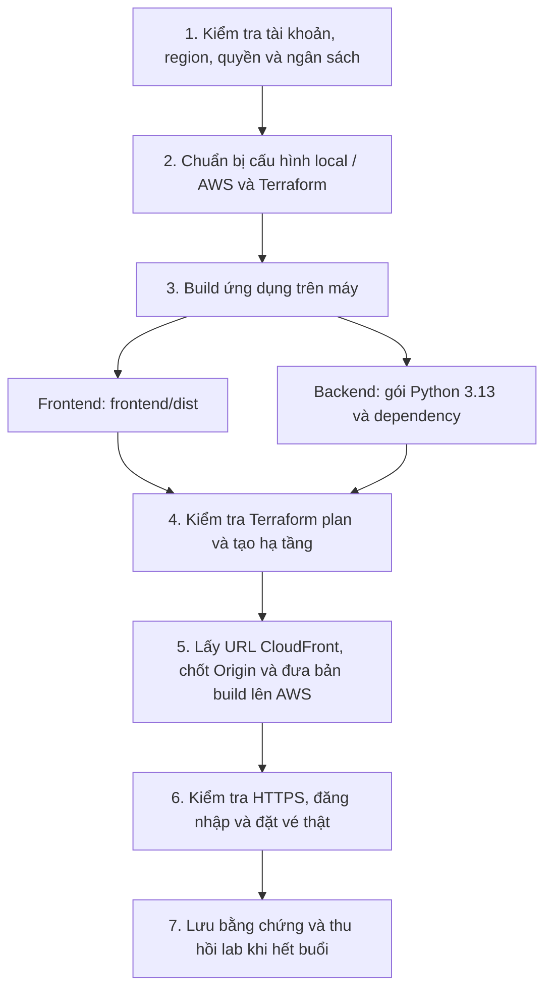
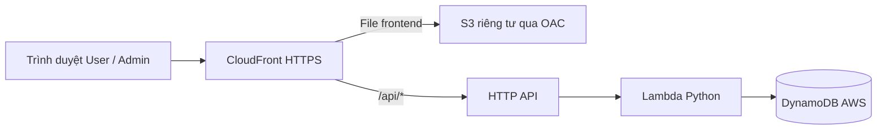
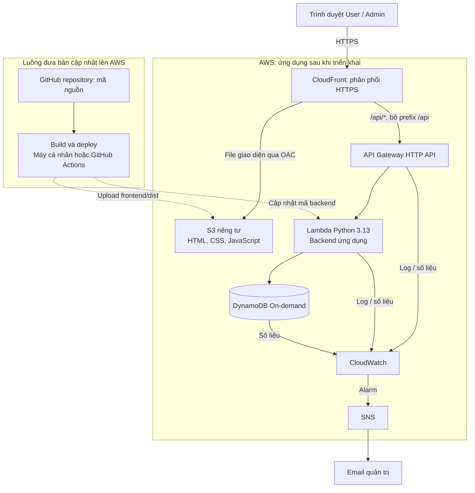

# Kế hoạch triển khai AWS tiết kiệm cho bản demo

Ngày lập: **30/10/2026 — Tuần 5 (26/10–01/11)**. Trạng thái: **kế hoạch đã chốt tại Checkpoint 30/10/2026; chưa triển khai**.

Người dùng mới tiếp cận AWS, đã có tài khoản cá nhân và chọn ngân sách **5–10 USD/tháng**. Sau Checkpoint 30/10, người dùng xác nhận **Free plan, còn 100 USD credit**; đây là thông tin được cung cấp, chưa phải kết quả AI đọc Console/API. Chưa biết ngày hết hạn credit, quota/quyền và chi phí hiện có. Kế hoạch hiện tại đã được chốt; phạm vi frontend/API/backend/DB, kiểm tra và thu hồi nêu dưới đây là cơ sở để tiếp tục, không cần xin duyệt lại các điểm đã thống nhất. Chưa sửa code/IaC hoặc tạo tài nguyên. Trước bước phụ thuộc phải xác minh account/region/quyền, công cụ và bằng chứng theo từng giai đoạn; thay đổi đáng kể giải pháp/phạm vi cần được trình bày lại theo [AI_RULE.md](../phuc-worklog/AI_RULE.md).

## Hai nhiệm vụ chính đã thống nhất

Kế hoạch đã chốt tách phần triển khai CloudWatch sang nhiệm vụ 2. Hai nhiệm vụ và luồng triển khai bên dưới chưa được thực hiện trên AWS.

**Cách làm việc đã được làm rõ sau Checkpoint:** hai người cùng bàn, cùng một phiên trên một màn hình, thay phiên thao tác; giữ state local trên máy triển khai như phương án đã chốt. Không cần bổ sung điều phối hai máy. Xem mục 8.

| Nhiệm vụ | Phạm vi | Điều kiện hoàn thành |
| --- | --- | --- |
| **1 — Triển khai ứng dụng lên AWS** | CloudFront/S3, HTTP API/Lambda/DynamoDB, quyền IAM, cấu hình bảo mật và dữ liệu test; build/deploy từ máy cho lần đầu, smoke test và quy trình thu hồi lab | Có URL HTTPS hoạt động, User/Admin dùng được chức năng hiện hành, dữ liệu/ownership/idempotency đúng; có hướng dẫn dọn tài nguyên |
| **2 — Bổ sung giám sát bằng CloudWatch** | Cấu hình log/retention có hệ thống, dashboard, metric/alarm, SNS email và kiểm chứng cảnh báo; quan sát bài test có kiểm soát nếu cần | Số liệu/log phản ánh request thật, cảnh báo được xác minh, biết chi phí và dọn được tài nguyên giám sát |

**Ranh giới log cơ bản trong kế hoạch đã chốt:** nhiệm vụ 1 giữ log kỹ thuật tối thiểu của Lambda để xử lý lỗi deploy, có retention ngắn và được Terraform quản lý để dọn cuối buổi. Chưa dựng dashboard/alarm/SNS. AWS mặc định gửi log Lambda tới CloudWatch khi execution role có quyền; vì vậy không mô tả nhiệm vụ 1 là không dùng CloudWatch hoặc không có phí log. Các phần này chưa được cấu hình. [AWS Lambda logs](https://docs.aws.amazon.com/lambda/latest/dg/monitoring-cloudwatchlogs.html).

### Nhiệm vụ 1 — minh họa luồng triển khai từ máy lên AWS

| Bước | Thực hiện ở đâu / công việc | Đầu ra và điều kiện đi tiếp |
| --- | --- | --- |
| 1 | AWS Console: Billing/Free Tier/Credits; danh tính làm việc và region; terminal kiểm tra đúng account trước thao tác AWS | Biết ưu đãi/phí hiện tại, có quyền phù hợp và chốt một region; chưa tạo app khi account/đích triển khai chưa rõ |
| 2 | Repo trên `phuc`: cấu hình AWS dùng execution role/bảng chỉ định, local giữ guard; rà các client transaction, bootstrap Admin và smoke test; viết Terraform cả deploy/destroy | Bản thay đổi được duyệt và kiểm tra local đạt; có danh sách tài nguyên/quyền, không đụng dữ liệu local |
| 3 | Máy phát triển: frontend build API mode với `/api`; Lambda build cho Linux/Python 3.13/x86_64 và đóng gói dependency đã khóa | `frontend/dist` và gói Lambda có handler/dependency đúng vị trí; build/lint và kiểm tra phù hợp đạt |
| 4 | Terminal Terraform: init/validate/plan rồi apply trong phạm vi đã duyệt; tạo DynamoDB PK/SK On-demand, execution role, Lambda, route HTTP API, bucket S3 riêng tư, CloudFront/OAC/functions | Tài nguyên có ID/ARN và state/manifest; HTTP API payload v2 giữ route cụ thể để khớp handler; chưa có dashboard/alarm/SNS |
| 5 | Sau khi có hostname CloudFront: cập nhật allowlist Origin HTTPS, Secure cookie, proxy `/api` bỏ prefix, API không cache; upload file frontend và hoàn tất cấu hình Lambda | `https://<distribution>.cloudfront.net/` phục vụ web; `/api/health` đi đúng API/bảng; reload route sâu và header/cookie hoạt động |
| 6 | CLI tương tác và browser: tạo Admin AWS an toàn, tạo sự kiện, User signup/login/đặt/xem vé, thử lại cùng key, kiểm tra quyền | Ghi nhận request/dữ liệu thật; không tắt auth/CSRF hoặc coi mock/health đơn lẻ là tích hợp đạt |
| 7 | Máy phát triển + AWS Console: tải report về máy, dừng runner/job, xem destroy plan, gỡ lab và kiểm kê tài nguyên | Không còn tài nguyên lab tính phí; kiểm tra billing sau khi cập nhật, vẫn ghi nhận phí đã sử dụng |

Để lần triển khai đầu dễ theo dõi, có thể dùng hai lượt apply có kiểm soát: lượt đầu tạo hạ tầng để lấy hostname CloudFront, lượt sau cập nhật biến Origin HTTPS và hoàn tất cấu hình. Lượt đầu chưa cho phép thao tác ghi từ website; không mở wildcard Origin để đi tắt. Khi viết IaC cần tránh vòng phụ thuộc CloudFront → API → Lambda → hostname CloudFront; có thể cấp hostname đã lấy qua biến đầu vào ở lượt cấu hình thứ hai. Đây là lựa chọn triển khai đề xuất cần thể hiện rõ trong plan thực tế, không phải lệnh đã chạy.

Frontend giữ `/api` nên có thể build trước khi biết hostname AWS. Gói Lambda cần chứa handler và thư viện tương thích runtime, không chỉ nén mã nguồn hoặc đưa venv Windows lên AWS. [AWS Python deployment package](https://docs.aws.amazon.com/lambda/latest/dg/python-package.html). Terraform plan cho xem trước thay đổi; chưa có IaC nên các nhóm lệnh ở đây chỉ minh họa, chưa chạy được như runbook hoàn chỉnh. [HashiCorp terraform plan](https://developer.hashicorp.com/terraform/cli/commands/plan).

Luồng ứng dụng sau khi hoàn tất nhiệm vụ 1:

GitHub Actions vẫn là lựa chọn tự động hóa build/deploy sau bản đầu, không phải nơi host frontend và không phải điều kiện bắt buộc để hoàn thành nhiệm vụ 1. Đồng bộ adapter lab 3.0 → 4.1/HTTPS/bảng AWS là công việc cần làm trước bài tải; smoke chức năng nhỏ không thay bằng chứng scaling. Các phần tham khảo đầy đủ dưới đây ghi rõ cả nhiệm vụ 2, không được coi mọi dịch vụ trong sơ đồ tổng thể đều triển khai ngay ở nhiệm vụ 1.

## 1. Mục tiêu của lần triển khai đầu

Đưa ứng dụng API 4.1 hiện hành lên một địa chỉ HTTPS, dùng được đăng ký/đăng nhập User, quản trị, đặt vé và xem vé. Giữ transaction chống vượt số chỗ, chống trùng và gửi lại cùng key. Nhiệm vụ 1 tập trung ứng dụng và kiểm tra chức năng; nhiệm vụ 2 bổ sung giám sát CloudWatch/SNS. Cách kiểm soát ngân sách và thu hồi lab áp dụng xuyên suốt.

Định hướng bổ sung trong phiên: tìm hiểu cách **đưa lên test vài giờ rồi thu hồi toàn bộ tài nguyên lab để tránh phí duy trì**. Vòng đời lab ở giai đoạn 5 bên dưới được ưu tiên cho lần thử ngắn đầu tiên; chưa phải lệnh tạo hoặc xóa tài nguyên AWS thực tế.

Tuần 5 tập trung tìm hiểu, kiểm tra tài khoản và chốt kế hoạch. Dự kiến tuần 6 (**02–08/11**) mới triển khai, phù hợp lộ trình trong README; đây là thứ tự đề xuất, chưa phải cam kết hoàn thành. Email, thanh toán, đổi hệ thống xác thực và mở rộng production nằm ngoài bản đầu.

## 2. Những gì đã kiểm tra trong repository

Đối chiếu trên nhánh `phuc`, HEAD `e356eb6` khi bắt đầu; Git ban đầu sạch, main/phuc cùng commit. Đã đọc [bối cảnh](../phuc-worklog/PROJECT_CONTEXT.md), [nhật ký](../phuc-worklog/WORKLOG.md), contract/security và code liên quan. Chưa chạy lại ứng dụng hoặc suite kiểm thử trong phiên lập kế hoạch.

| Hiện trạng có bằng chứng | Hệ quả cho việc lên AWS |
| --- | --- |
| [configuration.py](../backend/lambda/configuration.py) chỉ chấp nhận endpoint/prefix DB Local và tự gắn credentials giả | Cần cấu hình AWS riêng; đổi URL trong env chưa đủ. |
| [repository.py](../backend/lambda/repository.py), [buyer_repository.py](../backend/lambda/buyer_repository.py), [account_repository.py](../backend/lambda/account_repository.py) gọi `local_client` trong transaction | Cần sửa đồng bộ đường đọc và đường transaction, giữ cách chạy local an toàn. |
| [template.yaml](../backend/template.yaml) ghi rõ dành cho local; cookie chưa Secure, origin localhost, timeout 60 giây | Không dùng nguyên template này như cấu hình AWS đã sẵn sàng. |
| [vite.config.ts](../frontend/vite.config.ts) proxy `/api` và bỏ prefix | S3 chỉ chứa file, không chạy proxy Vite; cần định tuyến tương ứng trên AWS. |
| [create_admin.py](../backend/tools/create_admin.py) và script ghi test khóa ở local | Cần công cụ bootstrap/test AWS có kiểm tra tài khoản, region, bảng đích riêng; không bỏ guard toàn cục. |
| `infra/infra.md` trống; chưa thấy file Terraform hoặc thư mục `.github` | IaC và CI/CD chưa được hiện thực hóa. |
| [profile lab](../tests/load/contract-v3-draft.json) còn health 3.0/cookie cũ, ứng dụng dùng 4.1 | Đồng bộ lab là việc riêng trước test tải. Kết quả cũ không chứng minh autoscaling AWS. |
| Danh sách User và dọn dữ liệu có `Scan`; danh sách event đọc toàn bộ partition `EVENTS` | Bản nhỏ có thể giữ, cần đo lượng đọc/chi phí và giới hạn dữ liệu; chưa kết luận thiết kế chịu tải lớn. |

## 3. Kiến trúc đã chốt và cách hiểu

Sơ đồ tổng thể **sau cả hai nhiệm vụ**; CloudWatch dashboard/alarm và SNS thuộc nhiệm vụ 2. Nhiệm vụ 1 xem sơ đồ rút gọn ở đầu tài liệu, với log Lambda tối thiểu như phần ranh giới đã nêu.

Frontend được host bằng **S3 + CloudFront**: S3 lưu bản build, CloudFront lấy file từ S3 khi cần hoặc phục vụ từ cache; trình duyệt nhận HTML/CSS/JavaScript rồi chạy React để hiển thị giao diện. Các response đi ngược theo đường request. [AWS CloudFront với S3 origin](https://docs.aws.amazon.com/AmazonCloudFront/latest/DeveloperGuide/GettingStarted.SimpleDistribution.html).

**GitHub Actions là công cụ CI/CD:** lấy code, kiểm tra, build rồi triển khai artifact lên S3/Lambda khi workflow được kích hoạt. Nó nằm ở luồng đưa bản cập nhật lên AWS; lượt truy cập website không đi qua runner Actions. Workflow chạy xong thì web tiếp tục được AWS phục vụ. Dùng Actions để giảm thao tác lặp lại và chuẩn hóa bước kiểm tra/build/deploy; lab ngắn đầu tiên vẫn có thể làm các bước này trên máy cá nhân. [GitHub Actions overview](https://docs.github.com/en/actions/get-started/understand-github-actions).

GitHub Pages là một dịch vụ static hosting riêng của GitHub, khác với Actions. Phương án hiện tại chọn S3 làm nơi lưu bản frontend để CloudFront phục vụ chung origin với `/api`; chưa chọn GitHub Pages. [GitHub Pages](https://docs.github.com/en/pages/getting-started-with-github-pages/what-is-github-pages).

Terraform tạo/cấu hình/thu hồi các thành phần AWS trong sơ đồ; có thể chạy trên máy cá nhân hoặc trong workflow được duyệt về sau. Các mũi tên nét đứt chỉ thao tác cập nhật artifact, không mô tả toàn bộ việc tạo hạ tầng. Phần IAM/OIDC cấp quyền và bộ test tải được giải thích ở dưới để giữ sơ đồ dễ đọc.

| Thành phần | Vai trò và lựa chọn ban đầu |
| --- | --- |
| S3 | Kho file của bản `frontend/dist`, bucket riêng tư. |
| CloudFront + OAC | Phục vụ HTTPS, lấy file từ S3; dùng hostname `*.cloudfront.net` cho bản đầu. OAC cho S3 dùng bucket origin thông thường, không dùng S3 website endpoint. |
| HTTP API | Cổng nhận request; giữ payload v2 và các route hiện hành. |
| Lambda | Chạy handler khi có request; một function như cấu trúc hiện tại, đóng gói dependency cho Python 3.13/x86_64. |
| DynamoDB Standard On-demand | Bảng PK/SK như hiện tại, trả theo lượng đọc/ghi; tách bảng demo và test. |
| CloudWatch/SNS | Nhiệm vụ 2: quan sát lỗi, thời gian chạy, tải và gửi cảnh báo; nhiệm vụ 1 chỉ đề xuất log Lambda tối thiểu để tìm lỗi. |
| Terraform / GitHub Actions OIDC | Terraform quản lý AWS; SAM tiếp tục build/chạy local. Sau khi bản thủ công hoạt động mới tự động hóa bằng Actions với quyền tạm thời. |

### Ánh xạ từ mã nguồn hiện tại

- **Một frontend:** `frontend/` chứa cả User và Admin; build một bản React để đưa lên S3. Các route `/admin` vẫn là route của web, còn `/api/admin/...` là API backend.
- **Một Lambda backend ban đầu:** giữ `app.lambda_handler` làm điểm vào, gọi các module auth/session, sự kiện, booking và quản lý User hiện có. API Gateway tích hợp payload v2 và các route cụ thể, phù hợp `routeKey` mà handler đang dùng. Không đổi sang route `$default` đơn lẻ mà chưa có logic định tuyến tương ứng. [AWS HTTP API/Lambda integration](https://docs.aws.amazon.com/apigateway/latest/developerguide/http-api-develop-integrations-lambda.html).
- **Một bảng DynamoDB cho mỗi môi trường:** nhiều loại item PK/SK cùng chứa sự kiện, tài khoản, email unique, phiên, vé, liên kết và idempotency. Đây là dữ liệu bền vững dùng chung giữa các lượt Lambda; không đưa session hoặc trạng thái còn ghế vào bộ nhớ riêng của function. Xem [data model](data-model.md).
- **Quyền AWS:** execution role cho Lambda đọc/ghi đúng bảng và log cần thiết; quyền User/Admin của ứng dụng vẫn do backend kiểm tra bằng cookie, profile và CSRF. IAM role không thay đăng nhập của người dùng website.
- **Bộ test là một luồng riêng:** dashboard → runner → k6 dự kiến chạy trên máy kiểm thử rồi gửi HTTPS tới stack AWS test, có bảng riêng. Runner hiện chỉ nhận URL HTTP loopback, fixture/audit cũng gọi DB Local và adapter còn 3.0. Cần hỗ trợ HTTPS/allowlist, credentials/quyền test và contract 4.1 trước khi dùng; không thể chỉ thay URL rồi chạy tải AWS. Không cần đưa dashboard/runner lên hosting AWS trong bản đầu.
- **Giới hạn tải cần đo:** mọi booking của cùng sự kiện tranh cập nhật một item số chỗ; Query sự kiện dùng chung PK `EVENTS`, một số nghiệp vụ còn Scan. Lambda tăng số lượt thực thi đồng thời không loại bỏ các giới hạn này. Cần đo trước khi thiết kế lại chỉ mục hoặc phân bố khóa. [AWS DynamoDB partition key design](https://docs.aws.amazon.com/amazondynamodb/latest/developerguide/bp-partition-key-design.html).

Đề xuất **`us-east-1` cho bản học tập ban đầu**, để dùng bộ giá tham chiếu đã kiểm tra bên dưới. Đây là lựa chọn ban đầu về chi phí, chưa đo độ trễ từ Việt Nam; `ap-southeast-1` (Singapore) là lựa chọn để so sánh nếu cần phản hồi gần người dùng hơn. Phải tính lại giá và chốt một region trước khi tạo tài nguyên; không áp bảng giá Mỹ cho Singapore.

Không cần bổ sung EC2/ECS, ALB, NAT Gateway hoặc VPC cho bản này. Chưa mua tên miền, bật Provisioned Concurrency, thêm Cognito hoặc WAF riêng. Đây là quyết định giảm phạm vi và các khoản chi bổ sung, không phải đánh giá rằng những dịch vụ đó không có ích ở quy mô khác.

Áp dụng tài liệu [OAC/S3](https://docs.aws.amazon.com/AmazonCloudFront/latest/DeveloperGuide/private-content-restricting-access-to-s3.html), [Lambda concurrency](https://docs.aws.amazon.com/lambda/latest/dg/configuration-concurrency.html) và [giá DynamoDB](https://aws.amazon.com/dynamodb/pricing/); các lựa chọn trên **chưa triển khai**.

### Web và API cần chung địa chỉ

Frontend giữ `VITE_DATA_MODE=api`, `VITE_API_BASE_URL=/api`. CloudFront có behavior API trước behavior mặc định của S3:

- `/api/*` và `/api` tới HTTP API; bỏ đúng prefix `/api` bằng viewer-request function. Ví dụ `/api/auth/session` tới `/auth/session`, query string được giữ.
- API cho phép các HTTP method ứng dụng cần, dùng `CachingDisabled`; chuyển cookie, query string, `Origin`, `X-CSRF-Token`, `Idempotency-Key` tới origin. `AllViewerExceptHostHeader` là điểm khởi đầu phù hợp cho API Gateway.
- Chuyển nguyên status, JSON, `Set-Cookie`, `Location`, `Idempotent-Replayed` về trình duyệt. Kiểm tra `Location` có trỏ đúng đường dẫn công khai `/api/...` trước nghiệm thu.
- Route của React như `/login`, `/me/...` cần trả `index.html` qua function gắn ở behavior frontend; asset thật vẫn lấy đúng file. Không dùng quy tắc đổi mọi lỗi 403/404 thành HTML 200 vì sẽ che lỗi API.
- Cookie AWS bật `Secure`, giữ `HttpOnly`, `SameSite=Strict`, Origin/CSRF và quyền hiện tại. Origin hợp lệ là chính xác URL HTTPS của CloudFront; không mở wildcard để chữa lỗi đăng nhập.

S3 chỉ nhận đọc qua distribution được cấp quyền. HTTP API vẫn có endpoint công khai; OAC của S3 không tự bảo vệ API. Cần kiểm thử đường gọi trực tiếp và xác minh nguồn IP khi qua CloudFront trước khi coi giới hạn đăng nhập theo IP hoạt động đúng; không tin tùy ý header IP client tự gửi.

Nguồn áp dụng: [origin request policies](https://docs.aws.amazon.com/AmazonCloudFront/latest/DeveloperGuide/using-managed-origin-request-policies.html), [cache policies](https://docs.aws.amazon.com/AmazonCloudFront/latest/DeveloperGuide/using-managed-cache-policies.html), [CloudFront Functions](https://docs.aws.amazon.com/AmazonCloudFront/latest/DeveloperGuide/function-code-choose-purpose.html), [hành vi custom origin](https://docs.aws.amazon.com/AmazonCloudFront/latest/DeveloperGuide/RequestAndResponseBehaviorCustomOrigin.html). Đây là thiết kế cần kiểm chứng bằng HTTP/browser trên AWS.

## 4. Dự toán trong ngân sách 5–10 USD/tháng

Đây là bảng tham chiếu cho **cả hai nhiệm vụ**. Nhiệm vụ 1 chưa tạo dashboard/alarm/SNS; vẫn tính phí log cơ bản nếu giữ log Lambda. Không coi toàn bộ khoản giám sát dưới đây là đã phát sinh hoặc đã triển khai.

### Cách tính và giả định

Đơn giá tham chiếu `us-east-1`, USD, tra cứu **30/10/2026**. Tính phần API/Lambda/DB **chưa trừ Free Tier hoặc credit**. Chưa gồm thuế, dịch vụ khác đã có trong tài khoản hoặc các tính năng bổ sung. Đây là phép tính kế hoạch, chưa phải báo giá Calculator đã lưu hoặc hóa đơn thực tế.

### Cách tính phí của bảy dịch vụ

| Dịch vụ / nguồn chính thức đã tham khảo | Đơn giá/cách tính tham chiếu cho bản đầu |
| --- | --- |
| [S3 Standard](https://aws.amazon.com/s3/pricing/) | Lưu trữ khoảng **0,023 USD/GB-tháng**, GET khoảng **0,0004 USD/1.000 request**, PUT khoảng **0,005 USD/1.000 request**. File, phiên bản cũ và artifact/state còn giữ đều cần tính vào dung lượng. |
| [CloudFront pay-as-you-go](https://aws.amazon.com/cloudfront/pricing/pay-as-you-go/) | Tính theo dữ liệu truyền ra, HTTP(S) request và tính năng edge. Allowance công khai mỗi tháng: **1 TB truyền ra, 10 triệu HTTP(S) request, 2 triệu Function invocation**. Nếu còn allowance và không bật tính năng tính phí khác, dòng này có thể bằng 0; vượt allowance phụ thuộc vị trí phục vụ người xem. |
| [API Gateway HTTP API](https://aws.amazon.com/api-gateway/pricing/) | **1 USD/triệu lượt** ở bậc đầu, cộng phí truyền dữ liệu nếu có theo đường đi thực tế. |
| [Lambda on-demand x86](https://aws.amazon.com/lambda/pricing/) | **0,20 USD/triệu lượt + 0,0000166667 USD/GB-giây**. 512 MB chạy trung bình 0,3 giây tương ứng 0,15 GB-giây/lượt. Không dùng provisioned concurrency trong phép tính này. |
| [DynamoDB Standard On-demand](https://aws.amazon.com/dynamodb/pricing/) | **0,625 USD/triệu WRU**, **0,125 USD/triệu RRU**; lưu trữ tham chiếu **0,25 USD/GB-tháng**. Đây là đơn vị tính phí đã xét kích thước/cách đọc ghi, không phải số request HTTP. |
| [CloudWatch](https://aws.amazon.com/cloudwatch/pricing/) | Ví dụ bậc đầu tại N. Virginia: Standard log ingestion **0,50 USD/GB**, lưu log **0,03 USD/GB-tháng** theo dung lượng tính phí; alarm độ phân giải tiêu chuẩn **0,10 USD/metric-tháng**. Custom metric, truy vấn, dashboard hoặc tính năng khác có phí riêng nếu dùng. |
| [SNS Standard — AWS FAQ](https://aws.amazon.com/tr/sns/faqs/) | Tham chiếu **0,50 USD/triệu request**, gửi email **2 USD/100.000 notification**. FAQ công bố allowance 1 triệu request và 1.000 email/tháng; cần kiểm tra lượng dùng chung account. Không dùng đơn giá này cho SMS. |

S3 0,023 USD/GB-tháng cũng được đối chiếu với ví dụ trong [AWS Calculator assumptions](https://aws.amazon.com/calculator/calculator-assumptions/); ví dụ Synthetics của trang CloudWatch xác nhận đơn giá S3 PUT và lưu trữ liên quan, không có nghĩa dự án sẽ bật Synthetics. Không dùng bảng giá S3 Tables/Vectors để suy cách tính của bucket frontend.

Ví dụ riêng phần giám sát: 3 alarm, mỗi alarm theo dõi 1 metric tiêu chuẩn, là **0,30 USD/tháng** trước ưu đãi; 0,1 GB Standard log mới là **0,05 USD ingestion**, chưa cộng lưu trữ/truy vấn. Tạo thêm alarm/custom metric có thể làm phần giám sát lớn hơn tiền chạy API của bản nhỏ.

Khi không có người truy cập, phí request/compute on-demand có thể rất thấp hoặc bằng 0, nhưng dung lượng S3/DynamoDB/log và alarm còn giữ vẫn có thể phát sinh phí. Credit, Free Tier, allowance và thuế phải đối chiếu riêng; chưa kiểm tra tài khoản thực tế.

### Hai kịch bản minh họa

| Hạng mục mỗi tháng | Demo nhỏ | Kịch bản tăng tải để so sánh |
| --- | --- | --- |
| HTTP API / số lần Lambda chạy | 100.000 / 100.000 | 1.000.000 / 1.000.000 |
| Lambda giả định 512 MB, trung bình 0,3 giây | 0,27 USD | 2,70 USD |
| HTTP API | 0,10 USD | 1,00 USD |
| DB giả định đã tính cả transaction/retry/scan | 1 triệu RRU + 0,2 triệu WRU: 0,25 USD | 10 triệu RRU + 2 triệu WRU: 2,50 USD |
| Cộng phần tính theo giả định trên | **0,62 USD** | **6,20 USD** |
| Khoản dự trù cho S3, DB storage, CloudFront, log, alarm, SNS, state | **1–2 USD**, cần thay bằng dự toán chi tiết | **1–3 USD**, cần thay bằng dự toán chi tiết |
| Tổng kế hoạch | **Khoảng 1,62–2,62 USD** | **Khoảng 7,20–9,20 USD** |

Khoản dự trù là số tiền chủ động để dành, **không phải đơn giá AWS đã xác minh cho từng dịch vụ**. Nó giả định dữ liệu DB dưới 1 GB, web nhỏ, tổng lưu lượng phân phối khoảng 1–5 GB/tháng, log dưới khoảng 0,5 GB/tháng, vài alarm, ít deploy và không có tính năng trả phí bổ sung. Trước apply cần điền từng khoản vào Calculator/Console theo account và region thực tế, gồm cả phí truyền dữ liệu nếu có; nếu tổng vượt 10 USD thì giảm phạm vi trước.

RRU/WRU trong bảng là ngân sách tiêu thụ giả định để minh họa, chưa đo từ workload. Một trang có nhiều request. Một booking hiện gồm 4 thao tác ghi và 1 ConditionCheck; transaction, kích thước item, session, retry, xung đột và Scan đều làm thay đổi lượng tính tiền. Không suy một booking bằng một WRU. [AWS DynamoDB transactions](https://docs.aws.amazon.com/amazondynamodb/latest/developerguide/transaction-apis.html).

Nếu thời gian Lambda trung bình tăng từ **0,3 lên 1 giây** ở 1 triệu lượt/512 MB, riêng Lambda thành khoảng **8,53 USD**, và tổng có thể vượt ngân sách. Vì vậy mục tiêu ban đầu là demo nhỏ, quan sát số thực rồi quyết định tải; 100 người đồng thời không đồng nghĩa 100 request/tháng.

### Free Tier và CloudFront cần kiểm tra riêng

Free Tier/allowance, credit và loại tài khoản là các điều kiện khác nhau; không suy tài khoản đang có vẫn đủ ưu đãi hoặc toàn bộ kiến trúc miễn phí. Free account plan giới hạn một số dịch vụ/tính năng và kết thúc khi hết thời hạn hoặc credit; Paid account plan có thể vẫn hưởng ưu đãi/credit nhưng tính phí phần vượt hoặc không đủ điều kiện. Kiểm tra trực tiếp gói, số dư/hạn credit, khả năng tạo IAM role và dịch vụ cần dùng trước triển khai. [AWS Choosing a plan](https://docs.aws.amazon.com/awsaccountbilling/latest/aboutv2/free-tier-plans.html).

FAQ hiện hành nhắc trải nghiệm đăng ký mới **10/2026** và vị trí xem credit khác nhau giữa các đợt account. Không gán một thời hạn credit/giao diện duy nhất cho mọi tài khoản; lấy ngày hết hạn/số dư thật từ Console Billing, Cost and Usage hoặc Settings của account. [AWS Free Tier FAQ](https://aws.amazon.com/free/free-tier-faqs/).

Ví dụ kiểm tra riêng Lambda: 100.000 lượt ở 512 MB và 0,3 giây/lượt là **15.000 GB-giây**, thấp hơn mức công bố **1 triệu lượt + 400.000 GB-giây/tháng** nếu allowance còn đủ và áp dụng cho account. Đây là giả định so sánh chi phí, không phải số đo hoặc bảo đảm concurrency. [AWS Lambda pricing](https://aws.amazon.com/lambda/pricing/).

DynamoDB của kế hoạch dùng **On-demand**: vẫn tính phí request units đọc/ghi, có thể được credit chi trả nếu đủ điều kiện. Không áp ưu đãi 25 RCU/25 WCU của provisioned capacity vào request units On-demand để coi mọi thao tác DB miễn phí. Quota dịch vụ và khả năng chịu tải vẫn cần kiểm tra riêng, không suy từ nhãn Free Tier. [AWS DynamoDB pricing](https://aws.amazon.com/dynamodb/pricing/).

CloudFront hiện có cả flat-rate (có gói Free 0 USD) và pay-as-you-go. Kế hoạch kỹ thuật này **tạm dùng pay-as-you-go** để cấu hình behavior/cache theo yêu cầu. Trang giá pay-as-you-go liệt kê allowance hàng tháng 1 TB truyền ra, 10 triệu HTTP(S) request và 2 triệu Function invocation; phải kiểm tra lượng đã dùng chung trong account. Không mặc định mọi gói có cùng tính năng hoặc toàn bộ hệ thống miễn phí vì CloudFront miễn phí. [CloudFront plans](https://aws.amazon.com/cloudfront/pricing/), [CloudFront pay-as-you-go](https://aws.amazon.com/cloudfront/pricing/pay-as-you-go/).

## 5. Kiểm soát chi phí trước khi mở demo

- Đặt budget tháng **10 USD**, cảnh báo thực chi ở **3, 5, 8 USD** và dự báo vượt 10 USD. Theo dõi thêm chi phí sử dụng chưa trừ credit để thấy tốc độ tiêu thụ; kiểm tra scope toàn account và khoản chi cũ. Đây là cấu hình đề xuất, chưa tạo cảnh báo.
- Budget cập nhật có độ trễ; **không tự ngắt mọi dịch vụ ở 10 USD**. API throttle là best effort và concurrency chỉ hạn chế chạy đồng thời, cũng không phải trần tiền tháng. [AWS Budgets](https://docs.aws.amazon.com/cost-management/latest/userguide/budgets-managing-costs.html), [HTTP API throttling](https://docs.aws.amazon.com/apigateway/latest/developerguide/http-api-throttling.html).
- Bản đầu đề xuất throttle khoảng **5 request/giây, burst 10**; reserved concurrency khoảng **5–10 nếu quota account cho phép**, không bật provisioned concurrency. Phải kiểm tra quota thật; tài khoản quota nhỏ có thể không cấp được reservation. Đây là giá trị khởi đầu cần đo, không phải năng lực tối đa của kiến trúc.
- Log retention đề xuất **7 ngày**; log requestId/status/duration cần thiết, không log body đăng nhập, cookie hoặc token. Nhiệm vụ 1 đề xuất log Lambda tối thiểu; chọn metric/alarm và dashboard ở nhiệm vụ 2, không bật tính năng chi tiết hàng loạt khi chưa tính giá. [CloudWatch pricing](https://aws.amazon.com/cloudwatch/pricing/).
- DynamoDB bật TTL trên `expiresAt` sau khi kiểm tra các loại item: dùng để dọn session/counter đã hết hạn. Backend vẫn kiểm thời hạn vì TTL xóa chậm; không tự đặt TTL cho vé/idempotency khi chưa chốt thời gian giữ. [AWS DynamoDB TTL](https://docs.aws.amazon.com/amazondynamodb/latest/developerguide/TTL.html).
- Có checklist dừng khi bất thường: ngừng runner/retry, hạn chế hoặc khóa nhận request API, kiểm tra dịch vụ gây phí. Đặt Lambda reserved concurrency về 0 có thể chặn function nhưng không xóa mọi khoản phí API/CloudFront/storage. Chỉ thao tác khi đúng phạm vi được duyệt.
- Không để test tải chạy nền. Chốt trước thời lượng, tổng request và ngưỡng dừng; kiểm tra Bills/Cost Explorer sau lượt chạy và khi dữ liệu billing đã cập nhật.

## 6. Các giai đoạn triển khai và kết quả cần có

### Giai đoạn 0 — hiểu tài khoản và chi phí

**Mục tiêu:** biết tài khoản đang dùng gói gì, quyền gì và đang có khoản phí nào. **Thực hiện ở:** AWS Console, trước khi tạo ứng dụng.

1. Billing and Cost Management: xem Bills tháng hiện tại, Free Tier, Credits/hạn dùng và gói account. Không tự nâng Free sang Paid khi chưa hiểu hệ quả.
2. Xác minh MFA cho root; dùng danh tính làm việc riêng với quyền phù hợp, ưu tiên credentials tạm thời. Không tạo root access key hoặc gửi credentials vào chat. [AWS IAM best practices](https://docs.aws.amazon.com/IAM/latest/UserGuide/best-practices.html).
3. Chốt region, dự toán chi tiết, budget/cảnh báo và danh sách tài nguyên dự kiến. Kiểm tra cả tài nguyên cũ ở region khác; không tự xóa chúng.

**Đạt khi:** biết gói/credit/chi phí hiện có, cách đăng nhập làm việc và dự toán nằm trong mức 10 USD. Có bằng chứng xác nhận cấu hình cảnh báo trước khi mở demo; không ghi dữ liệu nhạy cảm vào nhật ký.

### Giai đoạn 1 — chuẩn bị ứng dụng chạy được cả local và AWS

**Mục tiêu:** kết nối AWS có chủ đích mà không làm local tự truy cập cloud. **Thực hiện ở:** repository trên `phuc`, sau khi duyệt phạm vi code.

| Phần dự kiến thay đổi | Nội dung | Cách kiểm tra |
| --- | --- | --- |
| Backend configuration/repository | Chọn rõ local/aws; local giữ guard/credentials giả; AWS dùng region, bảng chỉ định và execution role, không truyền endpoint local hoặc key vào code | Unit kiểm tra thiếu/sai cấu hình phải dừng; tất cả transaction dùng đúng client; local không fallback AWS |
| Env/runtime/HTTP | Origin HTTPS, Secure cookie; xử lý đường dẫn công khai và nguồn IP proxy đúng tin cậy | Login/logout, CSRF, role, owner, retry/replay qua URL công khai |
| DB | Giữ PK/SK và transaction; tạo bảng AWS mới, TTL có kiểm soát; không migrate DB local tự động | Fixture test riêng, số chỗ/vé nhất quán; session hết hạn bị từ chối dù item chưa bị TTL xóa |
| Frontend | Build API mode với `/api`; có routing CloudFront thay proxy Vite | Reload route sâu, assets, hai browser với hai tài khoản, không cache lẫn phiên |
| Công cụ | Bootstrap Admin AWS và smoke test có xác minh account/region/table; test viết dùng namespace AWS test riêng | Không ghi đè Admin; từ chối ghi nhầm bảng demo; không sửa mọi guard local để chạy qua |

Dùng dữ liệu demo mới trên AWS; giữ dữ liệu/volume local. Chưa đổi data model để thêm GSI ngay; nếu số liệu cho thấy Scan/hot item là nút thắt thì lập thay đổi riêng, không gắn nhãn serverless là tự giải quyết mọi tranh chỗ.

**Đạt khi:** unit và local integration phù hợp đạt, frontend build/lint đạt; phân biệt rõ phần skip/chưa chạy. Đây là bằng chứng local, chưa phải đã tích hợp AWS.

### Giai đoạn 2 — khai báo và xem trước hạ tầng

**Mục tiêu:** tạo/xem lại hạ tầng bằng Terraform thay vì sửa rải rác trong Console. **Thực hiện ở:** `infra/` và terminal có danh tính AWS đã xác minh.

- Nhiệm vụ 1 khai báo S3/OAC/CloudFront/functions, HTTP API/routes, Lambda, execution role, bảng DynamoDB và log group Lambda tối thiểu để tìm lỗi. Chưa tạo dashboard/alarm/SNS; các phần đó sang nhiệm vụ 2. Role runtime chỉ có quyền DB/log cần dùng; quyền deploy tách riêng.
- Build Lambda với dependency trước khi đóng gói; build frontend ra file tĩnh. Terraform là bên sở hữu tài nguyên AWS; không dùng cả `sam deploy` và Terraform quản lý cùng tài nguyên.
- Với lab vài giờ do **một người thao tác trên một máy**, dùng Terraform state local, gitignored và sao lưu an toàn trên máy; giữ cả state/config đến khi xác minh dọn xong. Không cần tạo bucket state AWS cho lần thử này. Đây là lựa chọn trong kế hoạch đã chốt, chưa cấu hình. [HashiCorp local backend](https://developer.hashicorp.com/terraform/language/backend/local).
- Khi làm nhóm hoặc CI/CD lâu dài mới chuyển sang bucket state riêng tư, mã hóa, versioning, `use_lockfile=true` với phiên bản Terraform hỗ trợ. Nếu đã dùng backend S3 và muốn thu hồi toàn bộ lab, phải có bước riêng chuyển/giữ state an toàn rồi dọn bucket state cuối cùng; không coi nó tự biến mất khi destroy app. [HashiCorp S3 backend](https://developer.hashicorp.com/terraform/language/backend/s3).
- Gắn tên/tag project/environment/owner và mã lượt lab; lưu danh sách ID/ARN/region trước test. Tách `aws-dev` và `aws-test` bằng tên/state phù hợp. Bảng có dữ liệu cần giữ dùng bảo vệ xóa; bảng lab được thiết kế chỉ chứa fixture dùng lại được, cho phép destroy sau khi đã duyệt đúng phạm vi. Không tắt bảo vệ trên bảng ứng dụng/local hoặc bảng có dữ liệu thật. Xem plan để phát hiện phí và thay thế tài nguyên.
- Nhóm lệnh dự kiến khi đã có file: `terraform fmt -check`, `terraform init`, `terraform validate`, `terraform plan`. Chưa có file IaC nên **chưa chạy các lệnh này trong phiên**.

**Đạt khi:** plan cụ thể được xem lại, biết tài nguyên/quyền/chi phí và cách quay lui. Chỉ apply sau khi có phạm vi triển khai được duyệt; kế hoạch này chưa phải bằng chứng hạ tầng đã tạo.

### Giai đoạn 3 — đưa bản demo lên AWS và kiểm tra chức năng

**Mục tiêu:** một bản hoạt động đầu-cuối. **Thực hiện ở:** AWS và trình duyệt, sau giai đoạn 2.

1. Apply hạ tầng; Lambda lấy role và bảng đúng môi trường. Cấu hình Origin sau khi có hostname CloudFront, upload bản web và chờ distribution triển khai xong.
2. Kiểm tra `/api/health`: đúng contract 4.1, đúng bảng và DB thực sự đọc được. Nếu lỗi, xử lý trước khi tạo dữ liệu qua UI.
3. Tạo Admin qua CLI có nhập mật khẩu ẩn; tạo một sự kiện demo. Không sao chép account/session/password trong DB local lên AWS.
4. User signup/login → xem sự kiện → đặt vé → xem Vé của tôi → logout; Admin sửa/mở/đóng sự kiện và quản lý User. Kiểm tra mã HTTP và dữ liệu thật.
5. Kiểm tra owner, sai role, Origin/CSRF, Secure cookie, session hai người, retry cùng key không trừ chỗ lần nữa, reload route sâu, API lỗi vẫn trả JSON/status đúng. Bài phá hủy/tranh chỗ chạy ở stack/bảng test riêng.

**Đạt khi:** URL HTTPS hoạt động, dữ liệu tồn tại sau reload và request/metric/log đối chiếu được; S3 không public. Không suy một health 200 thành mọi chức năng đều đạt.

### Giai đoạn 4 — nhiệm vụ 2: giám sát, rồi mở rộng kiểm thử/tự động hóa khi cần

**Mục tiêu chính của nhiệm vụ 2:** thiết lập CloudWatch/SNS sau khi nhiệm vụ 1 đạt smoke test. Các mục CI/CD và mở rộng tải bên dưới là hướng tiếp tục tùy phạm vi được duyệt, không phải điều kiện bắt buộc để ứng dụng ở nhiệm vụ 1 chạy được.

1. Quản lý log group/retention và log có requestId, status, duration; giữ thông tin nhạy cảm ngoài log.
2. Chọn metric Lambda/API/DynamoDB phục vụ câu hỏi cần đo, dựng dashboard và alarm với ngưỡng rõ ràng.
3. Tạo SNS/email subscription theo phạm vi đã duyệt; xác nhận người nhận và thử một cảnh báo có bằng chứng.
4. Đối chiếu request thật với log/metric/alarm; ghi phần đạt/chưa đạt, tính phí giám sát và đưa toàn bộ tài nguyên mới vào quy trình teardown.

Với lần test ngắn đầu tiên có thể deploy thủ công bằng Terraform và hoãn phần Actions/OIDC. Các yêu cầu đồng bộ lab, giữ auth và giới hạn tải bên dưới vẫn áp dụng.

- Actions dùng OIDC, trust policy giới hạn đúng repo/branch hoặc environment; tách bước kiểm tra/plan và apply. Không mặc định cứ push `phuc` là tự deploy, không lưu AWS access key dài hạn trong GitHub. [GitHub OIDC in AWS](https://docs.github.com/en/actions/how-tos/secure-your-work/security-harden-deployments/oidc-in-aws).
- Đồng bộ lab 3.0 → 4.1, cookie và fixture tài khoản theo contract. Giữ guard; hỗ trợ bảng test AWS và host public đúng môi trường. Không chạy script local ghi dữ liệu thẳng vào DB demo.
- Chạy 1–2 User trước. Chỉ sau khi đạt mới chốt các bài 100/200, 100/10, 100/1; ghi rõ số User, số chỗ, request, thời lượng và hành vi mong đợi.
- Ví dụ giới hạn cho lượt đầu sau smoke: tối đa **5 phút hoặc 5.000 request đo**, dừng khi đạt một trong hai; dừng sớm nếu 5xx/throttle/lỗi DB bất thường. Trần 5.000 khớp giới hạn hiện tại trong `tests/load/config.py`; request chuẩn bị/kiểm tra bổ trợ và DB audit cần theo dõi riêng vì không nằm trong số request đo này. Đây là mức đề xuất cần chốt trước chạy, không phải kết quả đã đạt.
- Đo Lambda duration/concurrency/errors/throttles, API latency/5xx, DynamoDB consumed capacity/throttling và tính đúng số vé/chỗ. Chuẩn bị phiên trước khoảng đo; không bỏ rate limit, auth hoặc CSRF.
- Phân biệt tải bị throttle cố ý với lỗi ứng dụng; muốn nâng giới hạn phải tính lại chi phí. Số request đồng thời không phải số container giữ ấm.

**Đạt khi:** báo cáo có request/metric thật, kết quả đúng dữ liệu và chi phí cập nhật sau chạy; không kết luận scaling chỉ từ đồ thị minh họa hoặc local.

### Giai đoạn 5 — quay lui, giữ dữ liệu và kết thúc demo

**Mục tiêu của lab ngắn:** tạo → kiểm tra chức năng/tải có giới hạn → tải bằng chứng về máy → thu hồi tài nguyên lab → kiểm tra lại. Đóng Console, tắt Vite hoặc dừng runner không tự xóa tài nguyên AWS.

**Chuẩn bị trước apply:**

- Tất cả tài nguyên lab được tạo có chủ đích và quản lý bằng Terraform. Nhiệm vụ 1 gồm log Lambda tối thiểu/bucket artifact nếu có; nhiệm vụ 2 thêm log API, dashboard/alarm/SNS khi được chọn. Không để tài nguyên phát sinh ngoài danh sách quản lý rồi quên dọn.
- Dùng **CloudFront pay-as-you-go**, không đăng ký flat-rate cho lab cần xóa ngay cuối buổi. AWS yêu cầu disable distribution và chờ cập nhật trước khi delete; distribution thuộc flat-rate phải hủy gói rồi chờ hết chu kỳ thanh toán mới xóa được. [AWS delete distribution](https://docs.aws.amazon.com/AmazonCloudFront/latest/DeveloperGuide/HowToDeleteDistribution.html).
- Chỉ đưa dữ liệu test có thể tạo lại lên bảng AWS. Không migrate tài khoản/phiên hoặc DB local. Giữ artifact/fixture và report cần thiết trên máy để lần sau tái tạo, không giữ tài nguyên cloud chỉ để lưu bằng chứng.
- Bản lab không mua tên miền, đăng ký gói trả phí theo tháng/cam kết dài hạn, bật PITR/on-demand backup/AWS Backup hay tạo replica. PITR có phí riêng; nếu đã bật backup thì phải kiểm tra loại backup, việc giữ lại và phí thực tế khi thu hồi, không tự coi xóa bảng là đã xóa mọi backup. [AWS DynamoDB PITR](https://docs.aws.amazon.com/amazondynamodb/latest/developerguide/Point-in-time-recovery.html).
- Nếu lab bật S3 versioning, chuẩn bị dọn cả object version/delete marker và multipart upload dở. Không dùng cách xóa object hiện tại rồi coi bucket đã rỗng; không áp cấu hình cho phép xóa hết vào bucket có dữ liệu ngoài lab. [AWS empty bucket](https://docs.aws.amazon.com/AmazonS3/latest/userguide/empty-bucket.html).

**Cuối buổi — thứ tự thực hiện:**

1. Ngừng k6/runner và job deploy đang chạy; không để pipeline tạo lại tài nguyên trong lúc dọn. Chờ các request đang xử lý được đối chiếu phù hợp rồi tải report/metric/log cần giữ về máy, không xuất secret.
2. Xác minh account, region, state và mã lab; chạy `terraform plan -destroy` để xem đúng danh sách sẽ gỡ. Xác nhận dữ liệu test trên AWS thuộc phạm vi được phép xóa; giữ nguyên bảng/volume local và tài nguyên cũ ngoài lab.
3. Thực hiện `terraform destroy` trong đúng thư mục cấu hình sau khi có phạm vi thu hồi được duyệt. Lệnh xóa các tài nguyên Terraform quản lý, không phải mọi tài nguyên trong account. Chưa có IaC nên đây là lệnh dự kiến, **không phải runbook chạy được ngay trong repository hiện tại**. [HashiCorp terraform destroy](https://developer.hashicorp.com/terraform/cli/commands/destroy).
4. Chờ hoàn tất, kể cả bước disable/delete CloudFront. Nếu lỗi giữa chừng, giữ state để xử lý và chạy tiếp; không xóa state hoặc `state rm` để che lỗi, không coi đã dọn xong chỉ vì website không truy cập được.
5. Đối chiếu Console/API theo manifest tài nguyên và region, gồm CloudFront/IAM ở phạm vi global. State rỗng là một bằng chứng nhưng cần kiểm tra tài nguyên ngoài state nếu từng tạo thủ công.
6. Xem Bills/Cost Explorer ngày hôm sau, tiếp tục kiểm tra khi dữ liệu đã cập nhật. Chi phí có thể xuất hiện muộn hơn 24 giờ; hóa đơn tăng sau khi xóa có thể là phí của lượt test trước đó. Không hứa tổng hóa đơn về 0 hoặc xóa khoản phí đã phát sinh. [AWS Cost Explorer data](https://docs.aws.amazon.com/cost-management/latest/userguide/ce-exploring-data.html).

| Nhóm cần kiểm tra sau destroy | Điều kiện kết thúc |
| --- | --- |
| CloudFront, edge function/OAC riêng của lab | Distribution đã xóa, không chỉ Disabled; tài nguyên phụ riêng của lab cũng được dọn |
| S3 frontend/artifact và bucket state nếu từng tạo | Không còn bucket/dữ liệu lab, gồm versions/delete markers/multipart upload; state cần thiết đã lưu an toàn trước khi dọn backend |
| HTTP API, Lambda/version/alias riêng của lab | Không còn API/function hoặc job liên quan chạy lại |
| DynamoDB demo/test | Không còn bảng lab; đã kiểm tra backup/export/replica nếu từng phát sinh |
| CloudWatch | Xóa log group và alarm/dashboard riêng của lab. Không cần chờ retention hết hạn; xóa log group xóa các log bên trong. [AWS DeleteLogGroup](https://docs.aws.amazon.com/AmazonCloudWatchLogs/latest/APIReference/API_DeleteLogGroup.html) |
| SNS, IAM/OIDC chỉ tạo cho lab | Xóa topic/subscription và role/policy/provider riêng không dùng chung; không xóa quyền đăng nhập làm việc hoặc tài nguyên của việc khác |
| Billing | Ghi nhận chi phí sử dụng trước lúc xóa, kiểm tra phí phát sinh sau đó theo service/region khi dữ liệu đầy đủ; không chỉ nhìn số tiền tức thời |

**Đạt khi:** có đầu ra destroy và kiểm kê xác nhận không còn tài nguyên lab có thể tiếp tục tính phí; việc đối chiếu billing vẫn theo dõi đến khi dữ liệu cập nhật. Bản thân phí request/test đã dùng không được hoàn tác khi xóa. Giữ code, Terraform state cuối và bằng chứng trên máy, chưa cần triển khai lại cho tới buổi test sau.

Với môi trường lâu dài có dữ liệu thật, vẫn giữ artifact frontend/Lambda đã đạt để rollback và backup/restore được xác minh trước thay đổi dữ liệu; không áp chính sách thu hồi toàn bộ lab vào môi trường đó.

## 7. Điểm tiếp tục của phiên

**Việc tiếp theo nên làm:** giai đoạn 0, tiếp tục từ thông tin đã được cung cấp **Free plan, 100 USD credit**; kiểm tra ngày hết hạn, chi phí sẵn có, region/quota và quyền tạo các tài nguyên trong kế hoạch. Chỉ cần thông tin tổng hợp, không gửi account ID, email, password hoặc access key vào chat. Không hỏi lại loại gói/số dư đã được xác nhận nếu chưa có dấu hiệu thay đổi.

Kế hoạch hiện tại đã được chốt tại Checkpoint **30/10/2026**: triển khai ứng dụng trước, giám sát CloudWatch/SNS sau; giữ log Lambda cơ bản ở nhiệm vụ 1, deploy từ máy trước, CloudFront pay-as-you-go, state local cho lab một người/một máy, chỉ dùng dữ liệu AWS có thể tạo lại và thu hồi lab sau vài giờ. GitHub Actions/OIDC là hướng tự động hóa sau bản đầu. Không cần xin duyệt lại phạm vi đã chốt.

Các thông số ban đầu trong plan như region `us-east-1`, throttle/concurrency, TTL/retention và ngưỡng tải vẫn phải đối chiếu account/quota/cách dùng thực tế trước thao tác tương ứng; credit và dự toán chưa phải thông tin billing đã xác minh. Chưa sửa ứng dụng, chưa viết Terraform/workflow, chưa deploy/destroy hoặc chạy kiểm thử AWS. Điểm bắt đầu thực hiện vẫn là kiểm tra tài khoản/quyền/region/ngân sách, rồi chuẩn bị cấu hình và IaC theo nhiệm vụ 1.

Bàn giao đang theo dõi: [2026-10-30-0956.md](../phuc-worklog/handoffs/2026-10-30-0956.md). Khi nhận **Checkpoint**, tổng hợp công việc thực hiện và nguồn thực sự đã dùng vào mục ngày/tuần tương ứng trong WORKLOG, cập nhật PROJECT_CONTEXT nếu bối cảnh thay đổi. Kế hoạch này không thay nhật ký và không phải xác nhận đã deploy.

## 8. Cách làm việc thực tế: hai người cùng một phiên trên một màn hình

Người dùng làm rõ hai người ngồi cùng bàn, trao đổi và cùng thao tác trong một phiên trên một màn hình; không có hai luồng deploy/destroy độc lập từ hai máy. Giữ phương án ban đầu đã chốt cho một đầu mối triển khai.

- Một workspace/phiên triển khai, một bộ cấu hình và Terraform state local trên máy thực sự chạy Terraform. Giữ/sao lưu state an toàn đến khi thu hồi xong; không commit state hoặc credential vào Git.
- Cả hai cùng sửa/kiểm tra code rồi thực hiện tuần tự: build → Terraform plan/apply → test → lưu kết quả → destroy/kiểm kê. Ai thao tác bàn phím không làm thay đổi môi trường/state đang quản lý.
- Không cần thêm S3 remote state, điều phối concurrency, OIDC hoặc GitHub Actions chỉ để xử lý việc có hai người cùng ngồi làm. GitHub Actions vẫn là lựa chọn tự động hóa về sau, không phải điều kiện của nhiệm vụ 1.
- Xóa phần đề xuất điều phối hai máy vì không đúng cách làm thực tế vừa được làm rõ; chưa có bucket backend/workflow/quyền nào được tạo theo đề xuất đó.
- Giữ hai nhiệm vụ: triển khai ứng dụng trước, CloudWatch/giám sát đầy đủ sau; tài khoản Free plan/100 USD credit theo xác nhận đã có, chưa biết hạn credit/quota.
