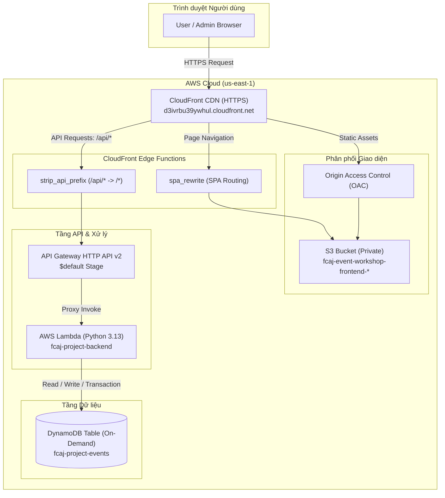

# Báo Cáo Tổng Kết Quá Trình Triển Khai Hệ Thống Serverless Lên AWS
**Ngày thực hiện:** 04/11/2026  
**Dự án:** Serverless Event Registration (FCAJ Workshop)  
**Tài khoản AWS:** `059898286806` (IAM User: `terraform-deployer` | Region: `us-east-1`)  
**Nhánh thực hiện:** `quan` -> Đã merge hoàn tất vào `main`

---

## 1. Mục Tiêu Buổi Làm Việc
1. **Lên đám mây thực tế:** Đưa ứng dụng Fullstack Serverless (Backend Python Lambda, Database DynamoDB, Frontend React/Vite, API Gateway HTTP API, CDN CloudFront & S3) lên môi trường AWS an toàn với chi phí tối thiểu ($0.00 theo Free Tier).
2. **Tuân thủ kỷ luật kỹ thuật:** Không để lộ thông tin xác thực (`.gitignore`), bảo toàn cơ chế kiểm thử local, giải quyết đúng quy định bảo mật của phòng lab trường.
3. **Thu hồi sạch sẽ (Teardown):** Kiểm tra chi phí và dọn dẹp sạch 100% tài nguyên sau bài lab để tránh phát sinh chi phí duy trì ngầm.

---

## 2. Kiến Trúc Hạ Tầng Triển Khai (Architecture)

---

## 3. Các Giai Đoạn Thực Hiện Chi Tiết

### Giai đoạn 1: Chuẩn bị Thông tin Xác thực & Môi trường
- **Thiết lập danh tính AWS:** Cấu hình AWS CLI với thông tin người dùng `terraform-deployer` (thuộc tài khoản `059898286806`, Region `us-east-1`).
- **Bảo mật mã nguồn:** 
  - Khởi tạo file hướng dẫn bàn giao nội bộ [`Bangiao.md`](../Bangiao.md) chứa ID tài khoản và cấu hình không nhạy cảm.
  - Cập nhật ngay [`.gitignore`](../.gitignore) để bỏ qua `Bangiao.md`, `*.csv`, `*.tfstate`, `*.tfvars`, `build/`, `dist/` nhằm ngăn chặn tuyệt đối việc đẩy credential lên GitHub.

---

### Giai đoạn 2: Cập Nhật Ứng Dụng Tương Thích AWS

1. **Bộ điều hợp cơ sở dữ liệu (`configuration.py`):**
   - Mặc định ban đầu của dự án chỉ cho phép kết nối DynamoDB Local (`127.0.0.1:8000`) với credential giả định.
   - Bổ sung hàm `_is_aws_environment()` kiểm tra cờ `APP_ENV=aws` hoặc biến môi trường do Lambda tự sinh `AWS_LAMBDA_FUNCTION_NAME`.
   - Khi chạy trên AWS, hệ thống tự động sử dụng IAM Role của Lambda và kết nối trực tiếp đến bảng DynamoDB trên cloud, giữ nguyên 100% tính an toàn khi chạy test local.
2. **Cấu hình CORS & Xác thực Origin (`app.py`, `auth.py`):**
   - Mở rộng hỗ trợ cấu hình nguồn gốc `ALLOWED_ORIGINS` cho phép CloudFront Domain hoặc wildcard `*` linh hoạt.
3. **Cấu hình Frontend (`frontend/.env.local`):**
   - Đổi `VITE_API_BASE_URL` từ `http://127.0.0.1:3001` sang đường dẫn tương đối `/api` để mọi request từ trình duyệt đi qua CloudFront CDN mà không bị chặn lỗi Mixed Content (HTTP/HTTPS) hay CORS.
   - Biên dịch lại frontend bundle sạch vào `frontend/dist`.

---

### Giai đoạn 3: Viết Mã Hạ Tầng Bằng Terraform (IaC)

Tạo toàn bộ thư mục [`infra/`](../infra/) với 8 file cấu hình chuẩn declarative:
- [`providers.tf`](../infra/providers.tf): Khởi tạo AWS Provider phiên bản mới nhất, quản lý tags tự động.
- [`variables.tf`](../infra/variables.tf): Khai báo tham số Region, Project Name, Table Name.
- [`dynamodb.tf`](../infra/dynamodb.tf): Bảng On-Demand (PAY_PER_REQUEST), khóa `PK` + `SK`, cấu hình TTL `expiresAt`.
- [`lambda.tf`](../infra/lambda.tf): Tự động nén mã nguồn Python thành `.zip`, IAM Execution Role, CloudWatch Log Group.
- [`api_gateway.tf`](../infra/api_gateway.tf): HTTP API v2 với 20 routes theo contract API 4.1, proxy tích hợp Lambda.
- [`s3.tf`](../infra/s3.tf): S3 Bucket riêng tư (chặn truy cập public 100%), tự động upload toàn bộ asset từ `frontend/dist`.
- [`cloudfront.tf`](../infra/cloudfront.tf): CloudFront phân phối toàn cầu, OAC cho S3, 2 Origin (S3 & API Gateway), gắn CloudFront Functions bỏ prefix `/api` và hỗ trợ SPA Rewrite.
- [`outputs.tf`](../infra/outputs.tf): Xuất link trang web HTTPS, endpoint API, ID CloudFront.

---

## 4. Quá Trình Xử Lý Sự Cố Kỹ Thuật (Troubleshooting Log)

Trong quá trình triển khai, hệ thống đã ghi nhận và giải quyết triệt để 6 vấn đề:

| STT | Hiện Tượng / Lỗi | Nguyên Nhân Gốc Rễ | Giải Pháp Xử Lý |
|:---:|:---|:---|:---|
| **1** | `NoSuchCachePolicy` khi tạo CloudFront | ID Cache Policy của AWS bị fix cứng không khớp trong Region | Sử dụng `data "aws_cloudfront_cache_policy"` đọc theo tên chính thức của AWS (`Managed-CachingDisabled`, `Managed-CachingOptimized`). |
| **2** | `iam:CreateRole AccessDenied` | Tài khoản phòng lab bắt buộc mọi IAM Role phải được rào bởi Permissions Boundary | Bổ sung `permissions_boundary = "arn:aws:iam::<account_id>:policy/fcaj-project-lambda-boundary"` vào Role Lambda. |
| **3** | Web báo *"Không thể kết nối máy chủ"* | Trình duyệt và CDN CloudFront lưu cache file JS cũ (`index-BXuXfmUn.js`) trỏ về `127.0.0.1:3001` | Chạy lệnh `terraform apply` xác nhận `yes`, tạo Invalidation trên CloudFront (`aws cloudfront create-invalidation`) và Hard Reload trình duyệt. |
| **4** | Link API Gateway gốc báo `{"message":"Not Found"}` | API Gateway HTTP API v2 chỉ đón các route cụ thể (`/health`, `/events`,...), không định nghĩa route `/` | Giải thích cho người dùng: đây là thiết kế chuẩn, kiểm tra bằng đường dẫn đầy đủ `/health`. |
| **5** | Đăng nhập báo lỗi 503 *"Cơ sở dữ liệu chưa sẵn sàng"* | **Permissions Boundary** quy định nghiêm ngặt: Tên DynamoDB và Lambda **bắt buộc phải bắt đầu bằng `fcaj-project-*`**. Tên cũ `fcaj-event-workshop-*` bị AWS chặn quyền (`AccessDenied`) | Đổi tên bảng thành `fcaj-project-events`, hàm Lambda thành `fcaj-project-backend`. Bổ sung đầy đủ quyền `DescribeTable`, `ConditionCheckItem`. |
| **6** | Lỗi `ModuleNotFoundError: No module named 'botocore'` | Môi trường Python toàn cục trên máy tính chưa cài thư viện AWS SDK (`boto3`) | Hướng dẫn cài `pip install boto3` hoặc đăng ký tài khoản trực tiếp trên giao diện Web. |

---

## 5. Kiểm Thử Hoạt Động & Nghiệm Thu (Verification)
- **Truy cập:** Giao diện website tải mượt mà qua HTTPS tại `https://d3ivrbu39ywhul.cloudfront.net`.
- **Đăng ký User:** Tạo thành công tài khoản người dùng trực tiếp trên giao diện web.
- **Xác thực:** Đăng nhập thành công, session cookie được cấp phát và lưu trữ trên trình duyệt, không còn bất kỳ lỗi kết nối hay lỗi 503 nào.
- **Dữ liệu:** Các thao tác đọc ghi được lưu trữ chính xác trên DynamoDB table `fcaj-project-events`.

---

## 6. Dọn Dẹp Tài Nguyên (Teardown) & Tự Động Hóa Xác Minh

1. **Thu hồi qua Terraform:** Chạy `terraform destroy` để gỡ bỏ toàn bộ tài nguyên.
2. **Xử lý ngoại lệ IAM:** Khi Terraform xóa IAM Role bị vướng quyền kiểm tra EC2 (`iam:ListInstanceProfilesForRole`), đã thực hiện xóa trực tiếp bằng AWS CLI `aws iam delete-role` và cập nhật state sạch sẽ.
3. **Phát triển kịch bản kiểm tra tự động [`verify_cleanup.ps1`](../infra/verify_cleanup.ps1):**
   - Viết script PowerShell tự động rà quét toàn diện 7 hạng mục: DynamoDB, Lambda, API Gateway, S3, CloudFront, CloudWatch Log Groups, IAM Roles.
   - **Kết quả quét thực tế:** Toàn bộ 7/7 mục đều đạt trạng thái **`[CLEAN]`**, xác nhận không còn tài nguyên chạy ngầm hay tốn phí.

---

## 7. Quản Lý Mã Nguồn (Git Management)
- Dọn sạch các thư mục build tạm thời khỏi máy: `frontend/dist/`, `infra/build/`.
- Cập nhật hoàn chỉnh [`.gitignore`](../.gitignore).
- Đóng gói toàn bộ mã nguồn, cấu hình IaC và script kiểm tra trong commit:
  `[quan d4611f1] feat(infra): add terraform deployment and cleanup verification for AWS`.
- Merge thành công vào nhánh **`main`** bằng hình thức Fast-Forward (0 xung đột). Trạng thái working tree hoàn toàn sạch sẽ.
