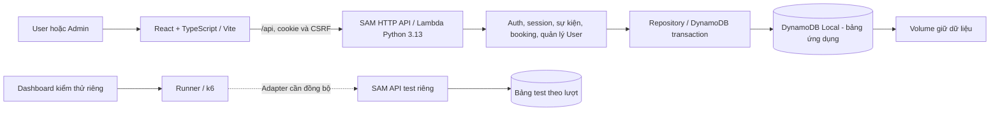

# Bối cảnh dự án

Mốc cập nhật nội dung: **30/10/2026 — Tuần 5 (26/10–01/11)**. File này mô tả hệ thống hiện hành và phần còn lại; lịch sử đóng góp xem [WORKLOG.md](WORKLOG.md), quy tắc cộng tác xem [AI_RULE.md](AI_RULE.md).

## 1. Mục tiêu và phạm vi

Website đăng ký sự kiện có giới hạn số chỗ, dùng để kiểm chứng tính đúng dữ liệu, chống gửi lặp, tranh chỗ và tải tăng. “Mua vé” hiện là đặt chỗ và nhận mã xác nhận, chưa thanh toán. Phát triển/kiểm thử local trước, sau đó dự kiến triển khai AWS để trình diễn hệ thống serverless trong doanh nghiệp.

Nền đã có trước đợt quản trị 16/10: prototype React, API đọc/đăng ký, DynamoDB transaction và tích hợp frontend/backend. Không tự tính lại phần nền thành công việc mới của các ngày sau. Phạm vi triển khai hiện gồm **User và Admin**, chưa có Organizer đa đơn vị, OTP/xác minh email, khôi phục mật khẩu, gửi email hoặc thanh toán.

## 2. Luồng sử dụng hiện tại

- Chưa đăng nhập: giao diện API mode tới `/login`, có liên kết `/signup`. API đọc sự kiện vẫn công khai, nhưng khung UI sản phẩm hiện yêu cầu đăng nhập.
- User: tạo tài khoản bằng tên/email/mật khẩu → đăng nhập → xem/tìm sự kiện → đặt vé → nhận mã → Vé của tôi. Danh tính lấy từ phiên, mỗi User tối đa một vé/sự kiện; chỉ chủ vé được xem.
- Admin: tài khoản cấp qua CLI, dùng cùng form login; quản lý sự kiện và User. Được xóa sự kiện có người, tìm/sửa/xóa User; không có tự đăng ký hoặc giao diện quản lý tài khoản Admin.
- Cùng browser/profile chỉ có một tài khoản đang dùng; đổi tài khoản/đăng xuất cập nhật các tab. Browser/profile và cookie jar khác độc lập. Sidebar/navbar theo vai trò; theo thiết kế hiện hành, desktop luôn hiện nhãn, mobile dùng drawer, có sáng/tối.

`VITE_DATA_MODE=api`, `VITE_API_BASE_URL=/api` dùng backend thật; API lỗi phải hiển thị lỗi, không tự chuyển mock. Chế độ mock chỉ dùng phát triển UI, không là bằng chứng dữ liệu hoặc hiệu năng.

## 3. Kiến trúc local

Frontend hiển thị/gọi HTTP; handler nhận request và trả response; service xử lý nghiệp vụ; repository đọc/ghi DB. Test lab là phần bên đồng hành bàn giao, tách khỏi UI sản phẩm; đã hợp nhất mã nguồn nhưng chưa đồng bộ adapter với contract hiện tại.

| Thành phần | Địa chỉ / cấu hình |
| --- | --- |
| Web sản phẩm / API | 127.0.0.1:5173, proxy /api tới SAM3001 |
| SAM test / web thử browser | 3002 / 5175; dùng env test riêng |
| Runner / dashboard test | 3100 / 5174 theo cấu hình lab, không phải thành phần UI sản phẩm |
| DB từ host / Lambda | http://127.0.0.1:8000 / http://fcaj-dynamodb-local:8000 |
| Docker network | fcaj-event-workshop-local |
| Bảng ứng dụng | fcaj-event-workshop-local |
| Bảng kiểm thử | Prefix fcaj-event-workshop-local-test-, mới theo lượt |
| Volume DB | fcaj-event-workshop-dynamodb-data |

## 4. Quy tắc dữ liệu và bảo vệ

- Mật khẩu băm bằng scrypt với salt riêng. Cookie HttpOnly `event_session` dùng chung hai role; server lưu hash token và kiểm phiên/quyền. Ghi sau login cần Origin hợp lệ và X-CSRF-Token; không lấy role/userId client gửi để cấp quyền.
- Booking dùng transaction **4 thao tác ghi + 1 ConditionCheck**: giảm chỗ có điều kiện, kiểm profile User hoạt động, tạo liên kết User/event, Ticket và idempotency. Thành công cùng nhau hoặc không ghi phần nào.
- Idempotency-Key là UUID v4: cùng User/key/nội dung trả 200 và vé đã lưu, tạo mới trả 201; key cũ khác nội dung bị từ chối. Không đổi key khi chưa rõ request trước đã lưu hay chưa.
- Backend dùng giờ server để kiểm salesOpenAt, trạng thái mở, số chỗ và thời điểm diễn ra. Dữ liệu legacy thiếu userId được giữ, không tự gán owner theo email trùng.
- Sửa User kiểm email duy nhất và version; vé cũ giữ thông tin lúc đăng ký. Xóa User khóa truy cập trước, hủy vé và trả chỗ một lần cho event còn hoạt động, giữ dữ liệu người khác.
- Xóa event chỉ dọn vé/ghi danh/idempotency của event, giữ tài khoản và event khác. DELETE User/event dọn theo lô, có thể trả 202 để tiếp tục; không mở khóa hoặc coi là hoàn tất khi chưa xong.
- Init mặc định chỉ tạo bảng nếu thiếu. Demo có ghế giả đã dùng nhưng không có vé tương ứng; không dùng số đó làm số người thật. Không seed đè, reset remainingSeats, xóa volume hoặc ghi test vào bảng ứng dụng.

Nguồn chi tiết: [API contract 4.1](../docs/api-contract.md), [data model](../docs/data-model.md), [security](../docs/security.md). Các file này là chuẩn để sửa code/viết assertion, không sao chép schema dài vào nhật ký.

## 5. Nơi tìm mã nguồn và hướng dẫn

| Phần | File chính |
| --- | --- |
| HTTP và cấu hình SAM | [app.py](../backend/lambda/app.py), [template.yaml](../backend/template.yaml) |
| Account/session | [buyer_auth.py](../backend/lambda/buyer_auth.py), [session.py](../backend/lambda/session.py), [auth.py](../backend/lambda/auth.py) |
| Booking và truy cập DB | [booking.py](../backend/lambda/booking.py), [repository.py](../backend/lambda/repository.py), [buyer_repository.py](../backend/lambda/buyer_repository.py) |
| Quản trị/xóa | [admin_events.py](../backend/lambda/admin_events.py), [event_deletion.py](../backend/lambda/event_deletion.py), [admin_accounts.py](../backend/lambda/admin_accounts.py), [account_repository.py](../backend/lambda/account_repository.py) |
| UI | [App.tsx](../frontend/src/App.tsx), [AppShell.tsx](../frontend/src/components/AppShell.tsx), [AdminAccountsPage.tsx](../frontend/src/pages/admin/AdminAccountsPage.tsx) |
| Kiểm thử | tests/backend, tests/frontend, backend/tools/check_*; tests/load, tests/runner, tests/dashboard thuộc lab riêng |

Khởi động và lệnh kiểm tra xem [Backend README](../backend/README.md), [Frontend README](../frontend/README.md), [Runner README](../tests/runner/README.md). Thiết kế hiện hành là **Sakura Night**, kính mờ/cánh hoa, có sáng/tối theo [DESIGN.md](../frontend/DESIGN.md); đợt setup AWS không sửa giao diện.

## 6. Trạng thái và phần còn lại

- Làm ở thư mục gốc `D:\aws-workshop\event-registration`, nhánh **phuc**; GitHub/local còn main/phuc. Các nhánh feature đã gộp, lịch sử commit được giữ. Xem [git-workflow.md](../docs/git-workflow.md); không quay lại sửa worktree detached như một nhánh đang phát triển.
- Cập nhật Git ngày **24/10/2026**: theo yêu cầu bàn giao, main được đồng bộ tới cùng bản phuc trong đợt này, gồm ứng dụng, test lab và tài liệu. Những lần phát triển tiếp vẫn dùng phuc; trạng thái chức năng và các giới hạn kiểm thử bên dưới không thay đổi vì đồng bộ nhánh.
- Dữ liệu DynamoDB local được giữ. Trong đợt setup đã bật Docker ở workspace để build; chưa khởi động DB/API hoặc ghi dữ liệu. Máy triển khai đã gửi đầu ra Docker Linux engine/build đạt. Phiên tiếp theo vẫn kiểm tra process/health theo README, không suy runtime đang chạy từ tài liệu.
- Lượt kiểm thử **23/10/2026** đã đạt 75 bài backend với DB và HTTP/browser/SAM/frontend checks. Sau gộp Git chạy lại 63 bài backend không DB, 28 unit lab và build/lint cả hai web; 12 integration bỏ qua vì Docker tắt. Đây là kết quả lịch sử; phiên lập kế hoạch 30/10 không chạy lại các bài chức năng. Chi tiết và nguồn tại [WORKLOG.md](WORKLOG.md).
- **Điểm tiếp tục chính:** thực hiện nhiệm vụ 1 theo [kế hoạch AWS](../docs/aws-deployment-plan.md); công cụ/build/CLI và budget đã đạt như mục 7. Tiếp tục quyền triển khai/quota, cấu hình local/AWS và dependency trước Terraform/apply. Backend vẫn khóa DB Local/credentials giả; `infra/infra.md` trống, chưa có Terraform/workflow triển khai. STS đúng tài khoản không chứng minh quyền deploy.
- **Điều kiện trước test tải:** [adapter lab](../tests/load/contract-v3-draft.json) vẫn ghim health3.0/cookie `event_user_session`, app dùng4.1/`event_session`; runner chỉ nhận HTTP loopback, fixture/audit phụ thuộc DB Local. Cần đồng bộ contract và hỗ trợ môi trường AWS có guard trước khi thử 1–2 User rồi mới tăng tải. Không bỏ guard hoặc đổi version backend để làm test qua; việc gộp code không tự hoàn tất tích hợp lab.
- Chưa có kết quả 100 người, ramp/spike/hold/overload/recovery trên bản hiện hành hoặc số đo scaling AWS. Scan dùng trong danh sách User/dọn dữ liệu còn là giới hạn; cần đánh giá chỉ mục/chi phí khi lên AWS.

## 7. Kế hoạch AWS đã chốt — chưa triển khai

Nguồn thực hiện: [aws-deployment-plan.md](../docs/aws-deployment-plan.md). Kế hoạch được chốt tại Checkpoint **30/10/2026**, chia thành hai nhiệm vụ:

- **Nhiệm vụ 1:** một frontend React User/Admin trên S3 riêng tư + CloudFront/OAC; cùng hostname HTTPS chuyển `/api` tới HTTP API payload v2 + một Lambda Python 3.13 + bảng DynamoDB PK/SK On-demand cho mỗi môi trường. Giữ auth/CSRF/idempotency/quyền hiện tại, chỉ dùng log Lambda tối thiểu để debug; hoàn thành bằng kiểm tra chức năng đầu-cuối và khả năng thu hồi môi trường thử nghiệm.
- **Nhiệm vụ 2:** cấu hình CloudWatch log/retention, dashboard, metric/alarm và SNS email; kiểm chứng bằng request/cảnh báo thật. Chưa dựng các phần này ở nhiệm vụ 1.

Terraform quản lý tạo/cấu hình/thu hồi hạ tầng; SAM dùng build/local. Lần đầu build và deploy từ máy; GitHub Actions/OIDC là bước tự động hóa về sau, không host frontend và chưa bắt buộc cho lần test đầu. Trình duyệt lấy file qua CloudFront rồi chạy React.

Đây là dự án **`fcaj-project`**; tên profile/tài nguyên mới chứa `fcaj` và `project`. Hai người cùng bàn/cùng một phiên, thao tác tuần tự trên **máy Windows của người dùng**, không cần điều phối hai máy. Đợt thử chạy vài giờ rồi dọn: CloudFront pay-as-you-go, Terraform state local trên máy triển khai, dữ liệu AWS có thể tạo lại; giữ dữ liệu local và tài nguyên ngoài dự án. Dự kiến kết thúc dùng AWS sau **12/2026**; thu hồi/kiểm kê dự án, không tự đóng tài khoản. Quản lý cả log/tài nguyên phụ, lưu bằng chứng trước destroy; phí đã sử dụng vẫn tính và billing có độ trễ.

**Tài khoản cuối cùng:** tài khoản cá nhân **Paid**, credit còn **40 USD**, hạn khoảng **05/2027** theo thông tin được cung cấp; không có ngày hết hạn cụ thể. Không dùng kết quả Paid/0 USD của tài khoản người bạn đã bỏ, cũng không coi 60 USD kiếm thêm trong ảnh Explore AWS là số dư hiện tại. IAM user **`fcaj-project`**, profile login **`fcaj-project-login`**, cầu nối **`fcaj-project`** dùng credential_process/temp credentials; STS qua cầu nối đã xác nhận đúng tài khoản cá nhân/user. Không dùng root access key, không lưu Account ID/ARN đầy đủ/credential vào tài liệu.

**Budget:** từ 100 xuống **10 USD/tháng**, ngưỡng actual **30/50/80%** (= 3/5/8 USD), forecast **100%**; loại **Credit/Refund** để theo dõi chi phí trước bù trừ. Các ngưỡng/scope có ảnh, lưu và email recipients có xác nhận của người dùng; chưa thử gửi/nhận cảnh báo. Budget có độ trễ, không tự chặn mọi chi phí. Tên budget chưa xác minh; không tạo trùng/đổi tên chỉ vì quy ước tài nguyên dự án.

**Môi trường đã kiểm tra:** AWS CLI **2.39.2**, Terraform **1.17.1**, Node **24.14.0**, npm **11.9.0**, SAM **1.167.0**, Docker Linux **29.4.3**, Compose **5.1.4**. Đầu ra máy triển khai xác nhận npm ci/frontend build và SAM Python 3.13/x86_64 container build thành công. SDK credential_process từng gọi STS thành công trước đổi tài khoản; tài khoản cuối mới có STS CLI, chưa kiểm tra lại SDK/provider. Workspace Codex ở máy người bạn có lượt kiểm tra riêng; không dùng nó thay cho máy triển khai. Lệnh và nguồn trong [aws-environment-setup.md](../docs/aws-environment-setup.md).

**Còn lại trước triển khai:** quyền IAM tạo tài nguyên/quota chưa cấp hoặc xác minh; runtime vẫn chỉ cho DB Local/credential giả. `npm audit` có **4 mục (1 low, 3 high)** qua shadcn/registry/zod/deepmerge, chưa sửa hoặc xác minh ảnh hưởng bundle. Không tự chạy audit fix --force vì đề xuất thay đổi major; giữ import CSS shadcn khi xử lý. Tài khoản từng hoàn thành hoạt động EC2/Bedrock/Budgets, chưa kiểm kê tài nguyên còn chạy; không tự xóa/import vào state. Dự toán tham chiếu `us-east-1` vẫn là giả định, chưa phải bill hoặc số đo; kiểm tra quota/throttle/retention phù hợp trước thao tác tương ứng. Chưa IaC, app deploy/smoke/destroy hoặc test tải AWS.

Phạm vi kế hoạch đã chốt không cần xin duyệt lại; không tự mở rộng sang tính năng, kiến trúc hoặc dữ liệu ngoài phạm vi đó. Màn demo phải lấy request/metric/audit thật; số thực thi Lambda đồng thời không phải số môi trường giữ ấm. Local/đồ thị minh họa không thay số đo AWS.
