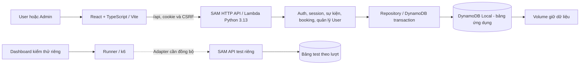

# Bối cảnh dự án

Mốc cập nhật nội dung: **30/10/2026 — Tuần 5 (26/10–01/11)**. File này mô tả hệ thống hiện hành và phần còn lại; lịch sử đóng góp xem [WORKLOG.md](WORKLOG.md), quy tắc cộng tác xem [AI_RULE.md](AI_RULE.md).

## 1. Mục tiêu và phạm vi

Website đăng ký sự kiện có giới hạn số chỗ, dùng để kiểm chứng tính đúng dữ liệu, chống gửi lặp, tranh chỗ và tải tăng. “Mua vé” hiện là đặt chỗ và nhận mã xác nhận, chưa thanh toán. Phát triển/kiểm thử local trước, sau đó dự kiến triển khai AWS để trình diễn hệ thống serverless trong doanh nghiệp.

Nền đã có trước đợt quản trị 16/10: prototype React, API đọc/đăng ký, DynamoDB transaction và tích hợp frontend/backend. Không tự tính lại phần nền thành công việc mới của các ngày sau. Phạm vi triển khai hiện gồm **User và Admin**, chưa có Organizer đa đơn vị, OTP/xác minh email, khôi phục mật khẩu, gửi email hoặc thanh toán.

## 2. Luồng sử dụng hiện tại

- Chưa đăng nhập: giao diện API mode tới `/login`, có liên kết `/signup`. API đọc sự kiện vẫn công khai, nhưng khung UI sản phẩm hiện yêu cầu đăng nhập.
- User: tạo tài khoản bằng tên/email/mật khẩu → đăng nhập → xem/tìm sự kiện → đặt vé → nhận mã → Vé của tôi. Danh tính lấy từ phiên, mỗi User tối đa một vé/sự kiện; chỉ chủ vé được xem.
- Admin: tài khoản cấp qua CLI, dùng cùng form login; quản lý sự kiện và User. Được xóa sự kiện có người, tìm/sửa/xóa User; không có tự đăng ký hoặc giao diện quản lý tài khoản Admin.
- Cùng browser/profile chỉ có một tài khoản đang dùng; đổi tài khoản/đăng xuất cập nhật các tab. Browser/profile và cookie jar khác độc lập. Sidebar/navbar theo vai trò, desktop thu gọn được, mobile giữ menu đầy đủ.

`VITE_DATA_MODE=api`, `VITE_API_BASE_URL=/api` dùng backend thật; API lỗi phải hiển thị lỗi, không tự chuyển mock. Chế độ mock chỉ dùng phát triển UI, không là bằng chứng dữ liệu hoặc hiệu năng.

## 3. Kiến trúc local

Frontend hiển thị/gọi HTTP; handler nhận request và trả response; service xử lý nghiệp vụ; repository đọc/ghi DB. Test lab là phần bên đồng hành bàn giao, tách khỏi UI sản phẩm; đã hợp nhất mã nguồn nhưng chưa đồng bộ adapter với contract hiện tại.

| Thành phần | Địa chỉ / cấu hình |
| --- | --- |
| Web sản phẩm / API | 127.0.0.1:5173, proxy /api tới SAM3001 |
| SAM test / web thử browser | 3002 / 5175; dùng env test riêng |
| Runner / dashboard test | 3100 / 5174 theo cấu hình lab, không phải thành phần UI sản phẩm |
| DB từ host / Lambda | http://127.0.0.1:8000 / http://fcaj-dynamodb-local:8000 |
| Docker network | fcaj-event-workshop-local |
| Bảng ứng dụng | fcaj-event-workshop-local |
| Bảng kiểm thử | Prefix fcaj-event-workshop-local-test-, mới theo lượt |
| Volume DB | fcaj-event-workshop-dynamodb-data |

## 4. Quy tắc dữ liệu và bảo vệ

- Mật khẩu băm bằng scrypt với salt riêng. Cookie HttpOnly `event_session` dùng chung hai role; server lưu hash token và kiểm phiên/quyền. Ghi sau login cần Origin hợp lệ và X-CSRF-Token; không lấy role/userId client gửi để cấp quyền.
- Booking dùng transaction **4 thao tác ghi + 1 ConditionCheck**: giảm chỗ có điều kiện, kiểm profile User hoạt động, tạo liên kết User/event, Ticket và idempotency. Thành công cùng nhau hoặc không ghi phần nào.
- Idempotency-Key là UUID v4: cùng User/key/nội dung trả 200 và vé đã lưu, tạo mới trả 201; key cũ khác nội dung bị từ chối. Không đổi key khi chưa rõ request trước đã lưu hay chưa.
- Backend dùng giờ server để kiểm salesOpenAt, trạng thái mở, số chỗ và thời điểm diễn ra. Dữ liệu legacy thiếu userId được giữ, không tự gán owner theo email trùng.
- Sửa User kiểm email duy nhất và version; vé cũ giữ thông tin lúc đăng ký. Xóa User khóa truy cập trước, hủy vé và trả chỗ một lần cho event còn hoạt động, giữ dữ liệu người khác.
- Xóa event chỉ dọn vé/ghi danh/idempotency của event, giữ tài khoản và event khác. DELETE User/event dọn theo lô, có thể trả 202 để tiếp tục; không mở khóa hoặc coi là hoàn tất khi chưa xong.
- Init mặc định chỉ tạo bảng nếu thiếu. Demo có ghế giả đã dùng nhưng không có vé tương ứng; không dùng số đó làm số người thật. Không seed đè, reset remainingSeats, xóa volume hoặc ghi test vào bảng ứng dụng.

Nguồn chi tiết: [API contract 4.1](../docs/api-contract.md), [data model](../docs/data-model.md), [security](../docs/security.md). Các file này là chuẩn để sửa code/viết assertion, không sao chép schema dài vào nhật ký.

## 5. Nơi tìm mã nguồn và hướng dẫn

| Phần | File chính |
| --- | --- |
| HTTP và cấu hình SAM | [app.py](../backend/lambda/app.py), [template.yaml](../backend/template.yaml) |
| Account/session | [buyer_auth.py](../backend/lambda/buyer_auth.py), [session.py](../backend/lambda/session.py), [auth.py](../backend/lambda/auth.py) |
| Booking và truy cập DB | [booking.py](../backend/lambda/booking.py), [repository.py](../backend/lambda/repository.py), [buyer_repository.py](../backend/lambda/buyer_repository.py) |
| Quản trị/xóa | [admin_events.py](../backend/lambda/admin_events.py), [event_deletion.py](../backend/lambda/event_deletion.py), [admin_accounts.py](../backend/lambda/admin_accounts.py), [account_repository.py](../backend/lambda/account_repository.py) |
| UI | [App.tsx](../frontend/src/App.tsx), [AppShell.tsx](../frontend/src/components/AppShell.tsx), [AdminAccountsPage.tsx](../frontend/src/pages/admin/AdminAccountsPage.tsx) |
| Kiểm thử | tests/backend, tests/frontend, backend/tools/check_*; tests/load, tests/runner, tests/dashboard thuộc lab riêng |

Khởi động và lệnh kiểm tra xem [Backend README](../backend/README.md), [Frontend README](../frontend/README.md), [Runner README](../tests/runner/README.md). Giữ thiết kế Almanac và component hiện có trong [DESIGN.md](../frontend/DESIGN.md).

## 6. Trạng thái và phần còn lại

- Làm ở thư mục gốc, hiện đã đồng bộ lên nhánh **main** (commit `d4611f1`), đồng thời nhánh **quan** đã cập nhật đầy đủ.
- **Hoàn thành Nhiệm vụ 1 (04/11/2026):** Đã triển khai ứng dụng lên AWS thành công bằng Terraform (CloudFront, S3 OAC, API Gateway v2, Lambda Python 3.13, DynamoDB On-Demand `fcaj-project-events`). Kiểm thử người dùng đăng ký, đăng nhập và đặt vé thành công qua HTTPS.
- **Thu hồi lab an toàn:** Đã destroy toàn bộ hạ tầng bằng Terraform và chạy script `infra/verify_cleanup.ps1` xác nhận 7/7 dịch vụ sạch sẽ 100% `[CLEAN]`, không tốn phí duy trì.
- Chi tiết báo cáo triển khai và xử lý sự cố Permissions Boundary xem tại [Báo cáo triển khai AWS 04/11/2026](../docs/aws-deployment-report-2026-11-04.md).
- **Điểm tiếp tục chính:** Nhiệm vụ 2 theo [kế hoạch AWS](../docs/aws-deployment-plan.md) — Bổ sung giám sát hệ thống bằng CloudWatch Metrics/Alarms, Dashboard và cảnh báo qua SNS email.

## 7. Kế hoạch AWS — Tiến độ thực hiện

Nguồn thực hiện: [aws-deployment-plan.md](../docs/aws-deployment-plan.md). Kế hoạch gồm hai nhiệm vụ:

- **Nhiệm vụ 1 (ĐÃ HOÀN THÀNH - 04/11/2026):** Triển khai ứng dụng lên AWS với CloudFront, S3 private, API Gateway, Lambda và DynamoDB; kiểm thử chức năng đầu-cuối qua HTTPS và thu hồi sạch sẽ lab bằng Terraform và script kiểm tra tự động.
- **Nhiệm vụ 2 (CHƯA TRIỂN KHAI):** Cấu hình CloudWatch log/retention có hệ thống, dashboard, metric/alarm và SNS email; kiểm chứng bằng request và cảnh báo thật.

Terraform quản lý tạo/cấu hình/thu hồi hạ tầng; SAM dùng build/local. Lần đầu build và deploy từ máy; GitHub Actions/OIDC là bước tự động hóa về sau, không host frontend và chưa bắt buộc cho lần test đầu. Trình duyệt lấy file qua CloudFront rồi chạy React.

Mục tiêu dùng lab vài giờ rồi dọn: CloudFront pay-as-you-go, state local cho một người/một máy, dữ liệu AWS có thể tạo lại; giữ dữ liệu local và tài nguyên ngoài lab. Chuẩn bị teardown ngay từ đầu, quản lý cả log/tài nguyên phụ, tải bằng chứng về máy và kiểm kê sau destroy. Phí đã sử dụng vẫn được tính và billing có độ trễ; không suy xóa web thành hóa đơn 0 USD.

Ngân sách **5–10 USD/tháng**; đã có tài khoản cá nhân nhưng gói/credit/Free Tier/phí hiện có chưa xác minh. Dự toán trong plan dùng giá tham chiếu `us-east-1`, lượng request/duration/DB units giả định, chưa phải bill hoặc số đo thật. Region và các ngưỡng quota/throttle/retention/tải cần đối chiếu trước giai đoạn tương ứng. Chưa có thay đổi code, Terraform, deploy, smoke test hoặc tải AWS trong phiên nghiên cứu.

Phạm vi kế hoạch đã chốt không cần xin duyệt lại; không tự mở rộng sang tính năng, kiến trúc hoặc dữ liệu ngoài phạm vi đó. Màn demo phải lấy request/metric/audit thật; số thực thi Lambda đồng thời không phải số môi trường giữ ấm. Local/đồ thị minh họa không thay số đo AWS.
