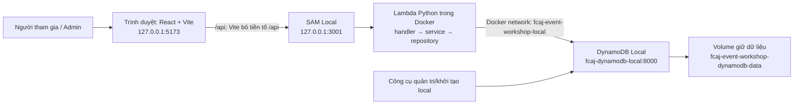
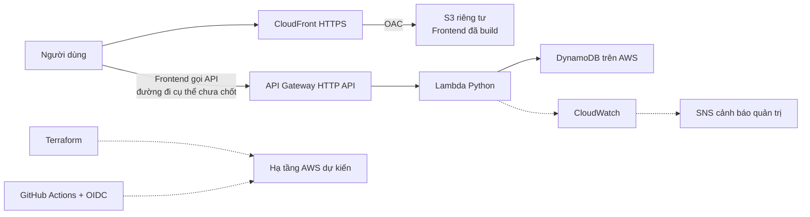

# Nhật ký 23/10 — Khởi động tuần 4

- Ngày: **23/10/2026**, giờ Việt Nam. Tuần làm việc thứ tư theo xác nhận của Phúc.
- Nhánh kiểm tra: **`phuc`**.
- Mục tiêu: đọc lại lịch sử, ghi quy tắc phối hợp, hướng dẫn Phúc khởi động và tự dùng thử hệ thống; ghi nhận bối cảnh chuẩn bị cho AWS.
- Trạng thái: **backend health/events đã đạt theo đầu ra Phúc gửi; Phúc xác nhận web chạy ổn. Phúc làm rõ trọng tâm là kiểm thử tính đúng đắn và tải; đang thảo luận thiết kế tài khoản vừa đủ phục vụ mục tiêu này, chưa duyệt hoặc code phương án mới**.
- Không sửa mã nguồn ứng dụng trong đợt này. Ý tưởng có sửa code cần mô tả và chờ Phúc duyệt trước.
- Phúc nhắc lại trong buổi: **mục tiêu bây giờ là test local dự án**. Ưu tiên đưa backend/frontend lên, kiểm tra rồi để Phúc tự dùng thử; phần AWS chỉ lưu bối cảnh tương lai, không triển khai hay mở rộng công việc lúc này.
- **Cách hướng dẫn mới nhất:** theo từng giai đoạn, gom các thao tác liên quan rồi kiểm tra chung ở cuối giai đoạn. Thay cho cách chia một lệnh/một lượt đã áp dụng lúc sửa lỗi PowerShell. Sau khi web chạy, Phúc chuyển sang thảo luận vai trò/tài khoản; không tự dừng môi trường đang dùng.

## 1. Cửa sổ chat mới nên bắt đầu ở đâu?

Đọc [phong cách làm việc](../phong-cach.md), rồi đọc nhật ký này. Phúc muốn học cùng quá trình làm: giải thích dễ hiểu, code vừa sức và đúng chỗ, trình bày ý tưởng trước khi code, kiểm tra từng bước Phúc thực hiện rồi mới đi tiếp.

Không mặc định trạng thái ghi trong nhật ký là trạng thái máy đang chạy. Đầu ra công cụ là bằng chứng kỹ thuật, không tự coi là xác nhận của con người. Các kết quả chưa được Phúc dùng thử xác nhận phải giữ nguyên nhãn đó.

## 2. Xâu chuỗi lịch sử theo thời gian

| Mốc | Nội dung và cách hiểu |
| --- | --- |
| Trước nâng cấp 16/10 | Prototype frontend đã chuyển sang luồng API thật trên local: danh sách, chi tiết, đăng ký, kết quả; DynamoDB transaction giữ chỗ và chống trùng. `Reports/BC.txt` không có ngày riêng và chứa cả đoạn trạng thái cũ; không tự gán toàn bộ công việc này vào tuần 3 hoặc 4. |
| Nâng cấp 16/10 | Thêm chọn vai trò, đăng nhập/session/logout admin, thêm/sửa/xóa sự kiện và mở/đóng đăng ký. Người dùng đã chọn chặn xóa sự kiện có chỗ đã dùng. Có kết quả kiểm tra local trong worklog riêng. |
| Sau nâng cấp 16/10 | Có lượt dừng/dọn môi trường, sau đó Phúc bật lại và tạo admin `phuc`. Ghi chú dừng môi trường không phải trạng thái cuối của cả ngày. |
| Dọn mẫu 16/10, sau đó | Xác minh tám sự kiện mẫu không có đăng ký thật, xóa đúng tám sự kiện và giữ dữ liệu admin. Kết quả lần đó: 0 sự kiện, 0 đăng ký, 1 ADMIN, 1 SESSION, 2 LOGIN. Khởi tạo mặc định được đổi sang chỉ tạo bảng; thêm mẫu phải chủ động dùng `--seed-demo`. |
| 23/10 — hôm nay | Đọc toàn bộ file trong `phuc-worklog`, đối chiếu tài liệu/cấu hình/mã liên quan đến chạy local; tạo nhật ký tuần 4 và văn hóa làm việc; cùng Phúc khởi động từng phần. |

[Bối cảnh tuần 3](../week-3/boi-canh.md) là tài liệu tổng hợp đã cập nhật cả việc dọn mẫu. Thứ tự đọc thuận tiện là bối cảnh → nâng cấp → dọn mẫu; thứ tự phát sinh nghiệp vụ là nền tảng → nâng cấp → dùng thử/dọn mẫu. Không dùng đoạn “chưa có admin” trong báo cáo BC để mô tả trạng thái mới nhất.

## 3. Tổng quan hệ thống đang có

Website đăng ký sự kiện có giới hạn số chỗ, phục vụ học tập/demo workshop AWS. Phúc phụ trách chính frontend; bạn cùng nhóm phụ trách backend theo ghi nhận trước. Chưa có xác nhận thay đổi phân công hôm nay.

**Người tham gia:** `/` chọn Người tham gia → `/events` tìm/lọc → chi tiết → form đăng ký → trang kết quả có mã UUID. Không cần tài khoản khách. Backend chuẩn hóa email rồi chống trùng theo sự kiện + email; một transaction cùng giảm chỗ, ghi đăng ký và khóa chống trùng.

**Quản trị viên:** chọn Quản trị viên → đăng nhập → `/admin` → thêm/sửa thông tin và mở/đóng đăng ký. Không giảm sức chứa dưới số chỗ đã dùng; không xóa sự kiện có chỗ đã dùng. Backend kiểm tra quyền, không chỉ dựa vào trang chọn vai trò. Session dùng cookie HttpOnly; thao tác ghi có kiểm tra Origin/CSRF.

**Phân lớp:** React hiển thị và nhận thao tác → service frontend gọi HTTP → handler Python nhận request → service xử lý quy tắc → repository đọc/ghi DynamoDB. Giữ đúng trách nhiệm giúp người ngoài đọc dễ hiểu và hai thành viên phối hợp qua API contract.

### Kiến trúc local hiện tại



Windows đọc DB qua `127.0.0.1:8000`; Lambda/tools đọc qua `fcaj-dynamodb-local:8000`. `localhost` bên trong container là chính container đó. Volume giúp dữ liệu còn sau khi dừng/bật lại container.

`VITE_DATA_MODE=api` và `VITE_API_BASE_URL=/api` dùng backend thật. Khi API lỗi, frontend hiển thị lỗi, không tự dùng dữ liệu giả. `mock` là chế độ UI riêng, có dữ liệu mẫu/localStorage riêng và không cấp quyền admin.

## 4. Điều đã kiểm tra hôm nay và phần còn chờ

| Hạng mục | Bằng chứng / trạng thái |
| --- | --- |
| Đọc lịch sử | Đã đọc đủ `Reports/BC.txt` và ba file tuần 3; đối chiếu mâu thuẫn theo trình tự trên. |
| Git lúc bắt đầu | Nhánh `phuc`; `git status --short` không có thay đổi. |
| Công cụ host | Tìm thấy SAM, Node `v24.14.0`, npm `11.9.0`, Python host; không dùng phiên bản ghi trong README cũ như kết quả kiểm tra hôm nay. |
| File local | Có `frontend/node_modules`, `frontend/package-lock.json`, `.aws-sam/build/template.yaml`, `.venv/Scripts/python.exe`. Có artifact không chứng minh build còn khớp mã mới nhất; sẽ build lại backend. |
| Frontend env | Đã đọc đúng hai biến: `VITE_DATA_MODE=api`, `VITE_API_BASE_URL=/api`. |
| Trước khi bật | Không thấy listener 3001/5173/8000 ở lần kiểm tra đầu. |
| Docker | Phúc xác nhận đã mở Docker. Kiểm tra trực tiếp sau đó thành công: context `desktop-linux`, Server OS `linux`, Engine `29.4.3`. Compose lúc đó chưa có service chạy. |
| Đường dẫn Docker | Terminal trợ lý thiếu Docker trong PATH. Tìm được từ tiến trình: `C:/Users/ADMIN/AppData/Local/Programs/DockerDesktop/resources/bin/docker.exe`; gọi đường dẫn đầy đủ để kiểm tra. Không kết luận máy thiếu Docker. |
| Phúc bật DB | Phúc gửi đầu ra `up -d dynamodb` và `ps`: container `fcaj-event-workshop-dynamodb-1` đã Started, `Up 11 seconds`, bind `127.0.0.1:8000->8000/tcp`. Đây là bước bật container đạt; còn kiểm tra bảng/đọc DB trước khi xác nhận hệ thống sẵn sàng. |
| Đọc DB hôm nay | Trợ lý chạy `docker compose -f backend/compose.yaml run --rm tools backend/check_db.py --endpoint-url http://fcaj-dynamodb-local:8000`, thoát 0, trả `{"table":"fcaj-event-workshop-local","events":1}`. Có **1 sự kiện**, không còn là bảng trống như mốc dọn mẫu. Công cụ này không đếm đăng ký hoặc xác minh tài khoản; chưa biết số đăng ký hiện tại và chưa xác nhận admin đăng nhập được. Không sửa dữ liệu. |
| Đối chiếu container | Kiểm tra trực tiếp Compose xác nhận `dynamodb` Up, cổng 8000 đúng; log khởi tạo ghi DynamoDB Local `3.3.1`, dùng `/data`, `InMemory=false`. |
| Build backend — cập nhật sau đó | Phúc gửi `Build Failed`, `PythonPipBuilder:ResolveDependencies - Could not satisfy the requirement: boto3==1.43.114`. Trợ lý giữ nguyên requirements, kiểm tra PyPI/pip rồi build chẩn đoán riêng: **Build Succeeded**, exit 0, `ResolveDependencies succeeded`. Bản build đạt nằm tại `.aws-sam/diagnostic-build/`, chưa xác nhận HTTP qua SAM. |
| API HTTP — Phúc gửi sau khi bật SAM | `GET /health` trả `status=ok`, `database.status=ready`, bảng `fcaj-event-workshop-local`; `GET /events` trả 1 sự kiện tên `test`, ID `event-2f057ceb8233419895d1acee8fe5438d`, diễn ra `2026-10-17T14:56:00+07:00`, trạng thái `ended`, sức chứa 40, còn 39 chỗ. Ngày diễn ra trước hôm nay 23/10 nên trạng thái ended phù hợp. Chênh lệch 1 chỗ chưa thay thế việc đếm bản ghi đăng ký. Đây là kết quả thực tế do Phúc cung cấp, không phải trợ lý chạy lại suite. |
| Frontend | Phúc xác nhận “web chạy ổn áp” sau hướng dẫn bật Vite và truy cập website. Ghi nhận web chạy theo xác nhận của Phúc; chưa có kết quả cụ thể đăng nhập admin/đăng ký mới hôm nay. |
| Kiểm thử hôm nay | Chưa chạy suite, SAM HTTP smoke test hoặc trình duyệt. Các kết quả dưới đây là lịch sử, không phải vừa chạy lại. |

Worklog quản trị ghi 45 unit + 2 integration đạt trong đợt nâng cấp; worklog dọn mẫu sau đó ghi **46 unit đạt, 2 integration bỏ qua**, không chạy lại SAM HTTP/browser. Các con số khác nhau do khác mốc và phạm vi, không gộp thành kết quả mới hôm nay.

## 5. Hướng dẫn khởi động — đi từng điểm kiểm tra

Toàn bộ lệnh dưới đây chạy bằng **PowerShell tại `D:\aws-workshop\event-registration`**. Đây là hướng dẫn; chỉ ghi “đạt” khi đã kiểm tra đầu ra thực tế. Prefix `(.venv)` của terminal Phúc không cản các lệnh Docker/SAM; các bước chính chạy Python trong container. Khi hướng dẫn trong chat, gom thành các giai đoạn: backend + kiểm tra DB/API (các bước 1–3), frontend + kiểm tra truy cập (bước 4), dùng thử nghiệp vụ (bước 5). Không cần dừng hỏi xác nhận sau mỗi lệnh; nếu lệnh lỗi thì dừng để xử lý trước khi chạy lệnh phụ thuộc.

### Bước 1 — Docker và database

Mở Docker Desktop, đợi engine sẵn sàng rồi chạy:

```powershell
docker version
docker compose -f backend/compose.yaml up -d dynamodb
docker compose -f backend/compose.yaml ps
```

Mong đợi có Server Linux và service `dynamodb` trạng thái Up, cổng `127.0.0.1:8000`. Phúc đã gửi đúng đầu ra bật DB, được ghi ở mục 4. Nếu terminal mới không nhận Docker, chỉ thêm PATH trong terminal đó rồi thử lại:

```powershell
$env:Path = 'C:\Users\ADMIN\AppData\Local\Programs\DockerDesktop\resources\bin;' + $env:Path
```

### Bước 2 — Build backend, khởi tạo bảng và kiểm tra đọc DB

Trong Terminal 1:

```powershell
$env:SAM_CLI_TELEMETRY='0'
$env:AWS_ACCESS_KEY_ID='local'
$env:AWS_SECRET_ACCESS_KEY='local'
$env:AWS_DEFAULT_REGION='us-east-1'
$env:AWS_EC2_METADATA_DISABLED='true'

sam build --use-container --template-file backend/template.yaml
```

Chờ **Build Succeeded** và kiểm tra lỗi trước khi chạy tiếp:

```powershell
docker compose -f backend/compose.yaml run --rm tools backend/dynamodb_setup/init_db.py --endpoint-url http://fcaj-dynamodb-local:8000
docker compose -f backend/compose.yaml run --rm tools backend/check_db.py --endpoint-url http://fcaj-dynamodb-local:8000
```

Lệnh đầu tạo bảng nếu thiếu, giữ dữ liệu cũ và không thêm sự kiện mẫu; `created=0,preserved=0` là bình thường, hai số này không đếm toàn bộ dữ liệu. Lệnh sau phải đọc được tên bảng và số sự kiện. Không truyền `--seed-demo` vào bảng ứng dụng để bật lại các sự kiện đã dọn. Nếu bảng/số liệu khác dự kiến, kiểm tra cấu hình/volume trước khi tạo tài khoản mới.

### Bước 3 — Chạy SAM và kiểm tra API

Sau khi xác nhận bước 2 đạt, giữ Terminal 1 chạy:

**Cập nhật cho chính buổi 23/10:** build mặc định của Phúc đã thất bại ở pip, nhưng lượt build chẩn đoán sau đó đã đạt. Dùng `.aws-sam/diagnostic-build/template.yaml` như lệnh dưới để chạy đúng bản vừa kiểm tra. Những lần khác chỉ dùng lại `.aws-sam/build/template.yaml` sau khi build mặc định thành công; không dùng nhầm artifact dở dang.

```powershell
sam local start-api --template .aws-sam/diagnostic-build/template.yaml --env-vars backend/env.local.example.json --docker-network fcaj-event-workshop-local --host 127.0.0.1 --port 3001 --warm-containers LAZY
```

Mở Terminal 2 và kiểm tra:

```powershell
Invoke-RestMethod http://127.0.0.1:3001/health | ConvertTo-Json -Depth 5
Invoke-RestMethod http://127.0.0.1:3001/events | ConvertTo-Json -Depth 5
```

Health phải có `status=ok`, `database.status=ready`, bảng `fcaj-event-workshop-local`; events trả danh sách, trống vẫn hợp lệ. Lần gọi đầu có thể chậm vì phải khởi động Lambda container. Nếu lỗi, gửi lỗi client và đoạn log liên quan trong Terminal 1 để kiểm tra, chưa chuyển sang kết luận giao diện hoạt động.

### Bước 4 — Chạy frontend

Sau khi API đạt, dùng Terminal 2:

```powershell
npm.cmd --prefix frontend run dev -- --port 5173 --strictPort
```

`node_modules` và `.env.local` đang có nên chưa cần cài lại. Nếu lỗi dependency, kiểm tra lỗi cụ thể trước khi dùng `npm.cmd --prefix frontend ci`. Env đã được kiểm tra là `api` + `/api`. Không đổi sang mock để che lỗi backend.

Mở **http://127.0.0.1:5173/**; giữ cả SAM và Vite chạy. Kiểm tra trang chọn vai trò hiển thị và `/events` tải được. Dùng cùng địa chỉ 127.0.0.1 xuyên suốt buổi để tránh nhầm cookie giữa các hostname.

### Bước 5 — Phúc tự dùng thử vài phút

Đây là kịch bản đề nghị, **chưa phải kết quả đã đạt**. Dừng kiểm tra ở bước lỗi và báo lại để cùng xử lý.

| Thao tác | Điều cần quan sát |
| --- | --- |
| Chọn Quản trị viên, đăng nhập `phuc` | Dùng mật khẩu đã tự đặt; không gửi mật khẩu trong chat. Vào được `/admin`. Không tạo lại tài khoản chỉ vì khởi động phiên mới. |
| Nếu chưa có sự kiện, chọn Thêm sự kiện | Ví dụ tên `Dùng thử tuần 4`, danh mục Công nghệ, ngày 24/10/2026 lúc 15:00 giờ Việt Nam, địa điểm/đơn vị/giới thiệu/nội dung tự điền, sức chứa 3, bật Mở đăng ký. Thời gian ví dụ phải còn ở tương lai khi thực hiện. |
| Lưu sự kiện | Có thông báo đã lưu và sự kiện hiện trong danh sách. Sự kiện vừa tạo dự kiến còn đủ 3 chỗ. |
| Mở tab khác cùng origin, vào `/events` | Tìm đúng sự kiện, mở chi tiết, đăng ký bằng tên thử và email `phuc-week4-01@example.com`. |
| Xem kết quả, F5 | Có mã xác nhận, tải lại vẫn xem được; quay lại sự kiện còn 2 chỗ sau một đăng ký thành công. |
| Đăng ký lại cùng email, thay đổi hoa/thường | Báo trùng, số chỗ không giảm thêm. |
| Về admin, chỉnh sửa để bỏ Mở đăng ký | Lưu, tải lại phía khách; không đăng ký thêm được. Sự kiện có chỗ đã dùng sẽ không được xóa theo quy tắc đã thống nhất. |
| Đăng xuất admin | Truy cập lại `/admin` yêu cầu đăng nhập. Luồng khách vẫn truy cập được. |

Các thao tác trên ghi dữ liệu thật vào DynamoDB Local. Có thể giữ sự kiện và đóng đăng ký sau thử; không tự xóa đăng ký hoặc bỏ quy tắc bảo vệ để dọn dữ liệu. Nếu báo tài khoản không tồn tại, trước tiên kiểm tra đúng bảng/volume. CLI tạo admin chỉ dùng sau khi xác minh cần tạo, theo [Backend README](../../backend/README.md).

### Dừng khi dùng xong

Ctrl+C tại terminal Vite và SAM, rồi:

```powershell
docker compose -f backend/compose.yaml stop dynamodb
```

Giữ volume để lần sau tiếp tục dùng dữ liệu. Không dùng `down -v`. Không tự dừng ứng dụng trong lúc Phúc đang dùng thử.

## 6. Chuẩn bị cho AWS — hướng dự kiến, chưa triển khai

Phúc xác nhận mục tiêu sắp tới là triển khai AWS để các anh trong công ty AWS đánh giá cách ứng dụng công cụ trong doanh nghiệp. README cũ ghi local tuần 1–5, AWS tuần 6; đây là kế hoạch được lưu, chưa có quyết định lịch mới hôm nay.

### Sơ đồ mục tiêu theo README



Đây là sơ đồ kế hoạch, không phải tài nguyên đã tạo. Cách route API cùng domain hoặc khác domain chưa chốt; proxy Vite chỉ phục vụ local và không tự trở thành cấu hình CloudFront.

Điểm đã đọc được trong repository cần đưa ra thảo luận **trước khi code**:

- `configuration.py` chỉ chấp nhận endpoint/bảng local và dùng credentials giả. Cần thiết kế tách cấu hình local/AWS, quyền IAM phù hợp trước khi backend có thể dùng DynamoDB thật.
- `template.yaml` tự mô tả là template local, đang dùng origin localhost và `COOKIE_SECURE=false`. Chưa coi đây là template deploy production.
- `infra/` hiện chỉ có file `infra.md` trống; chưa có mã Terraform trong phần repository đã kiểm tra.
- Cần bàn cấu hình HTTPS, frontend/API và cookie/Origin, cách cấp admin, quyền đọc kết quả khách, nhật ký vận hành, cảnh báo và chi phí. Chưa duyệt Cognito, lời mời admin, super admin hoặc dịch vụ bổ sung nào hôm nay.
- Bằng chứng demo nên gắn với nhu cầu dễ hiểu: giới hạn chỗ/chống trùng, quyền admin, dữ liệu được giữ, lỗi được quan sát. Hiện chỉ có bằng chứng local lịch sử; cần đo và kiểm tra lại trên môi trường AWS khi thực sự triển khai.

Các mục này là vấn đề cần trao đổi dựa trên mã hiện tại, chưa phải kế hoạch triển khai đã duyệt. Chưa có đánh giá đạt từ công ty AWS.

## 7. Nhật ký tiến độ và điểm bàn giao

1. Đã đọc toàn bộ thư mục worklog, xác định phần báo cáo cũ và các cập nhật sau nó.
2. Đã đối chiếu hướng dẫn chạy local với Compose, SAM template, config DB, Vite, env và routes thực tế.
3. Đã tạo `week-4/23-10.md` và `phong-cach.md` theo yêu cầu trực tiếp; chỉ thay đổi tài liệu.
4. Phúc đã mở Docker; trợ lý xác minh được Linux engine và tình trạng Compose trước khi bật DB.
5. Phúc đã bật DynamoDB và gửi đầu ra chứng minh container Up, cổng đúng. Trợ lý đã đối chiếu trực tiếp container và đọc DB: đúng bảng ứng dụng, **1 sự kiện**, chưa đếm đăng ký. Không thay đổi dữ liệu.
6. Đã gửi Phúc phần biến môi trường local và lệnh build SAM. Phúc gửi ParserError: `$env:SAM_CLI_TELEMETRY='0' $env:AWS_ACCESS_KEY_ID='local'` bị dán thành cùng một dòng, không có dấu phân cách. Đây là lỗi cú pháp PowerShell, **chưa phải lỗi build SAM**; chưa có bằng chứng build đã chạy. Hướng dẫn lại từng lệnh riêng.
7. Đã kiểm tra hai file Markdown: các liên kết nội bộ tồn tại, khối code đóng/mở đầy đủ; `git diff --check` không báo lỗi với phần Git đang theo dõi. Git hiện chỉ có hai tài liệu mới được yêu cầu.
8. Phúc yêu cầu rõ **đi từng bước ở từng lượt chat**. Đã bổ sung vào file văn hóa làm việc. Không tiếp tục cả chuỗi hướng dẫn khi chưa xác nhận. Sau khi đủ biến mới build SAM, rồi kiểm tra API/frontend như mục 5. DB đã chạy và đọc được 1 sự kiện.
9. Phúc gửi lại riêng dòng `$env:SAM_CLI_TELEMETRY='0'`, không kèm báo lỗi; đầu ra phù hợp với lệnh gán biến thành công, chưa đọc lại giá trị biến trong terminal của Phúc. Sau đó đã hướng dẫn riêng `$env:AWS_ACCESS_KEY_ID='local'`; Phúc trả lời “Ok”, ghi nhận theo xác nhận của Phúc, chưa đọc lại biến. Đây là giá trị giả cho môi trường local, không phải access key AWS thật.
10. Đã hướng dẫn riêng `$env:AWS_SECRET_ACCESS_KEY='local'`; Phúc trả lời “OK”, ghi nhận theo xác nhận của Phúc, chưa đọc lại biến. Đây cũng là giá trị giả cho local; không yêu cầu secret AWS thật.
11. Đã hướng dẫn riêng `$env:AWS_DEFAULT_REGION='us-east-1'`; Phúc trả lời “Ok”, ghi nhận theo xác nhận của Phúc, chưa đọc lại biến. Đây là cấu hình region cho các công cụ local, không phải thao tác tạo tài nguyên AWS.
12. Đã hướng dẫn riêng `$env:AWS_EC2_METADATA_DISABLED='true'`; sau khi nhắc giữ trọng tâm test local, Phúc trả lời “Ok”, ghi nhận theo xác nhận của Phúc, chưa đọc lại biến. Lệnh tắt việc SDK dò thông tin đăng nhập qua EC2 metadata trong terminal local.
13. Phúc nhắc giữ trọng tâm test local. Đã ghi nhận: Docker/DB đang chạy, đã đọc được 1 sự kiện; vẫn chờ xác nhận lệnh ở bước 12, sau đó build/chạy SAM → kiểm tra API → chạy Vite → dùng thử khách/admin. Không triển khai AWS hoặc sửa tính năng trong nhiệm vụ hiện tại.
14. Các lệnh gán biến đã được Phúc xác nhận từng bước; đã hướng dẫn `sam build --use-container --template-file backend/template.yaml` trong cùng terminal. Đây là build local, không deploy AWS.
15. Phúc gửi log build gồm dấu chấm, `Mounting ... backend/lambda ... /tmp/samcli/source:ro,delegated` và `SAM_CONTAINER_ID`. Đoạn này cho thấy SAM đã gắn mã nguồn vào container, chưa có `Build Succeeded` hay lỗi kết thúc. Trợ lý thử đọc trạng thái/log đúng container đó nhưng Docker báo không còn container; không đủ căn cứ kết luận build thành công hoặc thất bại.
16. Phúc điều chỉnh cách phối hợp: **hướng dẫn theo từng giai đoạn thực hiện rồi kiểm tra một thể**, tránh chia quá nhỏ thành từng lệnh. Đã cập nhật file văn hóa làm việc theo yêu cầu mới, thay cho cách một lệnh/mỗi lượt.
17. Đã hướng dẫn trọn giai đoạn backend: chờ build kết thúc; nếu đạt thì chạy SAM ở Terminal 1 và kiểm tra `/health`, `/events` ở Terminal 2; nếu build lỗi thì dừng và gửi lỗi. DB trước đó đã đọc được 1 sự kiện, không cần khởi tạo/seed lại chỉ để chạy thử.
18. Phúc gửi lỗi kết thúc xác nhận build thất bại ở `PythonPipBuilder:ResolveDependencies`, không đáp ứng được `boto3==1.43.114`. Không suy ra phiên bản không tồn tại chỉ từ thông báo này. Kiểm tra `backend/lambda/requirements.txt` vẫn khóa đúng `boto3==1.43.114`; SAM CLI hiện tại là `1.167.0`.
19. Đã đọc metadata phiên bản trên PyPI và chạy pip trong container tools Python 3.13: `pip index versions boto3` có phiên bản `1.43.114`. Tiếp tục `pip install --dry-run --ignore-installed --no-cache-dir --disable-pip-version-check --retries 1 --timeout 15 -r backend/lambda/requirements.txt` đạt, exit 0; giải quyết được boto3 và các thư viện phụ thuộc, không thực hiện cài đặt. Đây là kiểm tra kỹ thuật, chưa phải kết quả dùng thử của Phúc.
20. Trợ lý tái hiện bằng `sam build --use-container --template-file backend/template.yaml --build-dir .aws-sam/diagnostic-build --debug`, với các biến local như đã hướng dẫn. Lượt này **Build Succeeded**, exit 0, `ResolveDependencies succeeded`; không thay đổi mã nguồn, requirements hoặc dữ liệu ứng dụng. Log lưu local tại `.local-data/sam-build-diagnostic.log` (đã gitignore). Template sinh ra dùng `CodeUri: EventsFunction` tương đối, có thể chạy trực tiếp từ thư mục build chẩn đoán. Nguyên nhân chính xác của lần lỗi trước **chưa xác định**; không kết luận lỗi mạng, sai phiên bản hay đã sửa một lỗi code.
21. Đã hướng dẫn dùng `.aws-sam/diagnostic-build/template.yaml` để Phúc chạy SAM ở Terminal 1; Terminal 2 gọi `/health` và `/events`. Không cần build lại ngay vì đã có bản build đạt.
22. Phúc gửi kết quả HTTP: health ok, DB ready đúng bảng ứng dụng; events có 1 sự kiện `test` đã kết thúc ngày 17/10, capacity 40, remainingSeats 39. **Giai đoạn kiểm tra API health/danh sách đạt** theo đầu ra Phúc gửi; chưa kiểm tra đăng nhập admin hoặc ghi đăng ký hôm nay. Không dùng sự kiện đã kết thúc này để thử đăng ký thành công và không tự sửa dữ liệu.
23. Đã hướng dẫn giữ SAM ở Terminal 1, dùng Terminal 2 chạy `npm.cmd --prefix frontend run dev -- --port 5173 --strictPort`; mở `http://127.0.0.1:5173/` rồi vào Người tham gia. Phúc xác nhận “web chạy ổn áp”. Không tự suy ra mọi luồng nghiệp vụ đã được kiểm thử.
24. Phúc hỏi cách các website sự kiện phân vai và muốn mở rộng phần tài khoản/phân quyền. Qua câu hỏi làm rõ, Phúc xác nhận mô hình mong muốn là **nhiều đơn vị tổ chức độc lập**, không chỉ một nhóm tự vận hành mọi sự kiện. Đây là định hướng người dùng đã xác nhận; quyền cụ thể và phương án code chưa duyệt.
25. Đã tra cứu tài liệu chính thức Eventbrite, pretix và OWASP, đối chiếu `auth.py`, `auth_repository.py`, `create_admin.py`, `service.py`, `admin_events.py` và `docs/security.md`. Hiện chỉ xác thực tài khoản admin; người tham gia đăng ký không cần tài khoản; trường `organizer` là chuỗi tên hiển thị, chưa phải quan hệ tài khoản/đơn vị để phân quyền.
26. Đã giải thích mô hình đề xuất Guest (trạng thái chưa đăng nhập), Attendee (tài khoản người tham gia), Organizer trong từng đơn vị và Platform Admin. Đã đề xuất quy trình xin tạo đơn vị qua quản trị nền tảng duyệt. Đây chỉ là phần thảo luận, chưa chốt quy trình duyệt hoặc sửa code.
27. Phúc làm rõ lại mục tiêu: website sự kiện là bài toán quen thuộc để chứng minh hệ thống đáp ứng kiểm thử chức năng, tranh chỗ cuối với 100 yêu cầu/1 rồi 10 chỗ, gửi lặp/mất phản hồi, tải tăng giảm, đột biến, duy trì, vượt ngưỡng và phục hồi. Hỏi thiết kế tài khoản cơ bản để phục vụ các yêu cầu này. Không tự coi bảng yêu cầu là các bài test đã chạy hoặc đạt.
28. Đã đối chiếu lại `service.py`, `repository.py`, integration test và HTTP smoke test. Có transaction giữ chỗ/chống trùng email; `ClientRequestToken` dùng UUID đăng ký sinh mới ở mỗi lần gọi HTTP, chưa phải idempotency key ổn định do client gửi lại. Luồng trùng hiện trả 409; chưa có tài khoản khách hay trang đăng ký của tôi. Test lịch sử mới gồm 8 lượt tranh chỗ ở service, 6 lượt trùng email và 6 lượt tranh chỗ HTTP; chưa phải bằng chứng đáp ứng 100 yêu cầu hoặc đầy đủ kế hoạch tải.
29. Đã trình bày đề xuất bản tài khoản tối giản User/Admin phục vụ kiểm thử trước, Guest vẫn được xem sự kiện; đăng nhập khi đặt chỗ, xem lại đăng ký riêng. Với quy tắc một User chỉ có một đăng ký/sự kiện và chưa có hủy/đăng ký lại, đề xuất dùng cặp User + sự kiện làm định danh nghiệp vụ ổn định, gửi lặp trả lại bản ghi đã lưu; đây là bổ sung idempotency/khôi phục kết quả ở nghiệp vụ. Hướng nhiều đơn vị đã nêu vẫn được lưu; tách nó sang đợt sau là **đề xuất chưa được Phúc duyệt**, không tự bỏ yêu cầu đã trao đổi. Nếu giữ nhiều đơn vị ngay thì cần Organizer có phạm vi đơn vị. Chưa sửa code hoặc chạy tải.
30. Phúc hỏi cách thực hiện 100 lượt request đồng thời khi nhóm chỉ có hai người và không có thời gian tạo 100 tài khoản thủ công. Đã đối chiếu lại script HTTP 6 request và integration 8 request sẵn có, công cụ tạo env test và giới hạn login hiện tại. Đã giải thích kế hoạch tự động chuẩn bị dữ liệu → phát 100 yêu cầu gần đồng thời → thu kết quả/đối chiếu DB; chưa code script mở rộng và chưa chạy 100 request. Chi tiết đề xuất ở mục 11.
31. Phúc nhấn mạnh buổi test phải **trực quan, khán giả nhìn thấy và hiểu dễ**. Đã đề xuất bảng trình diễn local với 100 ô đại diện request/người dùng giả lập, số liệu thực từ chương trình gửi API, bộ đếm và bước đối chiếu DB; các đồ thị theo thời gian cho nhóm tải. Chưa thiết kế/code giao diện demo hoặc thay đổi hệ thống; cần Phúc xem xét mô tả trước. Chi tiết mục 12.
32. Phúc hỏi cách trình diễn khả năng tự scaling theo giờ vắng/cao điểm. Đã đọc tài liệu AWS về Lambda concurrency, metric, memory, lifecycle, DynamoDB on-demand và Locust load shape. **Điểm bàn giao hiện tại:** mô tả bài demo AWS tăng/giữ/giảm/ngừng tải, dashboard cùng trục thời gian cho tải thực, concurrency Lambda, chất lượng phản hồi và DB; phân biệt số thực thi đang hoạt động với tổng môi trường giữ ấm, metric theo phút với dữ liệu tức thời. Đây là kế hoạch tương lai chưa duyệt triển khai; local hiện chưa chứng minh AWS autoscaling. Chi tiết mục 13.

Đã có xác nhận web chạy ổn, chưa có kết quả cụ thể đăng nhập/đăng ký mới hôm nay. Cập nhật chính file này khi có đầu ra mới, không tự đánh dấu toàn bộ buổi dùng thử đạt.

## 8. Nguồn và mức độ xác nhận

Lượt lập tài liệu ban đầu không tra cứu web. Sau đó đã đọc PyPI để xử lý lỗi build và đọc tài liệu Eventbrite/pretix/OWASP để thảo luận phân quyền ngày 23/10; nguồn cụ thể bên dưới. Nội dung còn lại dựa trên yêu cầu trực tiếp, tài liệu/mã nguồn và kết quả kiểm tra tại máy. Không coi toàn bộ nguồn trong nhật ký cũ là đã đọc lại hôm nay.

| Nguồn | Dùng cho nội dung nào |
| --- | --- |
| Trao đổi Phúc ngày 23/10/2026 | Tuần thứ tư, văn hóa làm việc, nhiệm vụ tạo tài liệu, tự dùng thử và mục tiêu đánh giá AWS; xác nhận mở Docker, đầu ra bật DB. |
| [Bối cảnh tuần 3](../week-3/boi-canh.md), [BC](../Reports/BC.txt) | Nền tảng, phân công và giới hạn trước buổi này; BC có trạng thái cũ. |
| [Worklog quản trị 16/10](../week-3/2026-10-16-role-admin-event-management.md) | Chức năng admin, quyết định chặn xóa và kết quả kiểm thử lịch sử. |
| [Worklog dọn mẫu 16/10](../week-3/2026-10-16-don-du-lieu-mau.md) | Mốc database đã dọn, thay đổi khởi tạo mặc định và kết quả kiểm tra sau đó. |
| [README gốc](../../README.md), [backend](../../backend/README.md), [frontend](../../frontend/README.md) | Phạm vi, hướng dẫn khởi động, kiến trúc AWS dự kiến và giới hạn đã ghi. |
| [Compose](../../backend/compose.yaml), [SAM template](../../backend/template.yaml), [env mẫu](../../backend/env.local.example.json), [Vite](../../frontend/vite.config.ts) | Network/volume/cổng, runtime, origin và proxy; không phải kết quả API đang chạy. |
| [Cấu hình DB](../../backend/lambda/configuration.py), [handler](../../backend/lambda/app.py) | Giới hạn local, credentials giả và luồng API; căn cứ nhận diện việc cần bàn trước khi lên AWS. |
| [Khởi tạo DB](../../backend/dynamodb_setup/init_db.py), [đọc DB](../../backend/check_db.py), [tạo admin](../../backend/tools/create_admin.py) | Hành vi lệnh hướng dẫn: không tự seed, đọc số sự kiện, không ghi đè admin. |
| [Routes](../../frontend/src/App.tsx), [form admin](../../frontend/src/pages/admin/EventEditorPage.tsx), [danh sách admin](../../frontend/src/pages/admin/AdminEventListPage.tsx) | Đường dẫn và kịch bản dùng thử theo giao diện đang có. |
| [Contract](../../docs/api-contract.md), [data model](../../docs/data-model.md), [bảo mật](../../docs/security.md), [tests](../../tests/tests.md) | Tài liệu đọc tiếp khi cần phân tích sâu API/dữ liệu/bảo mật/kiểm thử; không coi là suite vừa chạy. |
| Đầu ra terminal trong phiên này | Nhánh/Git, env, file có sẵn, phiên bản Node/npm, kiểm tra listener, Docker version/Compose và đầu ra Phúc gửi. Không chứa mật khẩu/token. |
| [Metadata boto3 1.43.114 trên PyPI](https://pypi.org/pypi/boto3/1.43.114/json), [trang boto3 do AWS duy trì trên PyPI](https://pypi.org/project/boto3/) | Đã đọc ngày 23/10: xác minh phiên bản được công bố. Nguồn này không xác định nguyên nhân lỗi build tại máy; kết quả pip dry-run và build thành công là bằng chứng local riêng. |
| [Eventbrite — Manage roles and permissions](https://www.eventbrite.co.uk/help/en-gb/articles/509534/how-to-manage-roles-and-permissions/) | Đọc ngày 23/10: ví dụ thực tế có Owner, Admin, vai trò check-in và vai trò tùy chỉnh trong tổ chức. Không suy ra toàn bộ nền tảng sự kiện đều dùng cùng một bộ role. |
| [pretix — Teams](https://docs.pretix.eu/guides/teams/) | Đọc ngày 23/10: phân quyền theo nhóm trong đơn vị tổ chức, giới hạn quyền cho một số hoặc tất cả sự kiện. Tham khảo sự khác nhau giữa loại quyền và phạm vi dữ liệu. |
| [OWASP — Authorization Cheat Sheet](https://cheatsheetseries.owasp.org/cheatsheets/Authorization_Cheat_Sheet.html) | Đọc lại ngày 23/10: tách xác thực/phân quyền, cấp quyền tối thiểu, kiểm tra quyền mỗi request và từng đối tượng. Là nguyên tắc tham khảo; không ấn định số lượng/tên role cho dự án. |
| [AWS Builders’ Library — Making retries safe with idempotent APIs](https://aws.amazon.com/builders-library/making-retries-safe-with-idempotent-APIs/) | Đọc ngày 23/10: định danh yêu cầu ổn định theo client, ghi nhận định danh và tác động nghiệp vụ cùng một thao tác atomic, trả kết quả tương đương khi gửi lại. Tài liệu mô tả mã yêu cầu do client cung cấp; đề xuất tối giản cho dự án là tận dụng tính duy nhất User + sự kiện nếu giữ quy tắc một đăng ký vĩnh viễn cho cặp này. Đây là lựa chọn thiết kế dự án để Phúc xem xét, chưa code. |
| [Locust — Writing a locustfile](https://docs.locust.io/en/stable/writing-a-locustfile.html) | Đọc ngày 23/10: người dùng giả lập có HTTP session/cookie riêng và có thể login khi bắt đầu. Dùng làm ví dụ cho cách chuẩn bị tải; chưa chốt hoặc cài Locust. Login trong `on_start` vẫn phát sinh request đo được, nên muốn tách số liệu phải có giai đoạn chuẩn bị và báo cáo rõ. |
| [OWASP — Session Management](https://cheatsheetseries.owasp.org/cheatsheets/Session_Management_Cheat_Sheet.html) | Đọc ngày 23/10: cookie HttpOnly/SameSite, Secure cho HTTPS và bảo vệ CSRF. Dự kiến tận dụng cách quản lý session admin đang có cho thiết kế tài khoản người tham gia, chưa triển khai. |
| [Python — ThreadPoolExecutor](https://docs.python.org/3/library/concurrent.futures.html#threadpoolexecutor), [Python — Barrier](https://docs.python.org/3/library/threading.html#barrier-objects) | Đọc ngày 23/10: tổ chức nhiều tác vụ gửi HTTP và điểm chờ chung trước khi phát đợt request. Là căn cứ cho đề xuất tự động hóa bài tranh chỗ; chưa triển khai và không bảo đảm mọi request đến server cùng một thời điểm tuyệt đối. |
| [AWS — Lambda concurrency/scaling](https://docs.aws.amazon.com/lambda/latest/dg/lambda-concurrency.html), [memory](https://docs.aws.amazon.com/lambda/latest/dg/configuration-memory.html) | Đọc ngày 23/10: Lambda tự tăng số môi trường thực thi cho các request đồng thời trong giới hạn; bộ nhớ/CPU mỗi môi trường là cấu hình riêng. Là nguồn cho giải thích cơ chế, không chứng minh ứng dụng đã triển khai hoặc scale thực tế. |
| [AWS — Lambda metric types](https://docs.aws.amazon.com/lambda/latest/dg/monitoring-metrics-types.html), [CloudWatch metrics](https://docs.aws.amazon.com/lambda/latest/dg/monitoring-metrics.html), [execution lifecycle](https://docs.aws.amazon.com/lambda/latest/dg/lambda-runtime-environment.html) | Đọc ngày 23/10: ý nghĩa ConcurrentExecutions/Max, Errors/Throttles, Duration không gồm cold start; metric chuẩn theo khoảng 1 phút; môi trường có thể giữ ấm/freeze sau request. Không dùng metric thiếu dữ liệu làm bằng chứng tài nguyên bằng 0. |
| [AWS — DynamoDB on-demand](https://docs.aws.amazon.com/amazondynamodb/latest/developerguide/on-demand-capacity-mode.html) | Đọc ngày 23/10: tự đáp ứng lưu lượng đọc/ghi theo mode và giới hạn; có thể bị throttling. Lưu lượng/capacity tiêu thụ không phải số server DB cấp phát. Chưa chốt cấu hình AWS thật. |
| [Locust — Custom load shapes trong Configuration](https://docs.locust.io/en/latest/configuration.html#custom-load-shapes) | Đọc ngày 23/10: điều khiển số user/spawn rate theo thời gian cho ramp/spike. Đây không tự bảo đảm RPS mục tiêu; cần đo RPS đạt được. Chưa chọn/cài công cụ. |

## 9. Thảo luận tài khoản và phân quyền — chưa triển khai

Đây là phần trao đổi trước khi Phúc làm rõ trọng tâm kiểm thử ở mục 10. Hướng nhiều đơn vị đã được nêu, nhưng quy trình cấp quyền/duyệt ở mục này mới là đề xuất; không mặc định triển khai toàn bộ để bắt đầu kiểm thử tải.

**Đã được Phúc xác nhận:** muốn phát triển phần tài khoản/phân quyền; website phục vụ nhiều đơn vị tổ chức độc lập.

Phải phân biệt đăng ký tài khoản (có danh tính để đăng nhập) với đăng ký tham gia sự kiện (giữ một chỗ). Hiện dự án có việc thứ hai cho khách, chưa có tài khoản người tham gia. Admin hiện đang kiêm quản lý mọi sự kiện; chưa có tài khoản tổ chức và chưa giới hạn quyền theo đơn vị.

**Mô hình trợ lý đề xuất để trao đổi:**

| Nhóm | Phạm vi đề xuất |
| --- | --- |
| Khách chưa đăng nhập | Xem/tìm sự kiện công khai. Là trạng thái truy cập, không nhất thiết lưu thành một role trong DB. |
| Người tham gia / Attendee | Tạo tài khoản, đăng nhập, đăng ký và xem các đăng ký của chính mình. Việc còn cho đăng ký không tài khoản hay bắt buộc đăng nhập cần chốt riêng. |
| Ban tổ chức / Organizer | Tạo/sửa/mở/đóng sự kiện và xem danh sách người đăng ký trong đơn vị được cấp quyền. Không được truy cập dữ liệu riêng của đơn vị khác. Đây là quyền gắn với đơn vị; một người có thể vừa tham dự vừa làm việc cho ban tổ chức. |
| Quản trị nền tảng / Platform Admin | Quản lý đơn vị, cấp/thu hồi quyền tổ chức và xử lý vận hành theo quyền đã thống nhất. Phạm vi đọc dữ liệu cá nhân cũng cần xác định rõ, không tự coi mọi dữ liệu đều được công khai cho mọi admin. |

Nhân viên check-in hoặc chủ đơn vị là phần có thể tách khi có nhu cầu; chưa cần chốt thêm nhiều role ngay. Người đứng đầu một đơn vị khác với quản trị toàn nền tảng. Eventbrite/pretix chỉ là ví dụ tham khảo, không phải khuôn bắt buộc.

Luồng đề xuất để Phúc cân nhắc: người mới tạo tài khoản có quyền người tham gia → gửi yêu cầu tạo đơn vị → quản trị nền tảng duyệt → tài khoản có quyền tổ chức trong đơn vị đó. Không cho tự chọn Admin từ form đăng ký công khai. Cơ chế duyệt này là lựa chọn thiết kế được đề xuất, không phải yêu cầu do tài liệu tham khảo bắt buộc.

Trước khi code cần chốt bảng quyền, cách cấp quyền tổ chức, có bắt buộc tài khoản để tham dự không, thành viên thuộc một/nhiều đơn vị và cách xử lý dữ liệu cũ. Backend phải kiểm tra cả người dùng, hành động và đơn vị sở hữu dữ liệu. Không thể chỉ đổi tên menu hoặc tin `organizerId` do trình duyệt gửi lên. Khi kiểm thử phải có đơn vị A/B để chứng minh không đọc/sửa chéo; phần tài khoản khách cũng phải bảo vệ đăng ký riêng của từng người. Đây là hướng phân tích, chưa là kế hoạch implementation đã duyệt.

## 10. Làm rõ mục tiêu kiểm thử và thiết kế tài khoản tối giản — đang đề xuất

**Yêu cầu Phúc vừa cung cấp:**

| Nhóm kiểm thử | Điều cần chứng minh |
| --- | --- |
| Chức năng cơ bản | Xem sự kiện, đăng ký, kết quả và quản trị hoạt động trước khi tăng tải. |
| Tranh chỗ cuối | 100 yêu cầu từ các người dùng khác nhau tranh 1 chỗ rồi 10 chỗ; không vượt chỗ, số đăng ký khớp chỗ sử dụng, không ghi dở. |
| Gửi lặp/mất phản hồi | Không tạo thêm đăng ký cho cùng thao tác; lấy lại được kết quả sau khi server đã lưu. |
| Tải tăng rồi giảm | Đo latency, thông lượng và lỗi theo từng mức. |
| Tăng đột ngột | Quan sát hệ thống khi tải chuyển nhanh từ thấp lên cao. |
| Duy trì | Quan sát suy giảm hoặc lỗi tích lũy theo thời gian. |
| Vượt ngưỡng/phục hồi | Nhận diện timeout/throttling, dữ liệu vẫn đúng, phục hồi sau khi giảm tải. |

**Đề xuất để Phúc xem xét, chưa duyệt:**

- Bản phục vụ kiểm thử trước có User (người tham gia) và Admin (tạo/quản lý sự kiện). Khách được xem sự kiện, cần đăng nhập để đặt chỗ và xem đăng ký của mình. Không mặc định đã hủy hướng nhiều đơn vị: tạm tách nhánh đó là đề xuất về thứ tự ưu tiên; nếu giữ ngay thì bổ sung Organizer và phạm vi đơn vị.
- Tài khoản cơ bản: tên, email chuẩn hóa duy nhất, mật khẩu băm, `userId` ổn định, role do backend cấp. Đăng ký công khai chỉ tạo User. Có đăng nhập/session/đăng xuất và trang “Đăng ký của tôi”. Backend lấy `userId` từ session; không tin ID người dùng tự gửi. Mật khẩu và session phải dùng biện pháp phù hợp, có thể tận dụng nền tảng admin đã có thay vì tạo cơ chế khác tùy tiện.
- Đề xuất mỗi User tối đa một đăng ký/sự kiện. Hiện quy tắc là event + email; nếu chuyển sang userId cần thống nhất thay đổi contract và cách xử lý dữ liệu cũ. Không tự gắn đăng ký cũ vào một tài khoản chỉ dựa trên email chưa xác minh.
- Với quy tắc mỗi User có tối đa một đăng ký/sự kiện và chưa có hủy/đăng ký lại, đề xuất dùng cặp User + sự kiện làm định danh ổn định. Lần đầu tạo đăng ký và giảm chỗ bằng transaction; lần sau cùng cặp trả kết quả đã lưu, không giảm thêm. Ghi kết quả/chống trùng và giảm chỗ phải nhất quán trong transaction. Yêu cầu đã hoàn thành phải được tìm lại trước khi áp dụng điều kiện còn chỗ cho đăng ký mới; replay không bị biến thành lỗi hết chỗ sau khi chính request đã lấy chỗ cuối. Hai request trùng đồng thời phải được DB quyết định bằng điều kiện, request thua đọc lại kết quả, không chỉ dựa vào kiểm tra trước khi ghi. Chưa cần xây cơ chế mã yêu cầu tổng quát có TTL cho mọi API ở bản tối giản này.
- Nếu mất phản hồi, User gửi lại đăng ký cùng sự kiện để nhận bản ghi đã lưu hoặc mở “Đăng ký của tôi”. Không ghi đè nội dung cũ khi gửi lại; việc thay đổi thông tin là yêu cầu nghiệp vụ riêng. Chỉ chống trùng rồi trả 409 chưa chứng minh đạt phần khôi phục kết quả. Nếu sau này có hủy/đăng ký lại hay nhiều đăng ký/User/sự kiện thì phải thiết kế lại phạm vi idempotency, có thể cần mã yêu cầu riêng.
- Tạo tài khoản kiểm thử bằng công cụ riêng trong môi trường/bảng test, theo cùng quy tắc dữ liệu và băm mật khẩu; không thêm API production bỏ qua đăng nhập hoặc quyền. 100 tài khoản giả lập không chứng minh là 100 người thật. Test tính năng đăng ký tài khoản riêng; trước bài đo đăng ký sự kiện, chuẩn bị tài khoản/session/CSRF rồi mới bắt đầu cửa sổ đo.
- Có nhóm test signup/login riêng và nhóm test đăng ký sự kiện đã xác thực. Phiên phải còn hiệu lực trong khoảng đo, hoặc có kịch bản hết hạn riêng. Giới hạn đăng nhập admin hiện có không được tự sao chép sang User rồi coi mọi 429 khi chuẩn bị session là lỗi hết sức tải của API sự kiện; phải chốt chính sách login và tách số liệu theo nguyên nhân.
- Tải kéo dài phải có đủ tài khoản/lượt đăng ký hợp lệ, đủ chỗ hoặc sự kiện mới. Một tài khoản lặp vào một sự kiện chỉ đo nhiều lỗi trùng, một sự kiện hết chỗ chỉ đo nhiều lượt bị từ chối; không đại diện hiệu năng tạo đăng ký thành công. Không reset dữ liệu ngay trong cửa sổ đo nếu không phải mục tiêu bài test.
- Thu thập thời gian phản hồi, số request/giây, kết quả nghiệp vụ và lỗi kỹ thuật riêng. `EVENT_FULL`/trùng hợp lệ khác timeout/5xx/429. Khi kết thúc và sau phục hồi phải đối chiếu DB, kể cả yêu cầu timeout phía client nhưng có thể đã commit ở server. Với sự kiện test mới không có chỗ mẫu: số bản ghi đăng ký bằng capacity trừ remainingSeats, không âm chỗ, không thiếu khóa chống trùng hoặc bản ghi kết quả đã commit.
- SAM/DynamoDB Local dùng kiểm tra chức năng và tính đúng đắn; số đo local không tự chứng minh hiệu năng/autoscaling của AWS. Bộ công cụ đo tải và mức tải/thời lượng/ngưỡng đạt chưa được chọn hoặc chạy.

Chỉ bổ sung tài khoản không đủ để đạt toàn bộ bảng kiểm thử. Cần triển khai/kiểm tra riêng cơ chế transaction, idempotency, dữ liệu test, phát tải và quan sát/phục hồi. Bước tiếp theo là thống nhất phạm vi và mô tả thiết kế cụ thể trước khi code.

## 11. Cách tự động hóa 100 yêu cầu tranh chỗ — đề xuất để giải thích

Hai thành viên không cần thao tác như 100 người. Chương trình kiểm thử đóng vai 100 người dùng và tự chuẩn bị dữ liệu, gửi request, thu kết quả, đối chiếu database. Việc tự động chuẩn bị tài khoản không có nghĩa hai người phải đăng ký thủ công 100 lần.

### Trạng thái hiện có

- `backend/tools/check_registration_api.py` có một lượt 6 request HTTP tranh chỗ cuối qua `ThreadPoolExecutor`; nó tự sinh email khác nhau và chặn ghi nếu health không trỏ bảng test.
- `tests/backend/test_registration_integration.py` có lượt 8 người tranh một chỗ và 6 lượt cùng email; gọi service với DB thật, không đi qua HTTP/SAM. Không được gộp hai lớp này thành cùng một bằng chứng.
- `backend/tools/new_test_environment.py` tạo tên bảng và file env test mới, không tự tạo/seed bảng. Bước chuẩn bị fixture phải thực hiện riêng.
- Hệ thống đang cho khách đăng ký không cần tài khoản, vì vậy có thể tự sinh 100 tên/email khác nhau để kiểm tra transaction ngay, sau khi kế hoạch mở rộng test được duyệt. Chưa cần chờ xây xong tài khoản User.

### Kế hoạch một lượt kiểm tra

1. **Chuẩn bị:** tạo bảng/env test riêng có dấu hiệu nhận biết; chạy API test riêng (ví dụ cổng 3002), giữ ứng dụng đang dùng ở 3001. Công cụ phải xác nhận đúng bảng trước khi ghi. Tạo hai sự kiện mới, ngày tương lai, mở đăng ký: sức chứa/chỗ còn lại 1/1 và 10/10, không dùng số chỗ mẫu đã có người ảo.
2. **Dữ liệu người dùng:** hiện tại sinh 100 email kiểm thử khác nhau. Khi có tài khoản User, dùng công cụ chuẩn bị tự động tạo 100 tài khoản test theo cùng quy tắc dữ liệu/băm mật khẩu, rồi login bằng API thật và giữ cookie/CSRF riêng. Tính năng signup kiểm tra riêng; không cần dùng giao diện để tạo dữ liệu tải. Không chia sẻ một tài khoản/session cho cả 100 người nếu đang thử 100 danh tính khác nhau.
3. **Chuẩn bị phát tải:** tạo đủ 100 tác vụ, mỗi tác vụ gửi một lần vào cùng sự kiện. Cho chúng chờ ở điểm bắt đầu chung rồi phát gần đồng thời. Nếu có login thì login/kiểm tra phiên trước điểm bắt đầu. Dùng worker có timeout và xử lý lỗi, tránh một tác vụ lỗi làm chương trình chờ vô hạn.
4. **Đo:** ghi thời điểm gửi/nhận bằng đồng hồ đo thời gian phù hợp, trạng thái/mã lỗi, mã đăng ký/request ID cần thiết; không ghi mật khẩu/cookie/token. Đo độ trải của thời điểm phát request để biết thực tế đã gửi sát nhau đến mức nào. 100 request trong một burst khác với 100 request/giây hoặc 100 request đang được server xử lý đồng thời; phía server/SAM có thể xếp hàng. Nếu cần chứng minh xử lý chồng lấp thì đối chiếu thêm log server.
5. **Đối chiếu:** đợi xử lý hoàn tất, đọc DB thật kiểm tra số bản ghi đăng ký, khóa chống trùng và chỗ còn lại. Với lượt 1 chỗ, kỳ vọng 1 đăng ký mới; lượt 10 chỗ kỳ vọng 10 đăng ký mới, nếu đủ request hợp lệ được xử lý mà không có lỗi kỹ thuật. Các lượt còn lại nhận lỗi nghiệp vụ hết chỗ theo contract. Không có chỗ âm, đăng ký thiếu khóa hoặc bản ghi ghi dở. Hai sự kiện khác nhau giúp tái dùng cùng tập người test mà không gặp trùng từ lượt trước.
6. **Phân tích:** nếu có timeout/5xx/429, ghi riêng và đối chiếu DB vì request timeout có thể đã commit. Không khẳng định 99/90 phản hồi hết chỗ nếu thực tế có lỗi hạ tầng. Tách đánh giá tính đúng đắn dữ liệu khỏi đánh giá hoàn thành/độ trễ. Chạy lại trên sự kiện mới để kiểm tra tính lặp lại; không âm thầm reset sự kiện đã có đăng ký.

Nếu sau này dùng lại chính sách login admin hiện tại, 100 login từ cùng IP sẽ vướng giới hạn 30 lần/IP/cửa sổ 15 phút. Cần chốt cách chuẩn bị và chính sách login của User trước khi thử; không bỏ xác thực/rate limit hoặc giả IP để làm báo cáo đẹp. Request login phát sinh ở giai đoạn chuẩn bị được ghi riêng với burst đăng ký.

**Đề xuất công cụ:** bài tranh chỗ có thể mở rộng Python đang có bằng thread pool + điểm chờ chung; không nhất thiết thêm thư viện. Locust có thể dùng cho ramp/spike/soak/stress về sau, chưa được chọn/cài. Hiệu năng SAM Local phụ thuộc máy/container và không đại diện khả năng mở rộng của AWS. Chưa cam kết một máy bất kỳ tạo đủ tải; phải quan sát cả máy phát và máy chạy hệ thống.

Hai người có thể chia việc: một người quản lý môi trường/backend/log, một người chạy công cụ và xem báo cáo/DB. Đây là gợi ý phân công, chưa được người dùng xác nhận. Chưa sửa mã hoặc chạy lượt test 100 request trong lần giải thích này.

## 12. Trình diễn bài test cho khán giả — yêu cầu mới và đề xuất

**Yêu cầu trực tiếp của Phúc:** cách test cần trực quan để khán giả thấy được và dễ hiểu. Báo cáo kỹ thuật/log vẫn cần làm bằng chứng, phần trình diễn phải giải thích được câu chuyện tranh chỗ.

**Đề xuất giao diện demo local, chưa duyệt/code:**

- Một màn hình có tên bài test, sự kiện test, số người giả lập, số chỗ trước test; nút chuẩn bị/chạy kịch bản. Bản đầu chỉ cần hai kịch bản 100 request tranh 1 chỗ và 100 request tranh 10 chỗ.
- Lưới 10 × 10: mỗi ô là một danh tính test gửi đúng một request trong bài này. Hiển thị chữ/ký hiệu cùng màu: chưa gửi, đã gửi/chờ phản hồi, thành công, hết chỗ theo quy tắc, lỗi kỹ thuật/timeout. Trạng thái chờ phản hồi không được tự gọi là “server đang xử lý” nếu chưa có bằng chứng phía server.
- Các bộ đếm cập nhật từ kết quả thật: số đã gửi/đã nhận, đăng ký thành công, hết chỗ, lỗi kỹ thuật/chưa rõ kết quả. Có thể bấm ô để xem mã request/đăng ký và thời gian phản hồi của dữ liệu giả lập, không hiển thị cookie/mật khẩu/token.
- Khi kết thúc, chương trình đọc DB kiểm tra số đăng ký thật, khóa chống trùng và số chỗ. Chỉ hiện kết luận dữ liệu đạt khi bước này hoàn tất. Dashboard không tự trừ chỗ rồi dùng chính con số đó làm bằng chứng DB đúng. Nếu có timeout, đối chiếu DB và hiển thị riêng tính đúng đắn dữ liệu với mức hoàn thành yêu cầu.
- Ví dụ minh họa, không phải kết quả đã chạy: bài 1 chỗ có 1 thành công, 99 hết chỗ, 0 lỗi kỹ thuật; DB có 1 đăng ký, còn 0 chỗ. Bài 10 chỗ kỳ vọng tương ứng 10/90 nếu không lỗi kỹ thuật. Không gán trước kết quả này vào các ô; chỉ tô trạng thái từ response thật.
- Chương trình Python phát request ngoài trình duyệt; bảng demo chỉ điều khiển bài test và hiển thị tiến độ/báo cáo. Chương trình xác nhận API đang trỏ bảng test trước khi ghi; không tạo đường bỏ qua auth hoặc chạy tải lên bảng ứng dụng đang dùng. Cơ chế truyền tiến độ cụ thể sẽ chọn khi thiết kế chi tiết.

**Kịch bản thuyết trình đề nghị:** giới thiệu sự kiện còn một chỗ → cho thấy 100 người đã chuẩn bị → đếm ngược để cùng bắt đầu → phát request thật → xem lưới/bộ đếm → đối chiếu DB → mở kết quả của người thành công → chạy lại với sự kiện mới có 10 chỗ. Tốc độ phát request không bị giảm chỉ để hoạt ảnh dễ nhìn. Nếu bài chạy quá nhanh thì giữ kết quả trên màn hình, hoặc phát lại timeline từ log và ghi rõ “phát lại”; đồng hồ/đồ thị vẫn phản ánh thời gian thật.

Các bài ramp/spike/soak/stress dùng thêm các biểu đồ chung trục thời gian: tải thực phát/nhận, thời gian phản hồi và lỗi theo loại. Phân biệt tải mục tiêu với tải đạt được; không cần ép lưới 100 ô đại diện mọi lượt request trong bài kéo dài. Bài mất phản hồi cho thấy: server đã ghi → phía client chưa nhận → gửi lại/xem đăng ký của tôi → cùng mã kết quả, DB vẫn một đăng ký. Phần khôi phục này hiện chưa triển khai nên chưa thể demo như đã có.

Nguồn: yêu cầu Phúc trong phiên 23/10; đối chiếu script HTTP và `AdminEventListPage.tsx` (admin hiện có danh sách/chỗ, chưa có lưới hoặc báo cáo test này). Bố cục/lưới/kịch bản thuyết trình là ý tưởng của trợ lý để Phúc góp ý, không phải kết luận bắt buộc từ tài liệu bên ngoài. Chưa phát tải hoặc thu được số liệu demo mới.

## 13. Trình diễn scaling theo tải — kế hoạch AWS chưa triển khai

**Câu hỏi của Phúc:** khi vắng request dùng ít tài nguyên, khi cao điểm tự mở rộng xử lý; cần nhìn thấy quá trình đó rõ ràng trong demo.

### Cơ chế phải giải thích đúng

- Kiến trúc dự kiến là Lambda serverless, không phải ECS/Fargate đã có Auto Scaling Group. Với Lambda on-demand thông thường, tải đồng thời tăng có thể cần thêm môi trường thực thi, trong quota/tốc độ scaling/cấu hình. RAM/CPU mỗi môi trường theo cấu hình, không tự tăng MemorySize chỉ vì đông người. `MemorySize: 256` hiện thấy trong template là cấu hình local, chưa phải AWS đã deploy.
- `ConcurrentExecutions` phản ánh môi trường đang xử lý đồng thời, không phải toàn bộ môi trường giữ ấm. Khi giảm/ngừng tải, số thực thi đang hoạt động giảm; không dùng điều đó khẳng định mọi container đã bị xóa hoặc tổng tài nguyên/chi phí toàn hệ thống bằng 0. Missing metric là thiếu mẫu, không tự tô thành 0.
- Concurrency phụ thuộc cả tốc độ yêu cầu và thời gian xử lý; không có quy tắc 100 request/s phải bằng 100 môi trường. Concurrency tăng trong khi throughput không tăng, latency/lỗi tăng có thể là dấu hiệu nghẽn. Cần đọc cả ba nhóm số liệu.
- Hiện chỉ có SAM Local và DynamoDB Local. Có thể chuẩn bị runner/dashboard local, nhưng bằng chứng AWS scaling phải thu từ môi trường AWS thật sau khi được duyệt triển khai. Không thêm sleep hoặc giả số môi trường để có biểu đồ đẹp.

### Dashboard dự kiến

Các biểu đồ cùng trục thời gian, nhãn rõ nguồn, độ phân giải và thời điểm cập nhật:

1. **Nhu cầu:** tải mục tiêu và request/giây thực phát, throughput nhận lại, phân loại thao tác đọc/đăng ký. Nếu máy phát không đạt tải mục tiêu thì ghi rõ, chưa kết luận do backend.
2. **Xử lý:** Lambda `ConcurrentExecutions` theo statistic Max trong từng khoảng 1 phút, nhãn “Số thực thi đồng thời cao nhất trong phút”; đánh dấu giới hạn concurrency đã cấu hình. Không gọi đây là số máy đang chạy ở mỗi giây. Có thể hiển thị biểu tượng phụ để giải thích, nhưng không giả lập số đo AWS.
3. **Trải nghiệm:** p95 thời gian phản hồi phía client, HTTP 5xx, timeout, 429/throttling. p95 là mốc 95% request có thời gian không vượt quá giá trị đó. Lambda Duration dùng phân tích nội bộ, không thay cho độ trễ đầu cuối vì không gồm cold start và đường đi API/mạng. Lambda Errors cũng không bao trùm mọi HTTP lỗi do handler chủ động trả.
4. **Database/tính đúng:** lưu lượng đọc/ghi/throttling DynamoDB và kết quả đối chiếu số đăng ký/chỗ. Không biến lượng capacity tiêu thụ thành con số server DB được cấp phát; không vẽ tăng/giảm provisioned capacity nếu bảng dùng on-demand.

Lambda gửi metric chuẩn sang CloudWatch theo khoảng một phút và dữ liệu có thể đến chậm hơn lúc request diễn ra. Đề xuất bản đầu dùng CloudWatch dashboard thật đặt cạnh dashboard runner; chưa cần code sao chép toàn bộ monitoring AWS. Dữ liệu phát tải có thể cập nhật nhanh hơn, cần giữ timestamp rõ khi đối chiếu. Muốn độ phân giải cao hơn phải thiết kế instrumentation/chi phí riêng, chưa tự bổ sung lúc này.

### Kịch bản demo đề xuất

Ví dụ để hình dung, **chưa phải cấu hình tải đã chốt hoặc số liệu đo**: vắng → 5 request/s → 20 request/s → 100 request/s → 5 request/s → ngừng tải thử. Giữ các giai đoạn vài phút để có nhiều mẫu CloudWatch; mức tải/thời lượng thực tế chọn sau khảo sát baseline, giới hạn AWS, dữ liệu test và chi phí. Không mặc định 100 RPS sẽ cần nhiều môi trường hoặc mọi máy phát đạt được.

Trong lượt demo, chỉ thay đổi tải đầu vào theo kịch bản; không sửa MemorySize hoặc tự thêm instance để tạo kết quả. Chỉ cho khán giả thấy trên dữ liệu thật: tải tăng → concurrency/throughput biến đổi ra sao → latency/lỗi có nằm trong ngưỡng thống nhất không → giảm tải thì hoạt động giảm và trải nghiệm phục hồi thế nào. Nếu kết quả không đạt thì trình bày nút thắt, không tự tuyên bố autoscaling thành công.

Chuẩn bị tập đăng ký hợp lệ/đủ chỗ và bài đọc/ghi rõ ràng. Bài một chỗ chỉ đo tranh chỗ; nếu dùng nó làm toàn bộ bài scaling, phần lớn request sẽ bị từ chối sớm sau khi hết chỗ. Nên tách bài nhiều sự kiện/công việc hợp lệ với bài một sự kiện bị tranh chấp để phân biệt năng lực tổng thể và điểm nóng dữ liệu. Concurrency Lambda tăng không tự giải quyết nút thắt transaction/DB/API quota.

Tiêu chí cần thống nhất trước khi chạy: tải thực đạt mục tiêu; throughput đăng ký thành công/đọc thành công tăng phù hợp; latency/lỗi trong ngưỡng; quan sát concurrency phù hợp workload; sau giảm tải hệ thống phục hồi; DB vẫn đúng. Cần ghi rõ cấu hình on-demand/provisioned concurrency, quota/trần tải và các nguồn traffic khác (kể cả health check) để diễn giải đoạn vắng tải. Chưa có triển khai/metric AWS hay kết quả scaling của dự án trong buổi này.
