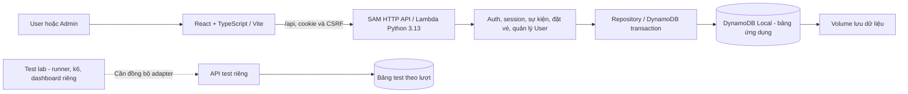

# Nhật ký công việc — 23/10/2026

## Mục tiêu

Hoàn thiện luồng đăng ký sự kiện để kiểm tra tính đúng dữ liệu khi nhiều người tranh chỗ, gửi lặp hoặc mất phản hồi. Tập trung phát triển và kiểm thử local; chuẩn bị nền tảng cho đánh giá khả năng mở rộng trên AWS.

## Các cập nhật đã thực hiện

| Hạng mục | Trước cập nhật | Kết quả sau cập nhật |
| --- | --- | --- |
| Tài khoản người tham gia | Chỉ Admin có tài khoản; khách đăng ký sự kiện bằng tên/email | Thêm đăng ký, đăng nhập, kiểm tra phiên và đăng xuất cho User; mật khẩu được băm, email duy nhất, không tự cấp quyền Admin. |
| Đặt vé và chống trùng | Ghi danh theo email trong từng sự kiện | Gắn vé với userId; mỗi User tối đa một vé/sự kiện. Mở rộng transaction giữ chỗ để kiểm tra tài khoản và ghi vé, liên kết sở hữu, idempotency cùng nhau. |
| Khôi phục yêu cầu gửi lặp | Chưa có key ổn định giữa các lần gửi HTTP | Thêm Idempotency-Key; gửi lại cùng key/nội dung nhận đúng vé đã lưu, không trừ thêm chỗ. Cùng key nhưng đổi nội dung bị từ chối. |
| Giờ mở bán | Chủ yếu mở/đóng đăng ký thủ công | Thêm salesOpenAt; backend kiểm tra giờ mở bán, trạng thái, thời điểm diễn ra và số chỗ theo giờ server. |
| Quyền xem vé | Kết quả đăng ký chưa gắn tài khoản sở hữu | Thêm Vé của tôi và kiểm tra chủ vé ở backend. Dữ liệu cũ chưa có userId được giữ nguyên, không tự gán theo email. |
| Điều hướng và phiên đăng nhập | Trang chọn khu vực, điều hướng User/Admin dễ lẫn; từng có hai phiên riêng | Chuyển sang một form đăng nhập, menu theo vai trò và một tài khoản đang dùng trong cùng browser/profile; đồng bộ đổi tài khoản/đăng xuất giữa các tab. |
| Giao diện ứng dụng | Chưa có khung điều hướng thống nhất | Thêm sidebar trái, navbar, vị trí trang hiện tại và đăng xuất. Sidebar cả hai vai trò thu gọn được, có nhãn hướng dẫn bằng chuột/bàn phím, nhớ lựa chọn; điện thoại dùng menu đầy đủ. |
| Xóa sự kiện | Chặn xóa khi có chỗ đã dùng | Cho Admin xóa cả sự kiện có người; dọn vé, ghi danh và idempotency của sự kiện, giữ tài khoản và dữ liệu sự kiện khác. |
| Quản lý User | Chưa có trang quản lý | Thêm danh sách hiện tên/email, tìm theo tên/email, sửa thông tin và xóa User. Sửa email có kiểm tra trùng và version để tránh ghi đè; vé cũ giữ thông tin lúc đăng ký. |
| Xóa User | Chưa hỗ trợ | Khóa truy cập trước, hủy vé và trả chỗ cho sự kiện còn hoạt động; gửi lại thao tác không trả chỗ hai lần, không ảnh hưởng người khác. |
| Tổ chức mã nguồn và bàn giao | Ứng dụng và bộ kiểm thử ở nhiều nhánh riêng | Chuẩn hóa API contract/data model, hợp nhất các nhánh vào phuc, giữ main và xóa nhánh feature đã gộp. Bộ test lab của bên kiểm thử được giữ nguyên, chưa tự đổi adapter. |

Đã sửa các lỗi tìm thấy khi kiểm tra: vé còn sót sau khi xóa sự kiện bị gián đoạn; vùng bấm icon sai khi ghép tooltip với menu; thông báo lỗi xóa bị mất sau tải lại; form sửa tài khoản giữ version cũ. Các trường hợp này đã được kiểm tra lại.

## Kiến trúc hiện tại

Frontend hiển thị và gọi API; service xử lý nghiệp vụ; repository chịu trách nhiệm đọc/ghi database. Transaction đặt vé gồm **4 thao tác ghi và 1 kiểm tra tài khoản đang hoạt động**, để giảm chỗ và lưu dữ liệu cùng thành công hoặc cùng thất bại.

Cookie HttpOnly `event_session` dùng chung cho hai vai trò; thao tác ghi kiểm tra Origin/CSRF. Quyền do backend quyết định. Xóa sự kiện hoặc User được khóa trước và dọn theo lô; chưa xong trả 202 để tiếp tục. Hủy vé và hoàn chỗ cùng transaction nên retry không hoàn lần hai.

Ứng dụng dùng web5173/API3001 và bảng `fcaj-event-workshop-local`. Kiểm thử dùng API3002 và bảng có prefix `fcaj-event-workshop-local-test-`; không dùng dữ liệu thử để ghi đè bảng ứng dụng. Chi tiết schema/API nằm trong [contract](../../docs/api-contract.md), [data model](../../docs/data-model.md) và [security](../../docs/security.md).

## Kết quả kiểm tra

| Phạm vi | Kết quả đã ghi nhận trong ngày |
| --- | --- |
| Backend với DynamoDB Local | 75/75 bài đạt, gồm 63 bài không cần DB và 12 integration. Có tranh chỗ cuối, chống trùng, replay, quyền xem vé, xóa đồng thời và tiếp tục sau gián đoạn. |
| HTTP và trình duyệt | Luồng tài khoản, đặt/xem vé, quản lý sự kiện/User và sidebar đạt. Đã thử mất phản hồi sau khi lưu để xác nhận không tạo thêm vé; kiểm tra giao diện ở 320/375/414/768/1280px. |
| Build và cấu hình | SAM build/validate, frontend build/lint đạt; còn hai cảnh báo Fast Refresh có sẵn. |
| Sau hợp nhất Git | 63 bài backend và 28 bài unit test lab đạt; build/lint cả web sản phẩm và dashboard đạt. 12 bài DB được bỏ qua ở lượt này vì Docker đã tắt, không phải chạy lại toàn bộ 75 bài. |

Các bài ghi/xóa dùng bảng test riêng. Bài tranh chỗ đã kiểm tra ở quy mô 8 người/1 chỗ; **chưa phải kết quả 100 người hoặc bằng chứng scaling AWS**. Unit/build của test lab chỉ xác nhận phần công cụ được kiểm tra, không thay bài tích hợp với ứng dụng hiện hành.

## Trạng thái bàn giao và việc tiếp theo

- Code và tài liệu hiện nằm trên nhánh **phuc**, tại thư mục gốc dự án; API contract **4.1**. Main giữ nguyên. Mốc hợp nhất và cách phối hợp Git ở [git-workflow.md](../../docs/git-workflow.md).
- Web, API và Docker Desktop đã dừng sau khi dùng xong. Đã dọn container/image/cache tạm, giữ volume DynamoDB và kiểm tra dữ liệu không thay đổi. Phiên sau cần khởi động lại theo [Backend README](../../backend/README.md) và [Frontend README](../../frontend/README.md).
- Test lab vẫn ghim contract3.0 và cookie cũ, còn ứng dụng dùng4.1/cookie chung; cần đồng bộ adapter trước bài mua vé tích hợp. Bắt đầu 1–2 User, sau đó mới chạy 100 người/200 chỗ,100/10,100/1 và các bài tải tăng–giảm, đột biến, duy trì, phục hồi.
- Chưa triển khai AWS hoặc đo autoscaling. Danh sách tài khoản và dọn dữ liệu hiện còn dùng Scan; cần đánh giá chỉ mục/chi phí khi chuẩn bị lên AWS. Chưa có Organizer đa đơn vị, OTP/xác minh email, khôi phục mật khẩu hoặc thanh toán.

## Nguồn đối chiếu

- Các commit triển khai: [tài khoản và đặt vé](https://github.com/leanhquan0211/FCAJ-23521254-23521225/commit/1688c9809ec27eed1a03a01cde262b6afce0f8c3), [phiên chung và xóa ghi danh](https://github.com/leanhquan0211/FCAJ-23521254-23521225/commit/a10907f0287acd7c664b3902b55968565e66042b), [quản lý User và sidebar](https://github.com/leanhquan0211/FCAJ-23521254-23521225/commit/9d47cff71a8f75e9c42845700d497cf029a56b16).
- Mã xử lý: [booking.py](../../backend/lambda/booking.py), [session.py](../../backend/lambda/session.py), [event_deletion.py](../../backend/lambda/event_deletion.py), [account_repository.py](../../backend/lambda/account_repository.py), [AppShell.tsx](../../frontend/src/components/AppShell.tsx), [AdminAccountsPage.tsx](../../frontend/src/pages/admin/AdminAccountsPage.tsx).
- Bằng chứng hồi quy: [tests backend](../../tests/backend/test_unified_integration.py), [HTTP account](../../backend/tools/check_accounts_api.py), [browser account](../../tests/frontend/check-accounts-browser.mjs), cùng đầu ra kiểm tra đã chạy trong phiên phát triển. Lượt chỉnh nhật ký này không chạy lại các bài chức năng.
