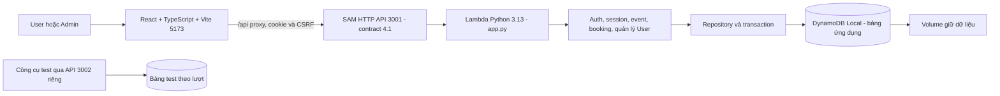
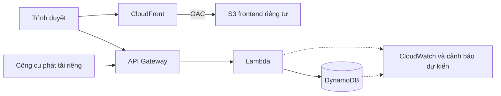

# Nhật ký 23/10 — tổng kết toàn phiên tuần 4

Ngày **23/10/2026**, giờ Việt Nam. Tổng hợp theo yêu cầu kết phiên của Phúc, bao gồm cả khởi động, thảo luận kiểm thử, nhận biên bản, triển khai và các lần điều chỉnh sau đó. **Toàn bộ công việc ứng dụng trong phiên thuộc Phúc**, kể cả từ lúc nhận yêu cầu bên ngoài. Bên đồng hành phụ trách bộ kiểm thử riêng; tên thư mục không xác định tác giả công việc.

## 1. Cửa sổ mới đọc phần này trước

- **Mục tiêu:** website sự kiện là bài toán để chứng minh tính đúng dữ liệu, chống gửi lặp, xử lý tranh chỗ và tải tăng. “Mua vé” hiện là đặt chỗ/cấp mã, chưa thanh toán.
- **Bản code cuối:** API **4.1**, nhánh `feat/admin-accounts-sidebar`, commit **`9d47cff71a8f75e9c42845700d497cf029a56b16`**, đã push và đối chiếu GitHub. Tài liệu kết phiên được bổ sung sau mốc code, không thay chức năng.
- **Đã có:** User/Admin, đăng nhập chung, lịch mở bán, transaction/idempotency, Vé của tôi, sidebar/navbar, xóa event kèm ghi danh, quản lý User và thu gọn sidebar.
- **Đã kiểm tra:** 75/75 backend đạt, HTTP/browser smoke đạt; frontend build/lint và SAM build/validate đạt. Lint còn hai cảnh báo Fast Refresh cũ. Đây là kết quả công cụ local, chưa phải Phúc xác nhận dùng thử xong UI cuối.
- **Chưa có bằng chứng:** tích hợp bộ k6/runner/dashboard của bên test, các bài 100 người, AWS autoscaling. Chưa triển khai AWS, Organizer đa đơn vị, OTP/xác minh email/khôi phục mật khẩu hoặc thanh toán.
- **Nơi làm việc:** repo gốc vẫn `phuc@f4e20b9`; code mới ở `D:\aws-workshop\event-registration\.worktrees\buyer-flow`, nhánh `feat/admin-accounts-sidebar`. Main chưa nhận tính năng mới.

Đọc [phong cách làm việc](../phong-cach.md): giải thích dễ hiểu, mô tả logic và chờ duyệt trước ý tưởng code mới; hướng dẫn theo giai đoạn rồi kiểm tra. Các plan cũ đã duyệt được hoàn tất, không phải quyền tự triển khai mọi ý tưởng tương lai. Phúc từng yêu cầu ngừng tự ghi nhật ký; yêu cầu kết phiên này cho phép tổng hợp, **không bật lại tự ghi cho mọi lượt sau**.

Thứ tự khi cần đọc sâu: [lịch sử đầu phiên](23-10-dau-phien.md) → [lịch sử triển khai ứng dụng](23-10-ung-dung.md). Trạng thái “chưa làm” trong bản lưu chỉ đúng tại thời điểm viết; dùng nhật ký này và [contract](../../docs/api-contract.md) cho hiện tại.

## 2. Diễn biến theo thời gian của toàn phiên

| Giai đoạn | Yêu cầu, công việc và kết quả |
| --- | --- |
| Tiếp nhận tuần 4 | Đọc worklog tuần 3, đối chiếu thứ tự nâng cấp admin rồi dọn tám sự kiện mẫu; tạo tuần 4 và văn hóa làm việc. Việc cũ chỉ là nền, không tính thành tính năng mới tuần này. Init mặc định đã là chỉ tạo bảng, không seed. |
| Bật local cùng Phúc | Docker có trên máy nhưng thiếu PATH ở terminal trợ lý; Phúc mở Docker và gửi DynamoDB Up. Lỗi dán hai phép gán PowerShell cùng dòng được sửa. Phúc yêu cầu chuyển từ một lệnh/một lượt sang nhóm thao tác theo giai đoạn và kiểm tra chung. |
| Lỗi build và xác nhận web | Phúc gửi lỗi resolve `boto3==1.43.114`; đã xác minh phiên bản, giữ pin và build chẩn đoán thành công. Phúc gửi health ready/events và nói “web chạy ổn áp”. Đây là xác nhận cho bản đầu ngày, không tự gán cho mọi nâng cấp sau. |
| Tài khoản/phân quyền | Phúc nêu hướng nhiều đơn vị độc lập; đã phân tích Guest/User/Organizer/Admin. Sau khi làm rõ trọng tâm là kiểm thử hệ thống, phương án được duyệt để làm trước là User/Admin tối giản. Chưa có quyền Organizer theo đơn vị; organizer hiện vẫn là tên hiển thị. |
| 100 request và trình diễn | Đã giải thích tự động tạo tài khoản/phiên và gửi gần đồng thời, không cần tạo 100 account thủ công hoặc mở 100 trình duyệt. Thảo luận 100 ô, bộ đếm, biểu đồ và đối chiếu DB lấy từ lượt chạy thật. Chưa coi đây là bộ demo đã xây hoặc bài tải đạt. |
| Scaling và AWS | Đã phân biệt SAM/DynamoDB Local với AWS thật; đề xuất tăng–giữ–giảm tải, quan sát tải thực, concurrency, latency/lỗi và DB cùng thời gian. Không giả số máy, không thêm sleep để biểu đồ đẹp. Chưa deploy hoặc đo AWS. |
| Biên bản bên đồng hành | Lưu [nguyên văn yêu cầu](../../quan-worklog/yeu-cau.md), rà repository và soạn contract/data model/cách chia file, Git, cổng và mốc bàn giao. Phúc duyệt toàn plan và cho tự hoàn tất; tạo worktree riêng để không ghi đè thư mục gốc. |
| Người mua — API 3.0 | Thêm register/login/session/logout User, lịch mở bán, một vé/User/event, owner-only, Vé của tôi, key chống gửi lặp và UI. Giữ legacy, không tự nhận theo email. Unit/integration/HTTP/browser đạt; bàn giao `feat/buyer-flow@a6ba0f2`. |
| Yêu cầu báo cáo tích hợp | Đã rà trạng thái ứng dụng/Git/contract/bằng chứng để bên test lấy đúng bản. Bên test khi đó báo công cụ còn local/chưa push; không coi unit test của lab là kết quả 100 người mua. Thông tin remote mới ở mục 7 thay thế tình trạng chưa push cũ. |
| Tách User/Admin | Phúc thấy vai trò dồn chung khó dùng và duyệt tách điều hướng. Làm trên `feat/role-navigation`, giữ mốc API 3 cũ và kiểm tra UI/responsive. |
| Đăng nhập chung — API 4.0 | Phúc yêu cầu bỏ bảng chọn khu vực, hiện login có liên kết tạo account, sidebar trái/navbar/logout và một tài khoản trong cùng browser/profile. Đã thay hai cookie bằng cookie chung, backend xác định role, các tab đồng bộ đổi account/logout. |
| Xóa sự kiện có người | Phúc chốt chỉ gạch ghi danh/vé của event, không xóa account. Admin xóa mọi event; khóa trước, dọn vé/reference/idempotency, giữ account/event khác. 202 cho phép tiếp tục dọn sau gián đoạn. Kiểm tra local và bàn giao `feat/unified-account@9341aef`. |
| Quản lý User — API 4.1 | Phúc chốt tìm tên/email, hiện cả tên/email, sửa và xóa User; xóa thì khóa truy cập, hủy vé và trả chỗ. Đã làm, kiểm tra, push `9d47cff`. Sidebar cả hai role thu gọn, tooltip/focus, nhớ lựa chọn; mobile vẫn đầy đủ chữ. |
| Lỗi được tìm và sửa | Dọn Ticket sót khi xóa event mất reference trước; retry xóa không trả chỗ hai lần. Sửa tooltip làm mất class/vùng bấm icon; kiểm tra target 44px. Sửa thông báo lỗi xóa bị mất sau reload và form giữ version cũ. Kiểm tra lại đạt. |
| Đính chính và kết phiên | Chuyển bản ghi ứng dụng đặt nhầm quan-worklog về Phúc, giữ đường dẫn chuyển tiếp. Theo yêu cầu mới, tổng hợp toàn phiên, phân biệt lịch sử với hiện hành và chuẩn hóa tài liệu phối hợp. |

Chi tiết đầu buổi/lỗi/nguồn ở [bản lưu đầu phiên](23-10-dau-phien.md); lịch sử v3/tách UI/v4 ở [ứng dụng, mục 8–15](23-10-ung-dung.md); đợt cuối 4.1 ở mục 16 của file đó. Không cộng kết quả test nhiều mốc thành một lượt chạy.

## 3. Tổng quan hệ thống hiện tại

**Chưa login:** UI API mode tới `/login`, có `/signup` trong form. API GET sự kiện vẫn công khai, nhưng khung UI sản phẩm hiện yêu cầu login. Đây là quyết định sau biên bản ban đầu cho khách xem không cần account.

**User:** tạo account tên/email/password → login → xem/tìm sự kiện → đặt khi tới giờ → nhận mã → Vé của tôi. Danh tính lấy từ phiên, không tin userId/role client gửi. Một User tối đa một vé/event. Chưa thanh toán hoặc email.

**Admin:** tài khoản cấp qua CLI, dùng cùng form login → Quản lý sự kiện/Tạo sự kiện/Quản lý tài khoản. Tạo/sửa lịch/sức chứa, đóng/mở/xóa event, tìm/sửa/xóa User. Chưa có tự đăng ký hoặc quản lý tài khoản Admin trong tính năng mới.

**Một account trong cùng browser/profile:** `event_session` HttpOnly chung hai role; login khác thay phiên cũ, các tab cập nhật. Profile/browser/cookie jar khác độc lập để thử nhiều User. Sidebar 256px khi mở, 80px khi gọn; icon có nhãn/tooltip, lựa chọn boolean lưu localStorage. Token/CSRF không lưu ở đó; mobile luôn menu đầy đủ.

### Kiến trúc local đã có



DB host `http://127.0.0.1:8000`; Lambda dùng `http://fcaj-dynamodb-local:8000` trong network `fcaj-event-workshop-local`. Bảng ứng dụng `fcaj-event-workshop-local`; bảng test prefix `fcaj-event-workshop-local-test-`. Cùng một DB Local nhưng tách bảng; không suy bảng chỉ từ cổng. Volume `fcaj-event-workshop-dynamodb-data` giữ dữ liệu qua restart.

| Quy tắc | Cách làm và ý nghĩa |
| --- | --- |
| Giữ chỗ | Transaction có **4 ghi + 1 ConditionCheck**: giảm chỗ có điều kiện, kiểm profile User hoạt động, tạo reference User/event, Ticket và idempotency. Hoặc cùng commit hoặc không ghi phần nào. |
| Chống trùng | Reference User/event duy nhất; key khác cho cùng User/event trả trùng, không cấp vé thứ hai. |
| Gửi lại | `Idempotency-Key` UUID v4. Cùng User/key/nội dung trả 200 và vé đã lưu; mới trả 201; key cũ khác nội dung bị từ chối. Giữ key khi chưa rõ request trước đã commit. |
| Lịch bán/quyền | Giờ server quyết định salesOpenAt/trạng thái/chỗ/chưa diễn ra. GET vé/Vé của tôi kiểm owner userId từ phiên. Legacy chưa owner không nhận bằng email trùng. |
| Sửa User | Validation tên/email, email chuẩn hóa/duy nhất, version chặn ghi đè. Vé cũ giữ snapshot; session/lần mua mới đọc profile mới. Không sửa role/password. |
| Xóa event | Khóa trước rồi dọn ghi danh/vé/idempotency của event, giữ account và event khác. |
| Xóa User | Khóa profile chặn login/session/booking; hủy từng vé và trả một chỗ cho event còn hoạt động trong cùng transaction. Retry không trả hai lần; không tạo lại event đã mất/đang xóa; giữ dữ liệu User khác. |
| Dọn dài | DELETE có thể trả 202 và lưu trạng thái; UI có Tiếp tục xóa. Chưa hoàn tất thì account/event vẫn khóa. |

Chi tiết chính xác ở [API contract 4.1](../../docs/api-contract.md), [data model](../../docs/data-model.md), [security](../../docs/security.md). Email đúng dạng chưa chứng minh quyền sở hữu hộp thư.

## 4. Tìm đúng code để tiếp tục

| Phần | File phụ trách |
| --- | --- |
| HTTP, routes, health | [app.py](../../backend/lambda/app.py), [template.yaml](../../backend/template.yaml) |
| Account/session | [buyer_auth.py](../../backend/lambda/buyer_auth.py), [session.py](../../backend/lambda/session.py), [auth.py](../../backend/lambda/auth.py) |
| Booking/replay/vé | [booking.py](../../backend/lambda/booking.py), [repository.py](../../backend/lambda/repository.py), [buyer_repository.py](../../backend/lambda/buyer_repository.py) |
| Quản trị/xóa event | [admin_events.py](../../backend/lambda/admin_events.py), [event_deletion.py](../../backend/lambda/event_deletion.py) |
| Sửa/xóa User và trả chỗ | [admin_accounts.py](../../backend/lambda/admin_accounts.py), [account_repository.py](../../backend/lambda/account_repository.py) |
| UI/navigation | [App.tsx](../../frontend/src/App.tsx), [AppShell.tsx](../../frontend/src/components/AppShell.tsx), [SidebarHint.tsx](../../frontend/src/components/SidebarHint.tsx), [AdminAccountsPage.tsx](../../frontend/src/pages/admin/AdminAccountsPage.tsx) |
| Thiết kế và test | [DESIGN.md](../../frontend/DESIGN.md), [tests/tests.md](../../tests/tests.md), [Backend README](../../backend/README.md), [Frontend README](../../frontend/README.md) |

Giữ Almanac nền giấy/xanh thông, component hiện có, code đúng lớp; đợt cuối không thêm dependency hoặc đổi Compose/lock/requirements.

## 5. Đã kiểm tra gì, còn giới hạn gì?

Đây là kết quả trong phiên phát triển. Lượt chuẩn hóa nhật ký chỉ đọc Git/health/tài liệu, không chạy lại suite hoặc ghi dữ liệu.

| Nhóm | Bằng chứng |
| --- | --- |
| Backend cuối | **75/75 đạt**: 63 bài không cần DB, 12 integration (3 transaction + 9 session/xóa/quản lý User), bảng mới `fcaj-event-workshop-local-test-5e9300b3e585`. 74/74 là lượt trước regression vé sót, không phải số cộng thêm. Lượt cuối dùng Python host; Lambda Python 3.13 được kiểm bằng SAM build/HTTP. |
| Booking | Đã thử 8 người tranh 1 chỗ, cùng User khác key, cùng key nhận cùng vé, schedule, ownership, replay sau full/closed. **8 không phải 100**. |
| HTTP 4.1 | API đọc/người mua/quản lý User đạt. Nhóm account: quyền, Origin/CSRF, body/role/password lạ, email trùng/version cũ, snapshot vé, hủy/trả chỗ một lần, chặn session/login, giữ vé người khác. Bảng HTTP/browser cuối `fcaj-event-workshop-local-test-7550bc1c02b8`. |
| Xóa cạnh tranh/gián đoạn | Khóa chặn booking đang chạy; gián đoạn sau hoàn chỗ rồi resume không trả lần hai; hai Admin xóa User và xóa event cùng lúc; Ticket sót sau khi event mất reference trước. |
| Browser | Tìm tên/email/không dấu, sửa/email trùng, xung đột version tự reload và giữ lỗi, xác nhận/hủy/xóa, lỗi xóa còn hiển thị sau refresh, hoàn đúng chỗ, User không thấy menu Admin. |
| Sidebar/responsive | Hai role thu gọn, keyboard tooltip, vùng bấm ít nhất 44px, nhớ lựa chọn, mobile giữ chữ. Thử 320/375/414/768/1280px và mở xem ảnh desktop/sidebar/mobile. |
| Build | SAM Build Succeeded, `sam validate --lint` đạt; frontend build/lint đạt, còn hai warning Fast Refresh cũ ở ui/button.tsx và ui/badge.tsx. |
| Con người | Phúc gửi kết quả Docker/health/events, xác nhận web đầu buổi, duyệt plan/chốt nghiệp vụ xóa. Chưa xác nhận tự dùng thử toàn bộ UI quản lý User cuối. |
| Test lab/AWS | Chưa review/chạy code test lab hoặc bài tích hợp 100 người; chưa deploy/đo AWS. |

Lệnh backend có dạng `python -m unittest discover -s tests/backend -v`, với RUN_DYNAMODB_INTEGRATION=1, endpoint host 8000, bảng test mới và PYTHONPATH tới code/SDK artifact. HTTP dùng [check_api.py](../../backend/tools/check_api.py), [check_registration_api.py](../../backend/tools/check_registration_api.py), [check_accounts_api.py](../../backend/tools/check_accounts_api.py); browser dùng [check-accounts-browser.mjs](../../tests/frontend/check-accounts-browser.mjs). Credential fixture sinh trong bộ nhớ/truyền stdin, không ghi Git; ảnh Temp không phải dependency.

Đã sửa lỗi harness selector và assertion tên trùng nhiều fixture, không coi đó là lỗi nghiệp vụ. Lỗi tooltip/vùng bấm và thông báo thất bại là lỗi app đã sửa rồi kiểm tra lại.

## 6. Môi trường lúc kết phiên

Kiểm tra chỉ đọc khoảng **22:12 ngày 23/10/2026 (+07:00)**: API `3001/health` và web `5173/api/health` đều ok/ready, contract=4.1, bảng `fcaj-event-workshop-local`. Có listener 8000/3001/5173; không thấy 3002/5175/9241/5174/3100. Ứng dụng phục vụ từ worktree buyer-flow, không phải mã cũ ở repo gốc.

Helper SAM3002/Vite5175/Edge riêng đã dừng sau kiểm tra; DB/bảng test và app chính giữ lại. Lượt kết phiên không Scan/count dữ liệu cá nhân hoặc sửa bảng ứng dụng. Health không chứng minh mọi nghiệp vụ đạt. Process có thể dừng sau khi đóng terminal/máy; lần sau kiểm lại command/health, không dùng PID cũ. **Kết phiên chat không tự hiểu là tắt môi trường**; lượt này giữ ứng dụng.

## 7. Git và mốc phối hợp

Đã đối chiếu remote khi kết phiên:

| Nhánh | SHA | Ý nghĩa |
| --- | --- | --- |
| main và phuc | `f4e20b90095e2519b0dfefd212fb1a1146abbe57` | Nền trước nâng cấp ứng dụng phiên này |
| feat/buyer-flow | `a6ba0f21e41cc73cfadb3242ff9bd9d30e2f234a` | API 3.0 người mua/booking |
| feat/role-navigation | `e9e9bffbcd54ebf2238f704802b069e0a0603b91` | Tách UI, API 3.0 |
| feat/unified-account | `9341aefb69f91587c4d8f782fc66e89f023c3cee` | API 4.0, code chính a10907f, HEAD thêm docs |
| feat/admin-accounts-sidebar | `9d47cff71a8f75e9c42845700d497cf029a56b16` | Mốc code 4.1 đã push trước tổng kết |
| feat/test-lab | `9e00d5a8757f60c6516e1bdbb2b4406bb3d05cad` | **Đã có GitHub**, chưa review/tích hợp từ cửa sổ app |

HEAD nhánh ứng dụng có thể thêm commit docs sau 9d47cff; ghim 9d47cff để lấy hành vi đã kiểm tra. Các nhánh cũ giữ nguyên, chưa merge main/phuc. Thông báo bên test “chưa push” thuộc lúc trước; remote tồn tại cũng không chứng minh tương thích 4.1 hoặc đạt tải.

[Phối hợp hiện hành](../../quan-worklog/phoi-hop.md) chỉ rõ clone không ghi đè, file mỗi bên, test env/cookie/CSRF/key/audit. Bên app cung cấp contract/code; bên test đối chiếu 4.1, gửi SHA/hướng dẫn đã review và chạy tích hợp. Không tắt auth hoặc chỉnh DB để làm test qua.

## 8. Mở lại và tự dùng thử ở phiên sau

Đây là hướng dẫn, không phải lệnh đã chạy lại khi tổng kết. Lệnh lỗi thì dừng nhóm phụ thuộc.

### A. Kiểm tra trước khi bật thêm server

```powershell
Set-Location 'D:\aws-workshop\event-registration\.worktrees\buyer-flow'
git status --short
git branch --show-current
git log -1 --oneline
docker version
docker compose -f backend/compose.yaml ps
Invoke-RestMethod http://127.0.0.1:3001/health | ConvertTo-Json -Depth 5
Invoke-RestMethod http://127.0.0.1:5173/api/health | ConvertTo-Json -Depth 5
```

Nếu đúng 4.1/bảng ứng dụng thì mở web, không build/start chồng. Docker PATH đã tìm thấy ở `C:\Users\ADMIN\AppData\Local\Programs\DockerDesktop\resources\bin`; kiểm lại nếu terminal không nhận docker.

### B. Khi thực sự cần khởi động lại

Từ đúng worktree, dừng đúng SAM/container Lambda đang mount artifact trước khi build trên Windows; không dừng process/DB bên khác. Terminal backend:

```powershell
$env:SAM_CLI_TELEMETRY='0'
$env:AWS_ACCESS_KEY_ID='local'
$env:AWS_SECRET_ACCESS_KEY='local'
$env:AWS_DEFAULT_REGION='us-east-1'
$env:AWS_EC2_METADATA_DISABLED='true'
docker compose -f backend/compose.yaml up -d dynamodb
sam build --use-container --template-file backend/template.yaml
```

Chỉ khi **Build Succeeded**, chạy đúng artifact mới:

```powershell
sam local start-api --template .aws-sam/build/template.yaml --env-vars backend/env.local.example.json --docker-network fcaj-event-workshop-local --host 127.0.0.1 --port 3001 --warm-containers EAGER
```

Terminal frontend:

```powershell
npm.cmd --prefix frontend run dev -- --host 127.0.0.1 --port 5173 --strictPort
```

Sau đó kiểm hai health như A. Máy này đã có node_modules; clone mới dùng `npm.cmd --prefix frontend ci`. Bảng app đã có, không init/seed lại. Máy mới xem [Backend README](../../backend/README.md), init chỉ tạo nếu thiếu, admin tạo qua CLI. Không dùng down -v/reset hoặc sửa remainingSeats bằng tay.

Không dùng diagnostic-build cũ đầu ngày cho code mới. Nếu pip resolve lại lỗi, kiểm PyPI/network/index/log, giữ pin `boto3==1.43.114`. Trong phiên đã build offline bằng wheel đúng phiên bản, kiểm SHA-256; cache `.aws-sam/wheels` chỉ local, không được push. Host test dùng SDK artifact cần `PYTHONDONTWRITEBYTECODE=1` để cache không làm SAM watcher restart. Không build xóa artifact khi test còn dùng.

### C. Phúc kiểm thao tác thật

Mở **http://127.0.0.1:5173**, login Admin → Quản lý tài khoản → tìm tên/email, sửa, thu gọn sidebar. Muốn thử xóa thì tạo User thử riêng, ghi rõ vé/chỗ trước–sau; không chọn tài khoản đang dùng để dọn thử. Dùng browser profile khác nếu muốn User/Admin song song; hai tab cùng profile thay chung danh tính. Xóa event chỉ bỏ ghi danh event; xóa User hủy vé/trả chỗ, giữ User khác. Chỉ ghi “Phúc xác nhận đạt” sau khi có kết quả thực tế, không suy từ health 200.

## 9. Việc tiếp theo và hướng AWS

1. Phúc dùng thử UI 4.1; cửa sổ app sửa lỗi theo bằng chứng, mô tả trước ý tưởng mới.
2. Bên test đối chiếu test lab với contract 4.1, gửi SHA/lệnh, ghim app SHA/contract/table/runId; bắt đầu 1–2 User rồi mới 100/200, 100/10, 100/1.
3. Mỗi User ảo có profile hoạt động, cookie jar/CSRF riêng; tạo account/login ngoài khoảng đo. Mỗi run có event/ghế mới và audit Ticket/reference/idempotency/remainingSeats. Tách 201 mới, 200 replay, 409 nghiệp vụ, 429, 503, timeout.
4. Chưa có kết quả ramp/spike/hold/vượt ngưỡng/phục hồi hoặc SLO p95/RPS được chốt; không coi số minh họa là cam kết.
5. Giới hạn local: danh sách User/dọn session/event dùng Scan; chưa pagination API, chỉ mục đảo hay worker nền. DELETE lớn cần tiếp tục 202. Đánh giá chi phí/chỉ mục/dọn dữ liệu khi lên AWS, không tự đổi kiến trúc lúc tổng kết.
6. Các nhánh feature/test lab chưa được review/merge vào main. Kiểm status/diff và tương thích trước tích hợp, không reset/clean/switch folder người khác.

### Kiến trúc AWS dự kiến — chưa triển khai



`configuration.py` cố ý chỉ cho DB Local/credentials giả, chưa phải cấu hình deploy. Hướng S3/CloudFront/API Gateway/Lambda/DynamoDB/CloudWatch, Terraform/CI/OIDC cần đợt triển khai riêng được duyệt.

Khán giả cần thấy trước chạy: số người/chỗ/cấu hình; trong chạy: request thật, thành công/hết vé/lỗi, p95/throughput; sau chạy: DB khớp hay không. Scaling phải nhìn tải tăng–giữ–giảm cạnh concurrency/latency/throttling/DB từ AWS thật; số thực thi đồng thời không phải số môi trường giữ ấm. SAM hoặc bài tranh 1 chỗ không đủ chứng minh scaling toàn hệ thống. Dashboard/100 ô do bên test phụ trách, chưa được cửa sổ app xác minh chạy.

## 10. Nguồn và mức xác nhận

- **Quyết định con người:** toàn bộ trao đổi Phúc 23/10, lời duyệt plan/chốt nghiệp vụ/đính chính tác giả/yêu cầu kết phiên; [biên bản gốc](../../quan-worklog/yeu-cau.md). Lời duyệt không thay kết quả test.
- **Lịch sử có nguồn:** [đầu phiên](23-10-dau-phien.md), [ứng dụng](23-10-ung-dung.md), [tuần 3](../week-3/boi-canh.md). Giữ nội dung cũ có nhãn, không xóa bằng chứng.
- **Hiện hành:** [contract](../../docs/api-contract.md), [data model](../../docs/data-model.md), [security](../../docs/security.md), [Compose](../../backend/compose.yaml), code/test ở mục 4–5; lấy cùng commit.
- **Công cụ:** đầu ra test/build/HTTP/browser trong phiên phát triển; Git remote/status/worktree và hai health lúc 22:12 trong lượt tổng kết. Không phải đánh giá từ AWS.
- **Tham khảo đã dùng trong phiên:** [DynamoDB transactions](https://docs.aws.amazon.com/amazondynamodb/latest/developerguide/transaction-apis.html), [AWS idempotent APIs](https://aws.amazon.com/builders-library/making-retries-safe-with-idempotent-APIs/), [OWASP CSRF](https://cheatsheetseries.owasp.org/cheatsheets/Cross-Site_Request_Forgery_Prevention_Cheat_Sheet.html), [session](https://cheatsheetseries.owasp.org/cheatsheets/Session_Management_Cheat_Sheet.html), [Lambda concurrency](https://docs.aws.amazon.com/lambda/latest/dg/lambda-concurrency.html), [metrics](https://docs.aws.amazon.com/lambda/latest/dg/monitoring-metrics-types.html). Đây là nguồn đã ghi nhận ở trao đổi trước, không khẳng định vừa đọc lại khi tổng kết. Danh mục Eventbrite/pretix/Locust/PyPI giữ trong bản lưu đầu phiên.
