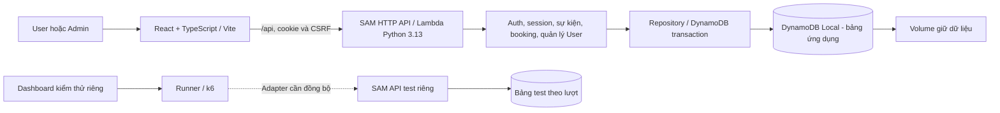

# Bối cảnh dự án

Mốc cập nhật nội dung: **13/11/2026**, thống nhất nhật ký ứng dụng, hạ tầng và kiểm thử tại **project-worklog/**; giữ các công việc ngày **04/11/2026 — Tuần 6 (02–08/11)** theo đúng ngày thực hiện. File này mô tả hệ thống hiện hành và phần còn lại; công việc theo ngày xem [WORKLOG.md](WORKLOG.md), quy tắc cộng tác xem [AI_RULE.md](AI_RULE.md), nơi đọc/cập nhật xem [README](README.md).

## 1. Mục tiêu và phạm vi

Website đăng ký sự kiện có giới hạn số chỗ, dùng để kiểm chứng tính đúng dữ liệu, chống gửi lặp, tranh chỗ và tải tăng. “Mua vé” hiện là đặt chỗ và nhận mã xác nhận, chưa thanh toán. Phát triển/kiểm thử local trước, sau đó dự kiến triển khai AWS để trình diễn hệ thống serverless trong doanh nghiệp.

Nền đã có trước đợt quản trị 16/10: prototype React, API đọc/đăng ký, DynamoDB transaction và tích hợp frontend/backend. Không tự tính lại phần nền thành công việc mới của các ngày sau. Phạm vi triển khai hiện gồm **User và Admin**, chưa có Organizer đa đơn vị, OTP/xác minh email, khôi phục mật khẩu, gửi email hoặc thanh toán.

## 2. Luồng sử dụng hiện tại

- Chưa đăng nhập: giao diện API mode tới `/login`, có liên kết `/signup`. API đọc sự kiện vẫn công khai, nhưng khung UI sản phẩm hiện yêu cầu đăng nhập.
- User: tạo tài khoản bằng tên/email/mật khẩu → đăng nhập → xem/tìm sự kiện → đặt vé → nhận mã → Vé của tôi. Danh tính lấy từ phiên, mỗi User tối đa một vé/sự kiện; chỉ chủ vé được xem.
- Admin: tài khoản cấp qua CLI, dùng cùng form login; quản lý sự kiện và User. Được xóa sự kiện có người, tìm/sửa/xóa User; không có tự đăng ký hoặc giao diện quản lý tài khoản Admin.
- Cùng browser/profile chỉ có một tài khoản đang dùng; đổi tài khoản/đăng xuất cập nhật các tab. Browser/profile và cookie jar khác độc lập. Sidebar/navbar theo vai trò; theo thiết kế hiện hành, desktop luôn hiện nhãn, mobile dùng drawer, có sáng/tối.

`VITE_DATA_MODE=api`, `VITE_API_BASE_URL=/api` dùng backend thật; API lỗi phải hiển thị lỗi, không tự chuyển mock. Chế độ mock chỉ dùng phát triển UI, không là bằng chứng dữ liệu hoặc hiệu năng.

## 3. Kiến trúc local

Frontend hiển thị/gọi HTTP; handler nhận request và trả response; service xử lý nghiệp vụ; repository đọc/ghi DB. Bộ kiểm thử tải tách khỏi UI sản phẩm; đã hợp nhất mã nguồn nhưng chưa đồng bộ adapter với contract hiện tại.

| Thành phần | Địa chỉ / cấu hình |
| --- | --- |
| Web sản phẩm / API | 127.0.0.1:5173, proxy /api tới SAM3001 |
| SAM test / web thử browser | 3002 / 5175; dùng env test riêng |
| Runner / dashboard test | 3100 / 5174 theo cấu hình lab, không phải thành phần UI sản phẩm |
| DB từ host / Lambda | http://127.0.0.1:8000 / http://fcaj-dynamodb-local:8000 |
| Docker network | fcaj-event-workshop-local |
| Bảng ứng dụng | fcaj-event-workshop-local |
| Bảng kiểm thử | Prefix fcaj-event-workshop-local-test-, mới theo lượt |
| Volume DB | fcaj-event-workshop-dynamodb-data |

## 4. Quy tắc dữ liệu và bảo vệ

- Mật khẩu băm bằng scrypt với salt riêng. Cookie HttpOnly `event_session` dùng chung hai role; server lưu hash token và kiểm phiên/quyền. Ghi sau login cần Origin hợp lệ và X-CSRF-Token; không lấy role/userId client gửi để cấp quyền.
- Booking dùng transaction **4 thao tác ghi + 1 ConditionCheck**: giảm chỗ có điều kiện, kiểm profile User hoạt động, tạo liên kết User/event, Ticket và idempotency. Thành công cùng nhau hoặc không ghi phần nào.
- Idempotency-Key là UUID v4: cùng User/key/nội dung trả 200 và vé đã lưu, tạo mới trả 201; key cũ khác nội dung bị từ chối. Không đổi key khi chưa rõ request trước đã lưu hay chưa.
- Backend dùng giờ server để kiểm salesOpenAt, trạng thái mở, số chỗ và thời điểm diễn ra. Dữ liệu legacy thiếu userId được giữ, không tự gán owner theo email trùng.
- Sửa User kiểm email duy nhất và version; vé cũ giữ thông tin lúc đăng ký. Xóa User khóa truy cập trước, hủy vé và trả chỗ một lần cho event còn hoạt động, giữ dữ liệu người khác.
- Xóa event chỉ dọn vé/ghi danh/idempotency của event, giữ tài khoản và event khác. DELETE User/event dọn theo lô, có thể trả 202 để tiếp tục; không mở khóa hoặc coi là hoàn tất khi chưa xong.
- Init mặc định chỉ tạo bảng nếu thiếu. Demo có ghế giả đã dùng nhưng không có vé tương ứng; không dùng số đó làm số người thật. Không seed đè, reset remainingSeats, xóa volume hoặc ghi test vào bảng ứng dụng.

Nguồn chi tiết: [API contract 4.1](../docs/api-contract.md), [data model](../docs/data-model.md), [security](../docs/security.md). Các file này là chuẩn để sửa code/viết assertion, không sao chép schema dài vào nhật ký.

## 5. Nơi tìm mã nguồn và hướng dẫn

| Phần | File chính |
| --- | --- |
| HTTP và cấu hình SAM | [app.py](../backend/lambda/app.py), [template.yaml](../backend/template.yaml) |
| Account/session | [buyer_auth.py](../backend/lambda/buyer_auth.py), [session.py](../backend/lambda/session.py), [auth.py](../backend/lambda/auth.py) |
| Booking và truy cập DB | [booking.py](../backend/lambda/booking.py), [repository.py](../backend/lambda/repository.py), [buyer_repository.py](../backend/lambda/buyer_repository.py) |
| Quản trị/xóa | [admin_events.py](../backend/lambda/admin_events.py), [event_deletion.py](../backend/lambda/event_deletion.py), [admin_accounts.py](../backend/lambda/admin_accounts.py), [account_repository.py](../backend/lambda/account_repository.py) |
| UI | [App.tsx](../frontend/src/App.tsx), [AppShell.tsx](../frontend/src/components/AppShell.tsx), [AdminAccountsPage.tsx](../frontend/src/pages/admin/AdminAccountsPage.tsx) |
| Kiểm thử | tests/backend, tests/frontend, backend/tools/check_*; tests/load, tests/runner, tests/dashboard thuộc lab riêng |
| Hạ tầng AWS | [Terraform](../infra/providers.tf), [CloudFront/OAC](../infra/cloudfront.tf), [S3](../infra/s3.tf), [HTTP API](../infra/api_gateway.tf), [Lambda/IAM/log](../infra/lambda.tf), [DynamoDB](../infra/dynamodb.tf), [outputs](../infra/outputs.tf) và [kiểm kê sau thu hồi](../infra/verify_cleanup.ps1) |

Khởi động và lệnh kiểm tra xem [Backend README](../backend/README.md), [Frontend README](../frontend/README.md), [Runner README](../tests/runner/README.md). Thiết kế hiện hành **Sakura Night**, kính mờ/cánh hoa, có sáng/tối theo [DESIGN.md](../frontend/DESIGN.md). Cập nhật frontend đã được tích hợp ngày 04/11: điều chỉnh màu/bo góc và lưu tùy chọn; mặc định theme sáng, giữ giá trị đã lưu. Nguồn đọc/áp dụng cấu hình chung ở [appearance-preferences.ts](../frontend/src/lib/appearance-preferences.ts), khôi phục trước render.

## 6. Trạng thái và phần còn lại

- Làm việc trên nhánh **phuc** tại `D:\aws-workshop\event-registration`. Mã ứng dụng, Terraform và tài liệu đã được tích hợp trên main/phuc; mốc đối chiếu khi thống nhất nhật ký ngày **13/11/2026** là **a01d9b8**. Quy trình Git xem [git-workflow.md](../docs/git-workflow.md).
- **Ngày 04/11/2026:** đã tạo IAM chuyên dụng, bổ sung Terraform và cấu hình ứng dụng cho AWS, triển khai thử rồi dùng Terraform thu hồi toàn bộ tài nguyên đã triển khai trong lượt thử cùng ngày. Kết quả triển khai/thu hồi được xác nhận bổ sung ngày **11/11**; phạm vi kết quả là môi trường của lượt thử đó.
- Frontend sau tích hợp ngày **04/11** build thành công, lint exit 0 với hai cảnh báo Fast Refresh tại badge/button. Chưa kiểm thử lại tương tác giao diện mới bằng trình duyệt trong lượt tích hợp này.
- Kiểm tra local ngày **11/11**: 63 bài backend không DB đạt, 12 bài integration bỏ qua theo chế độ opt-in; Terraform fmt/validate đạt. Các kết quả này tách biệt với lượt triển khai AWS ngày 04/11.
- Kết quả đầy đủ với DynamoDB Local, HTTP/browser/SAM ngày **23/10** giữ đúng mốc lịch sử trong [WORKLOG](WORKLOG.md). Dữ liệu/bảng/volume local được giữ; không suy tình trạng process hiện tại từ kết quả cũ.
- Bộ kiểm thử tải còn ghim health 3.0/cookie event_user_session, trong khi ứng dụng dùng contract 4.1/event_session; runner chỉ nhận HTTP loopback, fixture/audit phụ thuộc DB Local. Cần đồng bộ adapter và hỗ trợ AWS trước bài tải; giữ guard và bảng test riêng.
- Bộ kiểm thử đã có hai lượt đặt vé nhỏ trên API 3.0 ngày **23/10** với audit khớp; [minh chứng](references/test-lab-local.md) giữ runId và số đo. Đây là dữ liệu lịch sử, chưa phải kết quả chạy lại API 4.1. Điều kiện tích hợp hiện hành ở mục 8.
- **Điểm tiếp tục:** hoàn thiện kiểm thử chức năng AWS và bằng chứng kết quả, rà cấu hình triển khai, sau đó triển khai giám sát và kiểm thử tải theo kế hoạch. Chưa có kết quả 100 người hoặc số đo scaling AWS; Scan trong danh sách User/dọn dữ liệu còn là giới hạn cần đánh giá.

## 7. Kế hoạch AWS và trạng thái triển khai thử

Kế hoạch được chốt ngày **30/10/2026** tại [aws-deployment-plan.md](../docs/aws-deployment-plan.md). Trạng thái dưới đây đã cập nhật theo công việc **04/11** và xác nhận ngày **11/11**; các mô tả chuẩn bị trong tài liệu kế hoạch/setup được đọc theo mốc lịch sử của chúng.

- **Nhiệm vụ 1:** triển khai ứng dụng React User/Admin trên S3 riêng tư + CloudFront/OAC; cùng hostname HTTPS chuyển `/api` tới HTTP API payload v2, Lambda Python 3.13 và DynamoDB PK/SK On-demand. Đã có mã Terraform và hoàn thành vòng triển khai thử/thu hồi; kết quả nghiệm thu chi tiết từng luồng User/Admin/booking cần được ghi nhận thêm.
- **Nhiệm vụ 2:** CloudWatch dashboard, metric/alarm và SNS email, kiểm chứng bằng request/cảnh báo thật. Terraform hiện có log Lambda cơ bản giữ 7 ngày; chưa có bằng chứng hoàn tất phần giám sát đầy đủ.

**Ứng dụng và hạ tầng đã có:** Terraform quản lý các thành phần AWS, IAM role/policy, log và xử lý đường dẫn CloudFront. Backend có chế độ AWS khi APP_ENV=aws hoặc chạy trong Lambda, dùng cơ chế credential chuẩn của SDK khi không chỉ định endpoint local; chế độ local giữ kiểm tra endpoint/bảng và credential giả. Origin/CORS, công cụ tạo Admin và script kiểm kê sau thu hồi đã được bổ sung. Các đường dẫn mã nguồn ở mục 5; nội dung công việc và nguồn hướng dẫn AWS/HashiCorp ở mục ngày 04/11 trong WORKLOG.

**Cách triển khai:** Terraform quản lý tạo/cấu hình/thu hồi hạ tầng và state local trên máy triển khai; SAM dùng build/local. GitHub Actions/OIDC là hướng tự động hóa về sau. CloudFront phân phối frontend, trình duyệt chạy React. Giữ dữ liệu local, state và tài nguyên ngoài phạm vi dự án khi triển khai thử.

**Tài khoản và xác thực — mốc setup 30/10:** tài khoản cá nhân Paid, credit 40 USD/hạn khoảng 05/2027 theo thông tin được cung cấp tại thời điểm đó; chưa đọc lại số dư. IAM user fcaj-project, profile fcaj-project-login và cầu nối fcaj-project dùng credential_process/credential tạm thời, STS đã được xác nhận khi setup. IAM chuyên dụng cho hoạt động triển khai được tạo thêm ngày 04/11. Không lưu Account ID/ARN đầy đủ, credential hoặc thông tin đăng nhập trong Git.

**Budget:** 10 USD/tháng; ngưỡng actual 30/50/80% (= 3/5/8 USD), forecast 100%; loại Credit/Refund để theo dõi chi phí trước bù trừ. Cấu hình ngưỡng/filter, việc lưu và email nhận cảnh báo đã có xác nhận ở mốc setup; chưa thử giao email. Budget có độ trễ và không tự chặn mọi chi phí.

**Công cụ — mốc setup 30/10:** AWS CLI 2.39.2, Terraform 1.17.1, Node 24.14.0, npm 11.9.0, SAM 1.167.0, Docker Linux 29.4.3, Compose 5.1.4; frontend build và SAM Python 3.13/x86_64 container build đã thành công. Lệnh và kết quả theo mốc nằm trong [aws-environment-setup.md](../docs/aws-environment-setup.md).

**Các điểm kỹ thuật còn lại:** rà Origin/CORS đang cho phép wildcard theo mục tiêu giới hạn Origin trong kế hoạch, đóng gói dependency Lambda và cấu hình IAM cho lần triển khai tiếp theo. Npm audit ở mốc kiểm tra trước có 4 mục (1 low, 3 high) qua shadcn/registry/zod/deepmerge, chưa có bằng chứng xử lý; không tự dùng audit fix --force. Đồng bộ bộ kiểm thử tải trước khi chạy AWS và ghi số đo thực tế cho chi phí/scaling.

Phạm vi kế hoạch đã chốt không cần xin duyệt lại; chỉ triển khai trong phạm vi được yêu cầu. Dự kiến kết thúc sử dụng AWS cho dự án sau **12/2026**; quản lý cả log/tài nguyên phụ và giữ dữ liệu cần thiết khi thu hồi, không tự đóng tài khoản hoặc xóa tài nguyên ngoài dự án. Chi phí đã sử dụng vẫn được tính, billing có độ trễ.

## 8. Kiểm thử và điều kiện tích hợp

Tổng hợp ngày **13/11/2026** từ bối cảnh kiểm thử trước đây và đối chiếu mã hiện tại. API/schema chuẩn vẫn là [contract 4.1](../docs/api-contract.md), [data model](../docs/data-model.md) và [security](../docs/security.md); cách chạy giữ ở [Runner README](../tests/runner/README.md), không dùng bản nháp API hoặc lệnh checkout nhánh đã xóa làm hướng dẫn hiện hành.

| Nội dung | Trạng thái và yêu cầu hiện hành |
| --- | --- |
| Thành phần | Dashboard 5174 gọi runner loopback 3100; runner điều phối fixture/k6/audit tới SAM test 3002 và bảng test riêng. Không trộn dashboard vào UI User/Admin hoặc để trình duyệt chạy shell. |
| Contract còn lệch | Adapter ghim app a6ba0f2/API 3.0, cookie event_user_session và login email/password. Ứng dụng hiện là API 4.1, cookie event_session, login identifier/password và session có role. Fixtures/audit cần đối chiếu cả profile User hoạt động, Ticket/reference/idempotency; không chỉ đổi số version để vượt preflight. |
| Phiên và danh tính | Chuẩn bị User/login ngoài khoảng đo; mỗi User có cookie jar, CSRF và key riêng. Tạo tài khoản qua API/factory được hỗ trợ, giữ Origin/CSRF/rate limit; không tạo session giả, lấy role từ client hoặc giả source IP để qua guard. |
| Dữ liệu | Chỉ ghi bảng prefix fcaj-event-workshop-local-test- và kiểm tra health đúng bảng trước fixture. Audit chỉ đọc, gắn Ticket/reference/idempotency với đúng run/event/User; không gán owner legacy theo email hoặc dùng ghế mẫu không có vé làm số người thật. |
| Giới hạn công cụ | Cấu hình hiện giới hạn 1–100 User, tối đa 5.000 request đo; runner chỉ nhận HTTP loopback. Pool purchase có một ý định mua/User/event, dùng hết pool không còn là tải ghi mới; muốn đo tải ghi kéo dài phải thiết kế thêm dữ liệu. AWS cần cấu hình và adapter phù hợp trước khi dùng. |
| Phân loại kết quả | Tách vé mới 201, replay 200, hết vé và lỗi kỹ thuật/timeout; blocked là chưa đo, stopped/incomplete không phải passed. Dừng runner không bảo đảm hủy request phía server; chỉ kết luận toàn vẹn khi audit đủ điều kiện. |
| Dữ liệu kết quả | Report/raw metric trong tests/results được Git bỏ qua; dashboard đọc qua runner. Không lưu password/cookie/CSRF trong report. Cleanup chỉ xóa dữ liệu do đúng manifest sở hữu, không áp dụng vào bảng test chuẩn bị thủ công hoặc bảng ứng dụng. |

Các lượt tiếp theo thực hiện theo giai đoạn:

1. Đồng bộ adapter với contract hiện hành, kiểm tra cấu hình và fixture trên môi trường test riêng; ghi app commit, contract, bảng, runId và giới hạn của lượt chạy.
2. Thử 1–2 User trước: tạo/login, kiểm phiên, đặt vé, replay/duplicate, owner/cross-account và audit số chỗ/vé. Xử lý lỗi trước khi tăng tải.
3. Sau đó mới chạy 100/200, 100/10, 100/1 hoặc ramp/spike/hold/overload/recovery theo phạm vi đã chốt. Kỳ vọng số vé không vượt chỗ là tiêu chí kiểm thử, không phải kết quả đã đạt; kết quả local không chứng minh scaling AWS.
