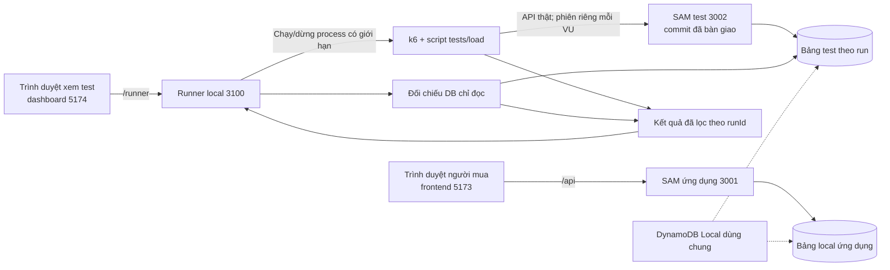

# Phối hợp song song giữa ứng dụng và kiểm thử

Ngày rà soát: **23/10/2026**. **Đây là phương án đề xuất để hai bên thống nhất; chưa tạo nhánh/worktree hay chuyển quyền sở hữu file trong Git.** Nguồn yêu cầu: [biên bản](yeu-cau.md). Bên ứng dụng được giao cho cửa sổ nhận biên bản này; tên người chịu trách nhiệm ngoài đời cần hai bạn tự xác nhận, không suy từ tên thư mục.

## 1. Hiện trạng Git đã đọc

- CWD: `D:\aws-workshop\event-registration`, nhánh `phuc`, HEAD `c13f4a985a02960eaedd06ac9ccfba186de59220`.
- Local có `main`, `phuc`; remote-tracking có `origin/main`, `origin/phuc`. Chưa fetch trong lượt này, không xem đây là trạng thái remote mới nhất.
- `git worktree list --porcelain` chỉ có một working tree hiện tại. Chưa có hai thư mục làm việc độc lập.
- Working tree sạch trước khi tạo bộ tài liệu này. Các tài liệu bàn giao chưa commit không tự xuất hiện ở nhánh hoặc máy của bạn kia.

## 2. Ranh giới file đề xuất

| Phần | Bên ứng dụng/người mua | Bên kiểm thử |
| --- | --- | --- |
| Giao diện sản phẩm | `frontend/`, gồm routes/services/types/login/register/vé và điều chỉnh form admin cho giờ mở bán | Đọc; báo lỗi, không tự sửa các file này |
| Backend/nghiệp vụ | `backend/lambda/`, `backend/template.yaml`, `backend/dynamodb_setup/`, công cụ ứng dụng trong `backend/tools/` | Gọi API và gửi bằng chứng lỗi; không viết lại schema/auth trong phần test |
| Contract chính thức | **Một đầu mối là bên ứng dụng:** `docs/api-contract.md`, `docs/data-model.md`, `docs/security.md` | Góp ý bằng danh sách yêu cầu; tránh hai bên cùng sửa canonical contract |
| Test hồi quy ứng dụng | Các file hiện có `tests/backend/`, `tests/frontend/` và smoke script `backend/tools/check_*` | Đọc/tái sử dụng; nếu cần sửa báo trước để bên ứng dụng sửa hoặc thống nhất ngoại lệ |
| Kịch bản k6, dữ liệu test | Cung cấp API/định nghĩa fixture ổn định; sửa lỗi nghiệp vụ | **Đề xuất mới:** `tests/load/`, có script chuẩn bị tài khoản/sự kiện, kịch bản và kiểm tra DB |
| Runner local | Cung cấp thông tin API/env, không thêm endpoint k6 vào Lambda | **Đề xuất mới:** `tests/runner/` |
| Frontend kiểm thử riêng | Không sửa/nhúng vào `frontend/` | **Đề xuất mới:** `tests/dashboard/`, package/config/lock riêng nếu dùng npm |
| Kết quả chạy | Cung cấp requestId/log cần thiết đã bỏ secret | **Đề xuất mới:** `tests/results/`; raw data/secret không commit, báo cáo đã lọc có thể lưu theo runId |
| Nhật ký | `quan-worklog/` theo yêu cầu lần này | Tiếp tục `phuc-worklog/` hoặc khu đã thống nhất; tránh hai cửa sổ cùng ghi một nhật ký |
| File dùng chung | README gốc/backend/frontend, `.gitignore`, `tests/tests.md`, Compose, dependency/lock, CI/infra | Báo nhu cầu; một bên được chỉ định sửa từng đợt, không cùng sửa |

Các thư mục có nhãn “đề xuất mới” chưa tồn tại lúc rà soát. Tách package giúp phía test không phải thêm dependency vào `frontend/package.json` hoặc sửa lock của sản phẩm. Không tự thêm thư mục/code chỉ vì có tên trong bảng.

## 3. Nhánh và thư mục làm việc

Đề xuất nhánh ứng dụng `feat/buyer-flow`, nhánh test `feat/test-lab`, cùng xuất phát từ một commit nền đã thống nhất. Hiện `c13f4a9` là ứng viên nền local; trước khi chốt cần đối chiếu với bạn kia và remote. Bộ tài liệu mới cần được review/commit/chia sẻ riêng trước khi bên kia dùng.

Nếu hai cửa sổ chạy trên **cùng máy**, dùng hai linked worktree hoặc hai clone. Chỉ đổi nhánh trong một folder không tạo ra hai bản file riêng; cửa sổ này có thể đổi file/HEAD mà cửa sổ kia đang dùng. Git worktree cho mỗi working tree thư mục và index/HEAD riêng; Git object/refs vẫn có phần dùng chung. Tránh chạy thao tác Git chồng nhau và không checkout cùng một nhánh trong hai worktree.

Ví dụ lệnh **chỉ để review**, chưa được thực hiện, giả sử nền `c13f4a9` đã được hai bên chốt:

```powershell
git worktree add -b feat/buyer-flow ../event-registration-buyer c13f4a9
git worktree add -b feat/test-lab ../event-registration-test c13f4a9
git worktree list
```

Các thư mục đích nằm ngoài workspace hiện tại; cần thao tác trong môi trường có quyền phù hợp khi thực sự thiết lập. Không cần tạo lại nếu thư mục/nhánh đã có: kiểm tra trước. Giữ nguyên folder đang dùng ở `phuc`, không tự switch bên dưới cửa sổ khác. Nếu hai bạn dùng hai máy, mỗi người dùng clone/nhánh riêng rồi tích hợp qua Git; local branch của máy này không tự hiện trên máy kia.

Mỗi worktree có `.aws-sam/`, `.env.local`, env test và dependency riêng; file gitignore không tự được copy sang. Build backend từ đúng worktree/commit. Một bên không dùng artifact của nhánh khác mà không ghi rõ.

## 4. Cách đưa thay đổi về chung

1. Chốt contract và ranh giới file trước. Bên test có thể chuẩn bị bộ khung dựa trên contract đã review, gắn nhãn API chưa sẵn sàng.
2. Bên ứng dụng bàn giao commit nhỏ theo từng mốc, ghi API đã kiểm tra. Bên test tích hợp commit đã bàn giao vào nhánh của mình theo cách hai bạn thống nhất, rồi build lại API test đúng commit.
3. Chỉ một người thực hiện mỗi lượt merge vào nhánh tích hợp đã thống nhất; đề xuất dùng `phuc` cho đợt local này, chưa tự ghi vào đó. Chưa mặc định dùng `main` làm nơi làm dở.
4. Trước commit kiểm tra `git status`, chỉ stage các file thuộc phần mình và xem diff. Không dùng thao tác reset/clean/discard để giải quyết thay đổi của cửa sổ khác.
5. Nếu cùng phải sửa một file, thống nhất bên nào sửa trước; bên còn lại chờ commit rồi tích hợp. Không có cách chia nhánh nào bảo đảm tuyệt đối hết conflict; việc chia phạm vi làm giảm khả năng xung đột.
6. Contract thay đổi phải ghi rõ before/after, mã lỗi/trường/header bị ảnh hưởng, commit áp dụng, test cần sửa. Không âm thầm đổi API trong lúc bên test đang đo tải; mỗi run ghi app commit và phiên bản contract.

Chưa commit/push/merge hoặc gửi tin nhắn cho người khác trong lượt soạn tài liệu. Việc chia sẻ thực tế cần hai bạn thực hiện hoặc yêu cầu riêng.

## 5. Cổng, process và dữ liệu local

| Thành phần | Cổng/địa chỉ đề xuất | Trạng thái |
| --- | --- | --- |
| Frontend sản phẩm | `127.0.0.1:5173`, `/api` → SAM 3001 | Đã có cấu hình |
| SAM dùng thử ứng dụng | `127.0.0.1:3001`, bảng ứng dụng | Đã có hướng dẫn; trạng thái chạy phải kiểm tra lại |
| SAM dành cho bài test | `127.0.0.1:3002`, env/bảng test riêng | Có hướng dẫn v2; mỗi run phải xác minh health |
| Frontend test | `127.0.0.1:5174`, `/runner` → runner 3100 | Mới đề xuất |
| Runner local | `127.0.0.1:3100` | Mới đề xuất |
| DynamoDB Local | host `127.0.0.1:8000`, container `fcaj-dynamodb-local:8000` | Compose hiện có |

Có thể chia sẻ một DynamoDB Local với các bảng riêng; Compose hiện có tên network/volume/cổng cố định, không chạy hai stack y hệt từ hai worktree. Một người chịu trách nhiệm bật/dừng Compose; không dùng `down -v`. Khi test đang chạy, không sửa/xóa bảng test hoặc restart process mà không báo.

Test CLI/k6 gọi SAM 3002 trực tiếp. Gửi `Origin: http://127.0.0.1:5173` như client của ứng dụng và cookie/CSRF đúng contract; đây là yêu cầu kiểm tra Origin của backend, không phải k6 bị trình duyệt áp CORS. Không cần thêm origin 5174 vào allowlist ứng dụng chỉ để chạy k6.

Trình duyệt frontend test chỉ gọi runner qua Vite proxy `/runner`, không giữ cookie/mật khẩu của 100 người và không đọc DB trực tiếp. Runner gọi ứng dụng như HTTP client, tự duy trì session test. Không trộn proxy `/api` của sản phẩm với proxy `/runner` của test. Nếu sau này dashboard cần gọi trực tiếp API ứng dụng bằng trình duyệt, phải review lại origin/cookie/CORS riêng trước.

Không coi đổi cổng là đã tách cookie trình duyệt: cookie được giới hạn theo host/domain/path. Các cookie jar của k6 là bộ nhớ riêng với trình duyệt sản phẩm. Khi viết proxy/runner, không log hoặc dùng cookie sản phẩm vô tình đi kèm request từ browser; có thể chọn host dashboard khác với host sản phẩm để tách cookie host-only, nhưng phải chốt và kiểm tra trước. Việc chưa giữ token trong JavaScript không tự có nghĩa browser không gửi cookie trên HTTP.

## 6. Kiến trúc tối thiểu để bên test triển khai



Runner/dashboard là phần bên test, không triển khai lên Lambda trong tuần này. Runner chỉ bind loopback, khởi chạy danh sách kịch bản cho phép với tham số đã kiểm tra và timeout/trần request; không nhận chuỗi shell tùy ý từ browser. Dashboard hiển thị trạng thái, tiến độ, metric và đối chiếu từ run thật; không hiển thị secret.

Giao diện runner **đề xuất, chưa tồn tại**, để phía test tự chốt trong phạm vi mình: `POST /runs` tạo run (202 + runId), `GET /runs` xem lịch sử, `GET /runs/{runId}` xem trạng thái/kết quả, `POST /runs/{runId}/stop` yêu cầu dừng có kiểm soát. Trạng thái `preparing → running → verifying → completed`, có nhánh `stopping/stopped/failed`. Dừng không đồng nghĩa mọi request phía server bị hủy: phải chờ/đối chiếu và ghi rõ phần chưa xác định. Không đưa các route runner này vào contract API ứng dụng.

## 7. Mốc bàn giao và việc làm song song

| Mốc | Bên ứng dụng giao | Bên test làm |
| --- | --- | --- |
| M0 — thống nhất | Duyệt contract/schema, phạm vi dữ liệu cũ, bảng quyền; cập nhật canonical docs sau duyệt | Khung k6/dashboard/runner, schema báo cáo, tham số và test case theo contract; chưa tuyên bố API mới chạy |
| M1 — tài khoản | Register/login/session/logout, kiểm tra mật khẩu/unique email/CSRF/role; ghi commit và bằng chứng | Chuẩn bị tự động 100 tài khoản/phiên; kiểm tra policy login và phân phối session cho VU |
| M2 — vé | Giờ mở bán, ownership, transaction, HTTP idempotency, kết quả và Vé của tôi; cập nhật hồi quy v2 bị ảnh hưởng | Test 200 vé/100 người, tranh 10/1 vé, replay/mất response, kiểm tra DB, ramp/hold/down |
| M3 — UI người mua | Xem công khai, login/register quay lại sự kiện, đặt vé và vé riêng | Browser smoke + dashboard kết quả thật; báo lỗi bằng requestId/runId |
| M4 — tích hợp | Sửa lỗi nghiệp vụ, tài liệu/lệnh local khớp code | Chạy lại kịch bản bị ảnh hưởng, báo cáo giới hạn và commit chính xác |

Chưa có mốc nào của phần mới được đánh dấu hoàn thành. Bên test bắt đầu ngay được phần thiết kế/kịch bản/bố cục, contract parser và runner đọc kết quả mẫu có nhãn minh họa; các lượt đo thật dùng API v3 phải chờ mốc tương ứng. API đọc công khai và v2 hiện tại có thể dùng smoke trên test DB, nhưng không thay bằng chứng v3.

## Nguồn

- [Biên bản người dùng cung cấp](yeu-cau.md), [contract hiện tại](../docs/api-contract.md), [data model](../docs/data-model.md), [README](../README.md), [Compose](../backend/compose.yaml), [Vite](../frontend/vite.config.ts).
- Kết quả `git status`, `git branch -a`, `git log`, `git worktree list --porcelain` trong lượt 23/10. Không fetch remote hoặc tạo nhánh.
- [Git — worktree](https://git-scm.com/docs/git-worktree), đọc 23/10: working tree riêng, nhánh và cơ chế dùng chung repository. Nhánh/cổng/phân công ở đây là đề xuất của nhóm, không do Git bắt buộc.
- [MDN — HTTP cookies](https://developer.mozilla.org/en-US/docs/Web/HTTP/Guides/Cookies), đọc 23/10: phạm vi cookie theo host/domain/path; kiểm tra riêng việc browser/proxy gửi cookie khi thiết kế cổng local.
