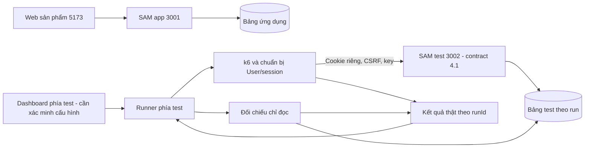

# Phối hợp hiện hành — ứng dụng và bộ kiểm thử

> **Sau khi Phúc yêu cầu gộp nhánh:** dùng **phuc**, không clone các feat/* cũ; các bảng SHA bên dưới là ảnh chụp trước khi gộp. App4.1 và lab đã cùng Git nhưng adapter lab vẫn3.0; cần đợt đồng bộ riêng. Xem [hướng dẫn hiện hành](../docs/git-workflow.md).

Mốc đối chiếu **23/10/2026**, khi kết phiên. Phúc phụ trách chuỗi công việc **ứng dụng**; bên đồng hành phụ trách **k6/runner/dashboard/dữ liệu test**. [Biên bản](yeu-cau.md) giữ nguyên văn nguồn; [nhật ký Phúc](../phuc-worklog/WORKLOG.md) ghi diễn biến và quyết định sau đó. Tài liệu này là hướng dẫn phối hợp, không thay contract hay nhật ký thực chạy của bên test.

## 1. Bản nào lấy được trên GitHub?

Đã kiểm tra bằng `git ls-remote --heads origin` lúc kết phiên:

| Nhánh | SHA remote | Phạm vi |
| --- | --- | --- |
| main, phuc | `f4e20b90095e2519b0dfefd212fb1a1146abbe57` | Nền trước nâng cấp app trong phiên |
| feat/buyer-flow | `a6ba0f21e41cc73cfadb3242ff9bd9d30e2f234a` | API 3.0, người mua/booking; giữ mốc cũ |
| feat/role-navigation | `e9e9bffbcd54ebf2238f704802b069e0a0603b91` | Tách UI, API 3.0 |
| feat/unified-account | `9341aefb69f91587c4d8f782fc66e89f023c3cee` | API 4.0, một cookie/sidebar/xóa ghi danh event |
| **feat/admin-accounts-sidebar** | **`9d47cff71a8f75e9c42845700d497cf029a56b16`** | **Bản code ứng dụng hiện hành API 4.1** |
| feat/test-lab | `9e00d5a8757f60c6516e1bdbb2b4406bb3d05cad` | Đã có remote, chưa được cửa sổ app review/chạy tích hợp |

Sau lượt này nhánh app có thể có thêm commit **tài liệu**; 9d47cff là mốc code đã kiểm tra. Không lấy branch name làm bảo đảm artifact đang đúng SHA. Code, contract, data model và artifact phải cùng mốc. Chưa merge feature/test lab vào main/phuc.

Bên test từng báo đã có bộ tạo dữ liệu, k6, dashboard, scenario/audit và unit/build/lint/đọc API nhỏ; **đây là thông tin bên đó cung cấp**, không phải cửa sổ app đã kiểm lại. Lúc họ báo, code còn local/chưa push. Kết phiên đã thấy remote như bảng trên; chưa biết mức tương thích 4.1 hoặc kết quả 100 người. Cần bên test bàn giao hướng dẫn/run evidence, không tiếp tục ghi “chưa push” như hiện trạng.

## 2. Mỗi bên sửa đâu để giảm xung đột?

| Khu vực | Bên ứng dụng (Phúc) | Bên kiểm thử |
| --- | --- | --- |
| frontend/ sản phẩm | Routes, UI User/Admin, service/types | Đọc, kiểm browser, báo lỗi |
| backend/lambda, template/config | Auth/session/event/booking/quản lý User/schema | Gọi API, đối chiếu; không viết lại auth/schema để vượt test |
| docs/api-contract, data-model, security | Đầu mối cập nhật sau khi thống nhất | Góp ý/assertion và báo khác biệt |
| tests/backend, tests/frontend, backend/tools/check_* | Hồi quy/helper ứng dụng | Tái sử dụng hoặc đề nghị thay đổi |
| tests/load, tests/runner, tests/dashboard, tests/results | Đọc kết quả, cung cấp contract | Phạm vi k6/runner/dashboard/audit riêng; kiểm lại đường dẫn thực tế nhánh test trước dùng |
| phuc-worklog | Nhật ký ứng dụng; chỉ ghi khi Phúc yêu cầu | Đọc để tích hợp |
| quan-worklog | Giữ biên bản/phối hợp/chuyển tiếp; không ghi thành công việc ứng dụng của Quân | Thêm bằng chứng phía test khi được giao, không ghi đè nguồn gốc |
| README, Compose, dependency/lock, CI/infra | Thống nhất một bên sửa trong mỗi đợt | Tránh sửa cùng lúc, báo nhu cầu trước |

Nhánh khác nhau trong **cùng một folder** vẫn thay chung file. Dùng worktree/clone riêng; một branch không checkout ở hai worktree. Worktree tách folder/HEAD/index nhưng refs/object Git vẫn chia sẻ, tránh thao tác Git chồng nhau. Không reset/clean/discard/stash hộ cửa sổ khác. Một người điều phối mỗi lượt merge, xử lý conflict sau khi đọc thay đổi hai phía.

Hiện repo gốc `D:\aws-workshop\event-registration` ở phuc=f4e20b9; worktree app `.worktrees/buyer-flow` ở feat/admin-accounts-sidebar. Không đổi HEAD gốc để “đồng bộ nhanh”. Thư mục .worktrees/browser profile/env/build chỉ local, không đưa vào Git. Cửa sổ app không tạo nhánh test lab hoặc xây runner/dashboard thay bên test.

## 3. Lấy bản app mà không ghi đè code đang làm

Cách đơn giản: clone vào **folder mới chưa tồn tại**, ghim đúng commit. Các lệnh là hướng dẫn, không được tự chạy đè lên folder đang chứa thay đổi:

```powershell
$target = 'D:\aws-workshop\event-registration-app-4-1'
if (Test-Path -LiteralPath $target) { throw 'Chọn folder mới; không ghi đè folder đang có.' }
git clone --branch feat/admin-accounts-sidebar https://github.com/leanhquan0211/FCAJ-23521254-23521225.git $target
if ($LASTEXITCODE -ne 0) { throw 'Clone lỗi; dừng kiểm tra.' }
Set-Location $target
git switch --detach 9d47cff71a8f75e9c42845700d497cf029a56b16
if ($LASTEXITCODE -ne 0) { throw 'Không ghim được commit app.' }
git status --short
git rev-parse HEAD
```

Detached HEAD để đọc/build/test đúng mốc, không sửa feature ở đó. Nếu muốn sửa, tạo branch riêng sau khi status sạch. Bên test giữ folder/branch hiện có; có thể dùng công cụ kiểm thử của mình gọi API ở clone app, chưa cần merge hai nhánh chỉ để kiểm API. Muốn lấy tài liệu kết phiên, xem HEAD nhánh app sau mốc code; không có thay đổi chức năng trong lượt docs này.

## 4. Cổng, database và cách chạy API test

| Thành phần | Cổng và trạng thái/quy ước |
| --- | --- |
| Web ứng dụng | 5173, /api →3001; cuối phiên health đúng bảng ứng dụng |
| SAM ứng dụng | 3001, bảng `fcaj-event-workshop-local` |
| SAM test | 3002, env/bảng test riêng; helper đã dừng sau smoke |
| Vite thử browser | 5175, /api →3002; Origin5175 chỉ thêm vào env test nếu dùng; đã dừng |
| DynamoDB Local | Host8000, container fcaj-dynamodb-local:8000; cùng network/volume |
| Dashboard/runner phía test | Quy ước cũ 5174/3100, chưa xác minh cấu hình trong commit test lab; phải đọc hướng dẫn bên đó |

Không suy tên bảng từ cổng. Cookie không tách theo cổng: dùng browser profile thử riêng và cookie jar riêng cho mỗi User ảo. Không đưa cookie cá nhân vào dashboard. Chia sẻ một DB Local nhưng tách bảng; không bật hai Compose stack cùng network/volume/cổng cố định từ hai worktree.

Từ clone/worktree app đúng commit, Docker Linux sẵn sàng. Các lệnh dưới tạo **env mới và bảng test riêng**, không reset ứng dụng. Lỗi thì dừng trước lệnh phụ thuộc:

```powershell
$env:SAM_CLI_TELEMETRY='0'
$env:AWS_ACCESS_KEY_ID='local'
$env:AWS_SECRET_ACCESS_KEY='local'
$env:AWS_DEFAULT_REGION='us-east-1'
$env:AWS_EC2_METADATA_DISABLED='true'
docker compose -f backend/compose.yaml ps
sam build --use-container --template-file backend/template.yaml
```

Chỉ khi Build Succeeded, tạo env và bảng:

```powershell
$test = python backend/tools/new_test_environment.py | ConvertFrom-Json
if ($LASTEXITCODE -ne 0) { throw 'Tạo env test lỗi.' }
docker compose -f backend/compose.yaml run --rm tools backend/dynamodb_setup/init_db.py --endpoint-url http://fcaj-dynamodb-local:8000 --table-name $test.table
if ($LASTEXITCODE -ne 0) { throw 'Khởi tạo bảng test lỗi.' }
$test | ConvertTo-Json
sam local start-api --template .aws-sam/build/template.yaml --env-vars $test.envFile --docker-network fcaj-event-workshop-local --host 127.0.0.1 --port 3002 --warm-containers EAGER
```

Giữ SAM chạy, terminal khác GET `http://127.0.0.1:3002/health`: phải ok/ready, apiContractVersion=4.1, tên bảng trùng `$test.table` và prefix test. Nếu không đúng, **chưa gửi request ghi**. Script env chỉ tạo file, không tạo bảng; init ở trên tạo bảng trống, không seed. Không dùng down -v, xóa volume, seed đè hoặc sửa remainingSeats.

Bên test dùng seeder đã review để tạo Admin/User/event test qua API/CLI đúng contract; không bỏ auth. Có thể kiểm hồi quy app trên **env mới khác** bằng toàn bộ suite:

```powershell
docker compose -f backend/compose.yaml run --rm -e RUN_DYNAMODB_INTEGRATION=1 -e DYNAMODB_ENDPOINT=http://fcaj-dynamodb-local:8000 -e "DYNAMODB_TABLE=$($test.table)" tools -m unittest discover -s tests/backend -v
```

Suite có fixture cố định trong nhóm transaction nên mỗi lượt dùng bảng mới; không chạy vào bảng đã có dữ liệu không rõ nguồn. Bài HTTP app [check_accounts_api.py](../backend/tools/check_accounts_api.py) tự tạo fixture và chặn bảng ngoài prefix test; [check_registration_api.py](../backend/tools/check_registration_api.py) cần fixture integration. Host tools cần SDK đúng requirements/PYTHONPATH; không ghi cache vào artifact (`PYTHONDONTWRITEBYTECODE=1`) khi SAM warm watcher đang chạy.

Trên Windows dừng đúng SAM/container Lambda đang mount artifact trước build lại, không dừng database hoặc process cửa sổ khác. Nếu resolve dependency lỗi, xem [nhật ký tổng kết](../phuc-worklog/WORKLOG.md) và [Backend README](../backend/README.md); không tự đổi pin để “chạy tạm”. Các bước này là runbook cho lượt mới, không phải log vừa chạy lại khi chuẩn hóa tài liệu.

## 5. Khác biệt contract cần cập nhật trong bộ test

Nguồn duy nhất để assertion hiện hành: [API 4.1](../docs/api-contract.md), [data model](../docs/data-model.md), [security](../docs/security.md), cùng SHA app.

| Điểm | Điều bộ test cần biết |
| --- | --- |
| Login | POST /auth/login `{identifier,password}`, identifier là email User hoặc username Admin; backend quyết định role. Email/password cũ vẫn nhận để tương thích. Một cookie HttpOnly `event_session`, không hai cookie như v3. |
| Session | GET /auth/session trả role/user hoặc admin identity và csrfToken/expiresAt. Cookie jar riêng từng User; same browser/profile thay account chung các tab. Admin không được mua vé như User; sai role403, thiếu/hết hạn/bị xóa401. |
| CSRF/Origin | Register/login cần Origin allowlist; ghi sau login cần thêm X-CSRF-Token. Mặc định Origin5173/localhost5173; k6 gọi thẳng3002 vẫn đặt Origin hợp lệ. Không cần mở Origin dashboard chỉ vì dashboard điều khiển runner. |
| Đặt vé | Body chỉ phone tùy chọn; danh tính từ phiên. Idempotency-Key UUID v4;201 mới/200 replay, cùng key khác nội dung409, User/event khác key trùng409. Key không đổi khi timeout chưa rõ commit. |
| Transaction | 4 ghi + ConditionCheck profile User hoạt động. Seeder cần profile thật từ đăng ký/đúng schema, không chỉ userId tự tạo hoặc session giả. |
| Lịch | salesOpenAt timezone/null và giờ server; chưa mở trả lỗi riêng, không tính thành hết vé. |
| Event deletion | Admin xóa cả event có người; khóa/dọn vé-reference-idempotency của event, giữ User;202 tiếp tục DELETE cùng version đến200. |
| User management | GET /admin/users; PUT/DELETE /admin/users/{userId}. Sửa tên/email/version, email unique, vé cũ snapshot. Xóa khóa User, hủy vé/hoàn chỗ một lần;202 tiếp tục, session mất quyền. Không sửa Admin/role/password. |
| Audit | PK/SK nội bộ không trả qua API; audit đọc bảng test theo schema, không suy owner từ email. Ticket, reference, idempotency phải cùng run/event/user. Legacy không được gán owner hoặc dùng ghế mock đã chiếm để kiểm đếm vé thật. |
| UI | Không còn chọn khu vực; login chung rồi menu theo role. API GET event công khai nhưng UI API mode yêu cầu login. Sidebar/menu selectors cũ v3 có thể không còn đúng. |

## 6. Kiến trúc phối hợp và màn demo



Phần app đã chạy local. Phần runner/dashboard là kiến trúc phối hợp từ biên bản và thông tin phía test, chưa được cửa sổ app kiểm tra trên commit test lab. Không nhúng dashboard kiểm thử vào UI sản phẩm; browser không trực tiếp chạy tiến trình k6. Không nhận chuỗi shell tùy ý từ dashboard, không hiển thị credential/token.

Trước demo hiện app SHA/contract/table/runId/người/chỗ; trong demo hiện request thực,201/200/409/429/503/timeout, p95/throughput; sau demo có audit DB đạt/không đạt. Các ô/đồ thị phải từ dữ liệu chạy thật, không reset DB để tạo kết quả đẹp.

## 7. Điều kiện bắt đầu tích hợp

1. Bên test gửi README/lệnh/config và xác nhận SHA test lab thực dùng, đã review với 4.1; cửa sổ app chưa xác minh công cụ này.
2. Chọn app `9d47cff`, build đúng bản, tạo bảng/env test mới, kiểm health và timestamp; ghi runId/giới hạn tải/thời gian. Không tự tính HTTP lỗi kỹ thuật thành hết vé.
3. Thử **1–2 User**: register/login/session, xem event trước mở, mua đúng lúc, replay cùng key, key khác bị trùng, User khác không xem vé, audit khớp. Nếu có lỗi thì sửa/kiểm lại trước tăng tải.
4. Sau đó 100/200 (đủ vé), 100/10 và100/1. Tài khoản/login chuẩn bị tự động **ngoài khoảng đo**; một User một jar/CSRF, đủ thời hạn. Tất cả gần đồng thời là mục tiêu phát tải, không hứa cùng một nano giây.
5. Kỳ vọng dữ liệu với User hợp lệ/mỗi người một yêu cầu và không lỗi kỹ thuật chưa xử lý: số vé không vượt chỗ; 100/200 có100 vé và100 chỗ còn,100/10 có10 vé và0chỗ,100/1 có1vé và0chỗ. Các số này là **tiêu chí**, chưa là kết quả đã đạt. Timeout/503 phải phân loại/khôi phục rồi audit, không tự đổi thành hết vé.
6. Ramp/spike/hold/overload/recovery cần đủ User/event/ghế mới, phân biệt response thành công với vé mới; chốt mức tải/ngưỡng trước đo. Một event hết ghế phản hồi409 nhanh không đại diện toàn bộ năng lực hệ thống.

Ứng dụng đã có bằng chứng 75/75 backend, HTTP/browser/build trong [nhật ký](../phuc-worklog/WORKLOG.md); chưa có kết quả k6 100 người hoặc AWS scaling. Quy mô local còn Scan, chưa pagination/index/worker nền. AWS cần cấu hình triển khai/HTTPS/quyền/quan sát và plan riêng được duyệt.

## 8. Nguồn

- [Biên bản gốc](yeu-cau.md), các quyết định tiếp theo của Phúc, [tổng kết phiên](../phuc-worklog/WORKLOG.md).
- Code, contract/data model/security hiện hành và đầu ra `git ls-remote` lúc kết phiên; nhánh remote tồn tại chỉ chứng minh đã chia sẻ, không chứng minh nội dung đã chạy.
- Tham khảo đã dùng trước đó: [Git worktree](https://git-scm.com/docs/git-worktree), [DynamoDB transactions](https://docs.aws.amazon.com/amazondynamodb/latest/developerguide/transaction-apis.html), [k6 cookies](https://grafana.com/docs/k6/latest/using-k6/cookies/), [noCookiesReset](https://grafana.com/docs/k6/latest/using-k6/k6-options/reference/#no-cookies-reset). Nguồn giải thích cơ chế, không thay kết quả run của dự án.
