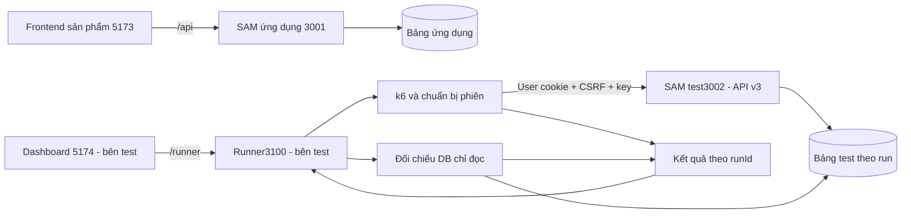

# Phối hợp song song — ứng dụng và kiểm thử

> Mốc mới đang triển khai ngày23/10: `feat/unified-account`, contract4.0 thay hai cookie bằng event_session, /auth/login nhận identifier/password, sai role403; admin xóa kèm ghi danh và có202 tiếp tục. Chưa coi đã push cho tới khi nhật ký ghi SHA remote được đối chiếu. Mốc `feat/buyer-flow@a6ba0f2` API3.0 và `feat/role-navigation@e9e9bff` được giữ nguyên. Phần mô tả các mốc M0–M4 bên dưới thuộc v3; muốn thử v4 phải lấy code/contract cùng commit, không trộn artifact. Xem [nhật ký mục15](week-4/23-10.md).

> Bổ sung23/10: sau bàn giao API `feat/buyer-flow@a6ba0f2`, người dùng duyệt tách giao diện User/admin. Phần UI làm trên `feat/role-navigation` tại cùng worktree buyer, không đổi API/schema hoặc nhánh bàn giao. Bên test tiếp tục dùng SHA đã chốt cho tích hợp API; cập nhật selector/điều hướng nếu chọn kiểm tra UI mới. Kết quả mới nằm ở mục14 [nhật ký](week-4/23-10.md).

Cập nhật23/10/2026 sau khi người dùng duyệt toàn plan. Nguồn: [biên bản](yeu-cau.md). Bên ứng dụng là cửa sổ nhận biên bản này; không tự suy người thực hiện từ tên thư mục. Contract tại commit v3 là API3.0; file [contract](../docs/api-contract.md) trên nhánh mới là4.0.

## 1. Trạng thái Git thực tế

- Nền `f4e20b90095e2519b0dfefd212fb1a1146abbe57`, đã chứa quan-worklog trên GitHub main. Đã kiểm tra lại remote main trong lượt triển khai.
- Worktree ứng dụng: `D:\aws-workshop\event-registration\.worktrees\buyer-flow`, branch `feat/buyer-flow`. Tạo trong writable workspace, không dùng đường dẫn ngoài workspace như ví dụ nháp ban đầu.
- Repo gốc `D:\aws-workshop\event-registration` được giữ nguyên; lúc kiểm tra cuối đang ở `phuc` tại f4e20b9. Không switch/merge bên dưới cửa sổ khác. Thư mục `.worktrees` và profile browser thử chỉ được exclude cục bộ, không sửa gitignore chung.
- Chưa tạo nhánh/worktree `feat/test-lab` thay bên kiểm thử; bên đó tự kiểm tra folder/branch hiện có trước khi tạo.
- Commit code mới sẽ được bàn giao trên feature branch; main chưa tự nhận code mới. Trạng thái commit/push cuối cùng xem nhật ký, không coi thay đổi chưa commit là đã chia sẻ.

Hai cửa sổ cùng máy cần hai worktree hoặc clone. Chỉ đổi branch trong một folder vẫn dùng chung file và có thể làm mất ngữ cảnh cửa sổ kia. Linked worktree có HEAD/index/folder riêng, nhưng Git refs/object chung; không thao tác Git chồng nhau. Không checkout cùng branch ở hai worktree.

## 2. Ai sửa đâu

| Khu vực | Bên ứng dụng | Bên kiểm thử |
| --- | --- | --- |
| frontend/ sản phẩm | UI/routes/service/types/User/Admin | Đọc, báo lỗi |
| backend/lambda và template/config | Account/session/booking/schedule/transaction | Gọi API, báo bằng chứng; không viết lại auth/schema |
| docs/api-contract, data-model, security | Một đầu mối cập nhật canonical | Góp ý thay đổi và assertion |
| tests/backend, tests/frontend, backend/tools/check_* | Test hồi quy ứng dụng, helper app | Tái sử dụng hoặc báo nhu cầu sửa |
| tests/load | Cung cấp contract/helper | k6, tài khoản thử, fixture, đối chiếu |
| tests/runner | Không thêm vào Lambda | Runner local riêng |
| tests/dashboard | Không nhúng vào frontend sản phẩm | Frontend test/package/lock riêng |
| tests/results | Đọc báo cáo | Kết quả theo runId, không secret |
| quan-worklog | Cửa sổ ứng dụng ghi | Đọc |
| phuc-worklog | Không ghi đè | Theo phân công bên đó |
| README, Compose, dependency, CI/infra | Một bên sửa mỗi đợt, ghi rõ nhu cầu | Tránh đồng thời sửa cùng file |

Đợt này bên ứng dụng cập nhật README gốc/backend/frontend và tests/tests.md để lệnh cũ không hướng dẫn body v2. Không đổi dependency/lock/Compose, không tạo k6/runner/dashboard hoặc triển khai AWS. Các thư mục test riêng trong bảng là phạm vi bên đồng hành, không có nghĩa đã tồn tại.

## 3. Bàn giao và tích hợp

| Mốc | Phần ứng dụng | Bên test có thể nối |
| --- | --- | --- |
| M0 | Contract v3, data model, ownership legacy đã cập nhật theo plan duyệt | Parser/envelope/status/header, manifest và kịch bản |
| M1 | Register/login/session/logout User, unique email, Origin/CSRF/rate limit | Chuẩn bị100 account/session tự động ngoài khoảng đo |
| M2 | Schedule, owner-only,4 ghi atomic, replay200/new201 | Tranh chỗ, trùng/key khác nội dung, mất response, audit |
| M3 | UI người mua và giờ mở bán trong admin | Browser smoke, dùng thử thủ công |
| M4 | Unit/integration/HTTP/Edge hồi quy ứng dụng và tài liệu | Chạy k6/runner/dashboard thật sau khi tích hợp đúng commit |

M0–M3 đã có mã và kiểm tra local. Phần hồi quy ứng dụng của M4 đã chạy; chưa có kết quả k6 100 người hoặc dashboard/runner của bên test. Số lượng và giới hạn bằng chứng trong [nhật ký](week-4/23-10.md).

Hai bên không cần chờ toàn dự án: bên test lấy commit bàn giao, tích hợp vào branch riêng rồi build lại API test từ chính branch đó. Trước mỗi run ghi app commit, contract3.0, bảng/env/runId và tham số thực tế. Không dùng artifact `.aws-sam` của branch khác mà không ghi rõ.

Mỗi lượt merge vào nhánh tích hợp chỉ một người thực hiện. Feature mới chưa tự merge vào main/phuc. Trước merge kiểm tra status/diff; không reset/clean/discard thay đổi cửa sổ khác. Nếu cần sửa cùng file, bên sau chờ commit bên trước. Chia phạm vi giảm conflict, không bảo đảm tuyệt đối hết conflict.

## 4. Cổng và process

| Thành phần | Địa chỉ dự kiến/chạy thử |
| --- | --- |
| Frontend sản phẩm |127.0.0.1:5173, /api →3001 mặc định |
| SAM ứng dụng |127.0.0.1:3001, bảng ứng dụng |
| SAM test |127.0.0.1:3002, bảng test mới theo env |
| Frontend dashboard bên test |127.0.0.1:5174, /runner →3100, chưa do cửa sổ này triển khai |
| Runner bên test |127.0.0.1:3100, chưa do cửa sổ này triển khai |
| DynamoDB Local dùng chung |host8000, container fcaj-dynamodb-local:8000 |

Lượt kiểm tra buyer dùng frontend5173 với `API_PROXY_TARGET=http://127.0.0.1:3002`, không phải backend ứng dụng3001. Phải kiểm tra health/bảng trước khi dùng hoặc ghi; đừng suy bảng từ cổng. Process nào còn chạy ở lúc bàn giao ghi trong nhật ký. Không dừng/restart process cửa sổ khác.

Chia sẻ một DB Local nhưng tách bảng. Compose có network/volume/cổng cố định, không chạy hai stack giống nhau từ hai worktree. Không dùng down-v, không reset/chỉnh remainingSeats bằng tay. Test integration tạo bảng/fixture mới; bảng giữ lại để đối chiếu, không tự cleanup.

Cookie không tách theo cổng. Dùng profile trình duyệt thử riêng; runner/k6 giữ cookie jar riêng cho từng User, không lấy cookie cá nhân đi kèm browser dashboard. K6 gọi API3002 với Origin5173 hợp lệ, cookie/CSRF thật. Không cần mở origin5174 vào ứng dụng chỉ để k6 gọi API. Vite dashboard chỉ proxy /runner, không trộn /api sản phẩm.

## 5. Kiến trúc và việc còn lại bên kiểm thử

Sơ đồ gồm phần đã có của ứng dụng và phần runner/dashboard do bên test sẽ làm. Runner chỉ bind loopback, chạy danh sách kịch bản/giới hạn được kiểm tra, không nhận chuỗi shell tùy ý từ browser. Dashboard hiển thị trạng thái/metric/audit thật và không hiển thị token/mật khẩu.

Chuẩn bị100 User qua API register/login, đủ thời hạn phiên; một VU một account/cookie/CSRF. Không chia chung cookie hoặc làm giả IP để vượt rate limit. K6 có thể reset jar sau iteration; phải nạp lại đúng User hoặc chọn option giữ cookie rõ ràng. Tài khoản được chuẩn bị ngoài khoảng đo đặt vé.

Ba bài đầu:100 người/200chỗ,100 tranh10,100 tranh1. Đây là kỳ vọng chưa đo. Với ramp/hold/down phải có đủ danh tính/sự kiện/ghế cho tải tạo vé, không diễn giải throughput của409 thành vé thành công. Timeout/503/429 tách riêng khỏi EVENT_FULL;200 replay không tính thêm vé. Đối chiếu DB theo event/run sau khi xử lý ổn định. Run sau tạo bảng/sự kiện mới; cleanup chỉ có kế hoạch nhắm đúng bảng test/run, không xóa hàng loạt hoặc volume.

Local chứng minh luồng và tính đúng dữ liệu trong điều kiện đã thử, chưa chứng minh scaling AWS. Khi lên AWS cần thiết kế cấu hình endpoint/HTTPS/quyền/quan sát và kiểm thử riêng theo giai đoạn đã duyệt.

Nguồn: [Git worktree](https://git-scm.com/docs/git-worktree), [DynamoDB transaction](https://docs.aws.amazon.com/amazondynamodb/latest/developerguide/transaction-apis.html), [k6 cookies](https://grafana.com/docs/k6/latest/using-k6/cookies/), [noCookiesReset](https://grafana.com/docs/k6/latest/using-k6/k6-options/reference/#no-cookies-reset); cùng code/contract và kết quả trong nhật ký. Không gửi tin nhắn cho người khác thay người dùng.
