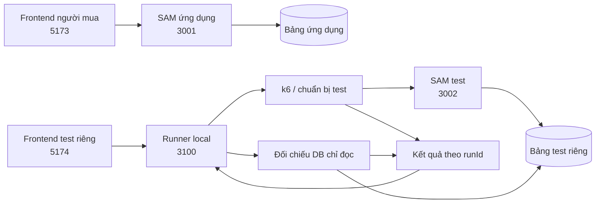
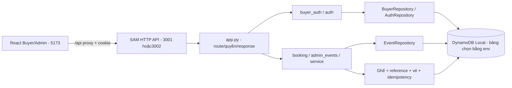
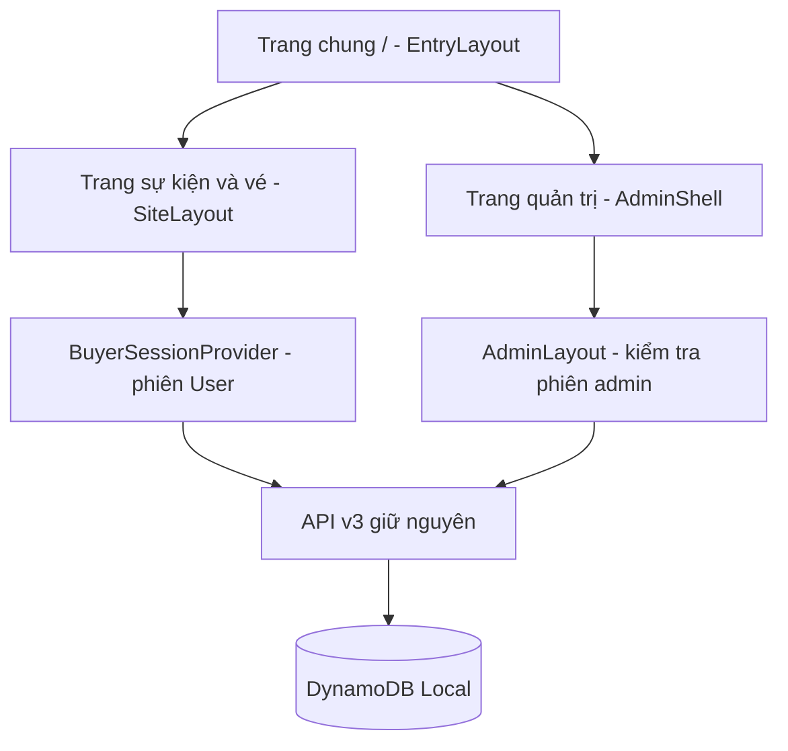
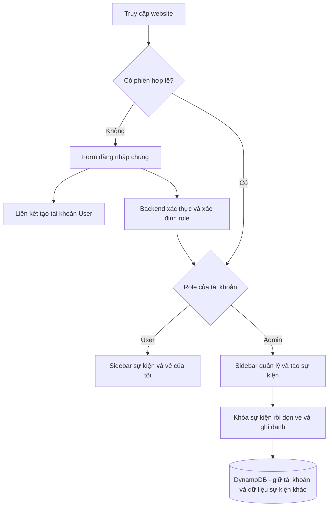
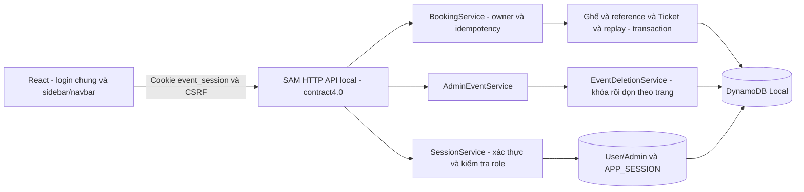

# 23/10 — Rà soát và bàn giao người mua

> **Trạng thái mới nhất:** người dùng đã duyệt toàn plan và cho phép tự hoàn tất. Mã v3 được triển khai trên `feat/buyer-flow`, worktree `.worktrees/buyer-flow`; API/account/booking/UI đã qua kiểm tra local. Đọc **mục8 trở đi** để tiếp tục công việc. Các mục1–7 giữ lịch sử khảo sát/bản nháp trước khi code, nên các câu “chưa làm/chưa duyệt” ở đó không mô tả trạng thái cuối ngày.

- Tuần 4, giờ Việt Nam. Nhánh lúc rà soát: `phuc`, commit `c13f4a9`.
- Yêu cầu: đọc biên bản bên đồng hành, chuẩn bị cách làm song song ít xung đột Git; mở `quan-worklog` và giữ nguyên văn hóa làm việc.
- **Đã làm:** đọc biên bản, đối chiếu repository; soạn bộ tài liệu phối hợp và contract nháp để review.
- **Chưa làm:** đổi API/schema/code; tạo nhánh/worktree; commit/push; chạy suite/tải; đọc lại hoặc sửa DB trong lượt này. Chưa triển khai AWS.

## 1. Nguồn yêu cầu và quy tắc

Biên bản được người dùng gửi tại attachment `Pasted text.txt` ngày 23/10; lưu bản sao trong [yeu-cau.md](../yeu-cau.md) để cửa sổ mới đọc được mà không phụ thuộc attachment. Quy tắc chung ở [phong-cach.md](../../phuc-worklog/phong-cach.md): mô tả logic trước khi code, chờ duyệt; giải thích dễ hiểu; khi người dùng tự thao tác phải kiểm tra theo giai đoạn.

Theo biên bản, cửa sổ này nhận **phần ứng dụng/người mua**. Bên đồng hành nhận **kiểm thử/k6/runner/frontend test riêng**. Việc thêm nhật ký Quân không tự chứng minh tác giả/người thực hiện các công việc cũ. Phân công cũ frontend/backend trong bối cảnh tuần 3 không được tự dùng thay biên bản mới.

Mua vé hiện là đặt chỗ và nhận mã, chưa thanh toán. Tuần này local; số đo local không chứng minh AWS autoscaling. Không mở rộng nhiều đơn vị/OTP/SSO trong đợt này nếu chưa có quyết định bổ sung.

## 2. Hiện trạng đã đối chiếu

| Nội dung | Kết quả đọc mã/tài liệu |
| --- | --- |
| Xem/tìm/lọc/chi tiết công khai | Đã có UI và GET API; tìm/lọc ở frontend sau khi tải danh sách |
| Đăng ký hiện tại | Khách gửi fullName/email/phone; chưa yêu cầu User login |
| Admin | CLI tạo tài khoản, login/session/logout, cookie HttpOnly, Origin/CSRF và rate limit đã có |
| Tài khoản người mua | Chưa có register/login/session riêng hoặc userId sở hữu đăng ký |
| Giờ mở bán riêng | Chưa có; hiện chỉ registrationOpen và giờ diễn ra dateTime/startsAtEpoch |
| Transaction/chống trùng | Đã có giảm chỗ + khóa event/email + đăng ký trong một transaction |
| Gửi lại sau mất response | UUID ClientRequestToken giữ trong một lượt xử lý/SDK retry; HTTP mới sinh UUID mới, chưa có key client ổn định và replay kết quả |
| Xem vé | GET registration theo UUID đang công khai; chưa kiểm tra chủ sở hữu, chưa có Vé của tôi |
| Frontend test/runner/k6 | Chưa có thư mục riêng trong repository đã đọc; test hiện có Python/unittest, HTTP smoke và Node browser scripts |
| Git | Working tree sạch đầu lượt; một worktree ở phuc; có main/phuc và remote-tracking main/phuc; không fetch nên chưa xác nhận remote mới nhất |

Các kết quả health/events và xác nhận web chạy ổn đầu ngày nằm trong [nhật ký Phúc](../../phuc-worklog/week-4/23-10.md). Lượt này không chạy lại các bước đó, không coi trạng thái process hoặc số DB cũ là dữ liệu mới.

## 3. Mức độ khớp biên bản và thay đổi đề xuất

Đồng ý luồng công khai xem sự kiện → cần tài khoản khi đặt vé → mỗi User tối đa một vé/sự kiện → Vé của tôi và owner-only. Có thể tái sử dụng lớp handler/service/repository, transaction và các biện pháp auth admin, nhưng không coi role admin hiện tại là tài khoản User đã có.

Điểm điều chỉnh so với phần thảo luận trước: biên bản yêu cầu **Idempotency-Key rõ ràng, phân biệt cùng key khác nội dung**. Bản nháp mới đề xuất có key này ngoài khóa duy nhất User/sự kiện; không chỉ dựa vào trả lại vé khi trùng User/sự kiện như ý tưởng tối giản trước đó. Bổ sung thời điểm `salesOpenAt` là thay đổi schema/API cần duyệt.

Giữ nguyên bản ghi cũ, không gán theo email chưa xác minh, không xóa để làm sạch báo cáo. Đề xuất khóa đọc công khai các vé không có chủ tài khoản; giữ chỗ đã dùng và cung cấp kiểm kê local chỉ đọc khi cần. Chính sách truy cập legacy cần được duyệt vì URL cũ sẽ thay đổi hành vi.

## 4. Kiến trúc và chia việc đề xuất



Sơ đồ là phương án chưa triển khai; 3001/5173 và DynamoDB Local là cấu hình đã có, còn runner/dashboard là đề xuất. Chi tiết file, nhánh, cổng, process và mốc ở [phoi-hop.md](../phoi-hop.md). Contract/schema/fixture và lỗi nằm trong [api-du-kien.md](../api-du-kien.md). Hai tài liệu này là bản có thể đưa cho phía test để góp ý, không tự gửi ra ngoài.

## 5. Điểm cần chốt trước khi code

1. Chấp nhận API v3 dự kiến: realm User riêng với admin, body đặt vé chỉ phone (tên/email từ tài khoản), salesOpenAt và trạng thái not_open, key UUID v4 và replay 200/new 201.
2. Chấp nhận dữ liệu legacy giữ nguyên nhưng không còn đọc công khai qua link UUID; chưa có chức năng nhận lại vé cũ theo email.
3. Chấp nhận phân công file, nhánh buyer/test và thư mục làm việc độc lập; chỉ bên ứng dụng cập nhật canonical contract. Chốt người chịu trách nhiệm merge từng mốc.
4. Chốt cách chuẩn bị 100 tài khoản qua API/script test và chính sách rate limit User đủ cho bước chuẩn bị, vẫn giữ auth/CSRF/quyền. Các con số đề xuất trong contract chưa là cấu hình đã chạy.

Không cần hai người chờ hoàn thành toàn bộ: sau M0 bên test dựng công cụ/kịch bản theo contract, sau M1 nối tài khoản, sau M2 nối đặt vé; frontend người mua hoàn chỉnh ở M3. Mọi API chưa có phải ghi rõ chờ bàn giao, không tính response mẫu/mock là kết quả test thật.

## 6. Nhật ký tiến độ

### Triển khai sau khi được duyệt

- Phúc đã cho phép thực hiện toàn bộ plan trong lượt này, không cần hỏi lại khi đang đi ăn. Quy tắc giải thích, kiểm tra và ghi bằng chứng vẫn giữ nguyên.
- Đã xác minh main/GitHub có bộ tài liệu tại `f4e20b9`, rồi tạo nhánh `feat/buyer-flow` ở worktree riêng `.worktrees/buyer-flow` để không đổi HEAD/file của cửa sổ ở thư mục gốc. Chỉ thêm exclude cục bộ `.git/info/exclude` cho thư mục worktree, không sửa `.gitignore` dùng chung.
- Phạm vi thực hiện: backend/account/session/booking/ownership/schedule/idempotency, frontend người mua, test hồi quy ứng dụng và contract. Không làm k6/runner/frontend test của bên đồng hành; không triển khai AWS hoặc sửa dữ liệu đang dùng.
- Đang triển khai M1/M2. Chưa có kết quả kiểm tra mới; các mục bên dưới trước đây là lịch sử soạn bản nháp.

1. Đã đọc toàn bộ attachment; xác định trách nhiệm ứng dụng so với kiểm thử.
2. Đã đọc lại README, contract v2/data model/security, template/config, auth, admin rules, service/repository, frontend routes/types/service/form và công cụ/env test liên quan.
3. Đã kiểm tra Git: phuc tại c13f4a9, working tree sạch đầu lượt, một worktree. Không checkout/fetch/merge hoặc thay đổi .git.
4. Đã tạo khu `quan-worklog` với bản sao yêu cầu, hướng dẫn đọc, phân công Git và contract dự kiến. Canonical contract v2/schema/code vẫn giữ nguyên.
5. Đã kiểm tra năm file Markdown: liên kết tương đối đều có đích, code fence đóng/mở đủ, không có whitespace cuối dòng hoặc ký tự UTF-8 thay thế. Bản sao biên bản khớp nguyên văn attachment sau phần tiêu đề bổ sung. `git status` chỉ có `quan-worklog/` mới; không có thay đổi tracked file của ứng dụng hay nhật ký bên kia. Không chạy build/test suite vì chưa sửa mã.
6. Đã đối chiếu thêm cookie jar/reset iteration của k6 và lưu ý cookie browser không tách theo cổng; bổ sung kỳ vọng 100 người/200 vé, 10/1 vé và cấu hình giới hạn run. Các số này vẫn là kỳ vọng chưa đo, không phải tính năng đã hoàn thành.
7. **Điểm tiếp tục:** Phúc và bên test review các mục cần chốt ở trên; sau khi duyệt mới cập nhật canonical docs và triển khai M1. Không tự bắt đầu code từ bản nháp này. Hai nhánh/worktree chưa được tạo; bộ tài liệu chưa commit/chia sẻ sang máy khác.

## 7. Nguồn và giới hạn bằng chứng

- [Biên bản gốc](../yeu-cau.md), [quy tắc làm việc](../../phuc-worklog/phong-cach.md), [nhật ký đầu ngày](../../phuc-worklog/week-4/23-10.md).
- [README](../../README.md), [backend README](../../backend/README.md), [frontend README](../../frontend/README.md), [contract v2](../../docs/api-contract.md), [data model](../../docs/data-model.md), [security](../../docs/security.md).
- [Auth](../../backend/lambda/auth.py), [repository](../../backend/lambda/repository.py), [service](../../backend/lambda/service.py), [admin rules](../../backend/lambda/admin_events.py), [template](../../backend/template.yaml), [Vite](../../frontend/vite.config.ts), [routes](../../frontend/src/App.tsx), [form đăng ký](../../frontend/src/pages/RegistrationPage.tsx).
- [Git worktree](https://git-scm.com/docs/git-worktree), [k6 cookies](https://grafana.com/docs/k6/latest/using-k6/cookies/), [DynamoDB transactions](https://docs.aws.amazon.com/amazondynamodb/latest/developerguide/transaction-apis.html), [OWASP CSRF](https://cheatsheetseries.owasp.org/cheatsheets/Cross-Site_Request_Forgery_Prevention_Cheat_Sheet.html): đọc ngày 23/10 cho đề xuất phối hợp/session/transaction. Chi tiết nguồn gắn ở tài liệu bàn giao.

Đọc mã chứng minh cách cài đặt hiện tại; không thay cho test vừa chạy. Chỉ kiểm tra tài liệu/liên kết/whitespace trong lượt này, không tuyên bố tính năng mới đã đạt.

## 8. Triển khai đã được duyệt và cách hiểu hệ thống mới

Người dùng cho phép thực hiện toàn plan trong lúc đi ăn, không cần hỏi duyệt lại lần này. Sau đó yêu cầu tiếp tục phần đang dở. Đây là nguồn duyệt từ con người; không coi bản nháp tự nó là quyền triển khai. Quy tắc giải thích, kiểm tra kết quả, bảo vệ dữ liệu và ghi nguồn vẫn giữ nguyên.

Đã tách worktree `.worktrees/buyer-flow`, branch `feat/buyer-flow` từ `f4e20b9`. Bộ quan-worklog nền đã nằm trên GitHub main, kiểm tra lại bằng `git ls-remote`. Repo gốc lúc kiểm tra cuối đang ở `phuc` tại cùng commit nền; cửa sổ này không đổi HEAD/file của repo gốc. Chỉ bổ sung exclude cục bộ cho worktree/profile test. Không tạo nhánh hay sửa vùng k6/runner/dashboard thay bên đồng hành.

Thay đổi chính:

1. **Tài khoản User riêng:** register/login/session/logout; role luôn user, email trim/lowercase unique atomic, mật khẩu scrypt theo helper hiện có. Register chưa tự login. Phiên8giờ, cookie User/admin riêng; token hash trong DB, kiểm tra profile/role và Origin/CSRF. User auth có counter riêng120/IP/900giây, login thêm10/account;429 có Retry-After.
2. **Đặt vé gắn chủ tài khoản:** tên/email từ session, body chỉ phone tùy chọn. GET kết quả và Vé của tôi chỉ chủ vé; sai owner/legacy không userId trả404. Không nhận lại vé cũ theo email chưa xác minh.
3. **Gửi lại an toàn:** UUID v4 Idempotency-Key theo User, fingerprint method/event/phone. Cùng key/nội dung trả200 vé cũ; khác nội dung409; User/event đã có vé nhưng key mới409 kèm id vé của chính User. Replay được đọc trước điều kiện bán nên vẫn hoạt động sau full/closed/ended.
4. **Ghế và dữ liệu đi cùng nhau:** transaction bốn ghi — ghế, User/event reference, Ticket, idempotency snapshot. Retry xung đột tối đa4 lượt có jitter;503 REGISTRATION_BUSY riêng với409 EVENT_FULL. Không tạo ghi dở khi transaction thất bại.
5. **Giờ mở bán:** salesOpenAt ISO có timezone hoặc null, không sau dateTime; admin tạo/sửa bắt buộc gửi field, form có thể để trống. Trạng thái not_open, kiểm tra bằng giờ server và epoch trong transaction; legacy thiếu field đọc null, không backfill.
6. **Giao diện:** signup/login giữ return path nội bộ, đặt vé bằng danh tính tài khoản, kết quả, Vé của tôi, logout. Key/phone đang chờ giữ trong sessionStorage qua reload; cookie/password/CSRF không lưu ở đó. Không tự retry ghi trong nền. Mock chỉ xem sự kiện.

Để mã dễ đọc, `app.py` chỉ điều phối route/quyền/response; `buyer_auth.py` xử lý account/session, `booking.py` xử lý vé/replay, repository chỉ đọc/ghi DB. UI dùng các page/service/provider tương ứng, giữ bộ component và thiết kế Almanac cũ, không thêm dependency.



Sơ đồ trên là phần ứng dụng đã chạy local. Hướng AWS sau này vẫn là frontend S3/CloudFront → API Gateway/Lambda → DynamoDB và CloudWatch, nhưng cấu hình endpoint hiện cố ý chỉ cho local; chưa dùng template này để deploy. Runner/dashboard là sơ đồ phối hợp ở [phoi-hop.md](../phoi-hop.md), chưa triển khai bởi cửa sổ này.

## 9. Kiểm tra thực tế theo giai đoạn

| Nhóm | Kết quả thực chạy23/10 |
| --- | --- |
| Unit backend |65 test được tìm thấy:62 đạt,3 integration skip mặc định; có test biên salesOpenAt/dateTime, auth/role/CSRF/owner/replay/transaction/lỗi |
| Integration DynamoDB thật |3/3 đạt trên bảng mới:8 người tranh1chỗ chỉ1thắng;6 lượt cùng User khác key chỉ1vé/1ghế;6 lượt cùng key nhận cùng vé/1ghế |
| HTTP buyer qua SAM→Lambda→DynamoDB |Đạt signup/login/cookie/session, Origin/CSRF, body/key, owner/legacy, Vé của tôi, lịch mở bán, logout;8 HTTP request tranh1chỗ chỉ1thắng; replay sau full/closed trả vé cũ |
| HTTP quản trị |Đạt quyền/cookie/CSRF/CRUD, giữ chỗ khi sửa, chặn xóa, hai sửa cùng version chỉ1thắng, logout |
| HTTP chỉ đọc |check_api đạt schema v3, số/timezone, list/detail,400/404, CORS GET/OPTIONS |
| Browser buyer Edge headless |Đạt signup, xác nhận password, login quay lại sự kiện, danh tính từ phiên, kết quả/Vé của tôi/logout. Cố tình bỏ response sau commit → reload → retry: chỉ1vé, pending key xóa sau thành công. Thử thêm thay response đã commit bằng502 không phải JSON, retry vẫn khôi phục đúng1vé cho sự kiện thứ hai |
| Browser admin Edge headless |Đạt chọn vai trò/tìm kiếm, URL admin/sai password/login/reload/logout, tạo/sửa/đóng, User đặt vé, chặn giảm ghế/xóa, script hiển thị như văn bản |
| Responsive và ảnh |Buyer signup/login/form/result/Vé của tôi và các trang admin thử ở320/375/414/768/1280px: không cuộn ngang/chữ nút không xuống dòng. Đã mở xem ảnh mobile vé/admin editor và desktop login |
| Build/lint |SAM container Build Succeeded; SAM validate--lint đạt; frontend build đạt; lint còn2warning Fast Refresh có sẵn ở ui/button.tsx và ui/badge.tsx |

Trong quá trình thử đã tìm ra lỗi logout có thể bị route guard kéo về login. Bản sửa tải lại trang công khai sau khi thu hồi cookie, xóa trạng thái tài khoản cùng lúc; browser đã kiểm tra lại đạt. Form cũng giữ ý định khi gặp lỗi kỹ thuật chưa rõ kết quả, thay vì vội đổi key. Lần validate đầu template đã báo hợp lệ nhưng tiến trình vướng quyền ghi metadata telemetry của SAM; chạy lại với SAM_CLI_TELEMETRY=0 trong môi trường có quyền phù hợp đạt exit0.

Các kết quả này chứng minh điều kiện đã thử, không phải kết quả k6 100người hoặc autoscaling. Chưa thử Firefox/Safari/trình đọc màn hình, OTP/khôi phục password, thanh toán, hủy vé, Organizer nhiều đơn vị hoặc AWS.

## 10. Dữ liệu, process và lệnh tiếp tục

- Bảng test mới được tạo riêng: `fcaj-event-workshop-local-test-137c49ba4a47`; env `backend/env.test-137c49ba4a47.local.json` ignored, không đưa secret vào Git. Bảng thứ hai `fcaj-event-workshop-local-test-ff7d61f799eb` dùng chạy lại3integration sau khi fixture đổi sang User UUID thật, cả3đạt. Hai bảng giữ lại để đối chiếu; không xóa/reset bảng ứng dụng/volume hoặc gán owner legacy.
- SAM thử chạy từ worktree buyer trên127.0.0.1:3002, network fcaj-event-workshop-local. Vite thử5173, API_PROXY_TARGET trỏ3002. Đây là dữ liệu thử, không phải process app3001. Mọi process còn chạy cuối lượt sẽ ghi thêm ở mục bàn giao.
- Browser profile riêng, debug9241; các credential test sinh ngẫu nhiên trong bộ nhớ, không dùng profile cá nhân. Ảnh tại thư mục Temp: event-buyer-tickets-mobile.png, event-buyer-login-desktop.png, event-admin-editor-mobile.png.
- SAM build đúng worktree, Python3.13 trong container; frontend npm ci dùng lock có sẵn. Host test dùng PYTHONPATH tới thư viện của build worktree, không cần nâng/hạ boto3. Dependency và Compose không đổi.

Lệnh test có thể lặp theo [Backend README](../../backend/README.md#kiểm-thử) và [Frontend README](../../frontend/README.md#kiểm-tra). Integration phải dùng bảng mới vì fixture không ghi đè. HTTP smoke tạo fixture UUID riêng và tự chặn bảng ngoài prefix test. Không tái dùng ghế/sự kiện cũ làm lượt đo tải mới.

```powershell
# Sau build; Docker Desktop đang chạy, thực hiện từ đúng worktree:
docker compose -f backend/compose.yaml run --rm tools -m unittest discover -s tests/backend -v
python backend/tools/check_api.py --base-url http://127.0.0.1:3002
python backend/tools/check_registration_api.py --base-url http://127.0.0.1:3002
python backend/tools/check_admin_api.py --base-url http://127.0.0.1:3002 --browser
# Hai script HTTP ghi cần boto3 trên host; xem README nếu dùng tools container.
$env:API_TEST_URL='http://127.0.0.1:3002'
node tests/frontend/check-buyer-browser.mjs
```

**Bên kiểm thử tiếp tục:** lấy commit bàn giao, build API từ đúng branch, xác nhận health contract3.0/bảng, chuẩn bị100 User/session ngoài khoảng đo và chạy k6/runner/dashboard trong phạm vi riêng. Audit theo event/run, đếm201 mới/200 replay/409 nghiệp vụ/429/503/timeout riêng. App M0–M3 và hồi quy M4 đã có, phần tích hợp tải của bên test chưa hoàn tất.

## 11. Nguồn cho thay đổi và giới hạn bằng chứng

- Nguồn người dùng: [biên bản](../yeu-cau.md), quy tắc [phong-cach.md](../../phuc-worklog/phong-cach.md), lời duyệt toàn plan trong phiên chat23/10.
- Chuẩn đã thực hiện: [API v3](../../docs/api-contract.md), [data model](../../docs/data-model.md), [security](../../docs/security.md), [phối hợp Git](../phoi-hop.md). Bản [api-du-kien](../api-du-kien.md) được gắn nhãn lịch sử để không lẫn trạng thái.
- Mã và test: [buyer_auth](../../backend/lambda/buyer_auth.py), [booking](../../backend/lambda/booking.py), [repository](../../backend/lambda/repository.py), [unit auth](../../tests/backend/test_buyer_auth.py), [unit booking](../../tests/backend/test_registration.py), [integration](../../tests/backend/test_registration_integration.py), [HTTP buyer](../../backend/tools/check_registration_api.py), [browser buyer](../../tests/frontend/check-buyer-browser.mjs).
- Tham khảo đã đối chiếu lại23/10: [DynamoDB transactions](https://docs.aws.amazon.com/amazondynamodb/latest/developerguide/transaction-apis.html), [AWS idempotent APIs](https://aws.amazon.com/builders-library/making-retries-safe-with-idempotent-APIs/), [OWASP CSRF](https://cheatsheetseries.owasp.org/cheatsheets/Cross-Site_Request_Forgery_Prevention_Cheat_Sheet.html). Nguyên tắc atomic/retry/CSRF tham khảo các nguồn này; tên field/header, giới hạn và scope là quyết định dự án đã duyệt.

Kết quả công cụ trong mục9 là bằng chứng chạy tự động, chưa thay lời xác nhận dùng thử của con người cho UI mới. Chỉ ghi người dùng đã xác nhận “web chạy ổn” cho phiên bản đầu ngày; chưa gán câu đó cho v3.

## 12. Bàn giao Git và local cuối lượt

- Code/tài liệu canonical/test được commit tại **1688c9809ec27eed1a03a01cde262b6afce0f8c3** (`feat: add buyer accounts and idempotent ticket booking`). Đã push non-force lên `origin/feat/buyer-flow`, đối chiếu SHA bằng ls-remote. Main vẫn f4e20b9 có bộ quan-worklog nền; không merge code mới vào main/phuc và không sửa working tree repo gốc.
- Có55file trong commit triển khai. Trước commit đã kiểm tra diff/whitespace,11Markdown có đích liên kết và code fence hợp lệ, UTF-8 không có ký tự thay thế; không stage env local, browser profile, build/node_modules, cookie hoặc credential thật. Dependency/lock/Compose không đổi.
- Đã build lại artifact cuối cùng. Khi đọc health ngay sau rebuild, SAM thay warm container nên request thử với timeout15giây hết hạn; log server sau đó trả200. Không diễn giải cold start local này thành kết quả scaling. Đã dừng đúng hai process SAM test3002/Vite thử do cửa sổ này tạo và khởi động lại bản dùng thử bình thường: SAM3001 theo env.local.example.json, frontend5173 proxy sang3001. Không chạy init/seed/migration trên bảng ứng dụng.
- Bản ứng dụng mới có thể mở ở `http://127.0.0.1:5173`. Đây là code từ worktree buyer, bảng `fcaj-event-workshop-local`. Kiểm tra cuối: health/API read-only đạt, contract3.0, Vite `/api/health` trả200 đúng bảng ứng dụng; danh sách hiện có1sự kiện ended. Không thêm/sửa sự kiện để làm đẹp demo. SAM3001 PID17948, Vite5173 PID2648 tại lúc kiểm tra; trước khi dừng sau này cần đối chiếu PID/command vì PID có thể được tái sử dụng. Bảng test giữ lại, cổng3002 đã trả trống. Browser debug9241/profile thử riêng đã được đóng bằng CDP sau kiểm tra.
- Điểm tiếp tục cho người dùng: dùng thử UI mới và phản hồi; nếu sự kiện cũ đã ended thì tạo sự kiện tương lai bằng admin để đặt vé. Phần user tự thao tác sẽ kiểm tra theo giai đoạn trong lượt tiếp theo, không coi kiểm tra tự động là người dùng đã xác nhận UI mới.
- Điểm tiếp tục cho bên đồng hành: fetch feature branch và tích hợp commit1688c98, đọc contract3.0; tự chuẩn bị100 phiên và bài tải. Không chạy lại suite ghi vào bảng ứng dụng3001. Các hướng dẫn test đang chỉ3002 phải khởi động SAM test với bảng mới trước.

Nhật ký này được commit riêng sau commit mã để có thể ghi chính xác mã bàn giao; xem HEAD/remote của feature branch để biết commit ghi nhật ký cuối cùng.

## 13. Hướng dẫn dùng thử cùng người dùng

- Người dùng yêu cầu hướng dẫn khởi động để tự test. Đã kiểm tra lại lúc15:21 ngày23/10: branch feat/buyer-flow tại a6ba0f2, Docker DB8000/SAM3001/Vite5173 còn chạy. GET3001/health và5173/api/health đều200, contract3.0, database ready đúng bảng ứng dụng fcaj-event-workshop-local. Không cần bật thêm process hoặc build lại.
- Hướng dẫn theo giai đoạn: trước hết mở web, tạo/đăng nhập User và xem Vé của tôi; chờ người dùng báo kết quả rồi kiểm tra mới sang tạo sự kiện tương lai bằng admin và đặt vé. Chưa coi người dùng đã hoàn thành các bước này.
- Không chuyển nhánh repo gốc, không tạo dữ liệu thay người dùng và không chạy bài tải trong lượt hướng dẫn này.

## 14. Phản hồi giao diện User/Admin và phương án chờ duyệt

- Người dùng gửi ảnh và phản ánh User/Admin đang lẫn nhau, gây khó dùng. Đọc lại App.tsx xác nhận các route admin/login/admin hiện nằm trong SiteLayout có menu theo phiên Buyer; AdminLayout lại thêm thanh username/logout bên trong. Có thể xuất hiện hai ngữ cảnh tài khoản trên cùng trang. Đây là vấn đề bố cục/điều hướng đã xác minh từ code, chưa có bằng chứng quyền backend bị lẫn.
- RoleSelectionPage vẫn ghi đăng ký tham gia không cần tài khoản, không còn khớp API v3. BuyerAuthPage dùng tiêu đề Đăng nhập chung, còn menu Vai trò không nói rõ đang đổi khu vực hay tài khoản.
- Phương án đề xuất: giữ các URL nhưng tách ba khung riêng — trang vào chung trung lập ở /; khu người tham gia chỉ có menu/tài khoản User; khu /admin gồm login và quản lý dùng khung admin riêng. Scope BuyerSessionProvider trong khu người tham gia. Hiển thị rõ danh tính và nút logout của đúng khu vực; admin logout về /admin/login, User logout về /events; đổi khu vực không tự đổi quyền hoặc đăng xuất realm còn lại.
- Dự kiến sửa App.tsx, SiteLayout.tsx, AdminLayout.tsx, RoleSelectionPage.tsx, BuyerAuthPage.tsx, AdminLoginPage.tsx; thêm EntryLayout.tsx và AdminShell.tsx, không xóa file. Sau duyệt cập nhật browser regression Buyer/Admin, tài liệu frontend và nhật ký; giữ tokens/component Almanac, không thêm dependency. Không đổi API v3/schema/transaction hoặc vùng k6/runner/dashboard của bên kiểm thử.
- Kiểm tra dự kiến: chỉ User login, chỉ admin login, cả hai cùng login, logout từng khu và đi qua lại; URL admin trực tiếp, return path đặt vé; responsive320/375/414/768/1280, build/lint. Đang chờ người dùng duyệt phương án theo quy tắc mô tả trước code; chưa sửa mã giao diện.

### Bắt đầu sau khi được duyệt

- Người dùng đồng ý tách khu vực để nhìn rõ đang ở đâu và tránh dồn các chức năng vào nhau. Đã bắt đầu sửa theo phạm vi ở trên, tiếp tục trên worktree buyer; không đụng working tree phuc hay API/schema của bản bàn giao a6ba0f2.
- Thêm EntryLayout trung lập và AdminShell riêng. Route admin đã ra ngoài SiteLayout; BuyerSessionProvider chỉ bọc các route người tham gia. Tên tài khoản, nhãn khu vực, navigation đang xem và nút logout thuộc đúng khu; trang chung không hiện tài khoản. Admin logout về /admin/login.
- Sửa nội dung cũ không cần tài khoản thành xem công khai nhưng đặt vé cần User. Chưa ghi kết quả đạt cho bản sửa này; đang build/lint và cập nhật kiểm tra trình duyệt, đặc biệt hai phiên cùng đăng nhập.

### Kết quả kiểm tra giao diện tách khu vực

- Tạo nhánh `feat/role-navigation` từ a6ba0f2 tại worktree buyer; giữ nhánh `feat/buyer-flow` và mốc bàn giao API nguyên vẹn cho bên test.
- Bảng test mới `fcaj-event-workshop-local-test-be027638760f`, SAM test3002 và Vite test5175 proxy3002. Chỉ thêm Origin5175 vào env test ignored, không sửa allowlist ứng dụng/template. App3001/Vite5173 của người dùng vẫn chạy; không chuyển frontend đó sang DB test.
- Build frontend và lint đạt; còn đúng2warning Fast Refresh cũ. Ba integration DynamoDB trên bảng mới đạt, dùng fixture riêng để browser tiếp tục thử.
- HTTP admin + browser hồi quy đã đạt: trang chung không gọi auth session và không hiện tài khoản; admin login không tải Buyer session; trang Buyer không tải admin session. Khi cả hai cookie còn hiệu lực, mỗi khu chỉ hiện tên/nút logout đúng tài khoản. Admin logout không làm mất phiên User, User logout không làm mất phiên admin. Không có exception trình duyệt chưa bắt.
- Trang chung/admin login/danh sách/form admin/Vé của tôi với tên User dài đã thử320/375/414/768/1280, không cuộn ngang hoặc xuống dòng chữ nút. Đã mở xem ảnh trang vào chung, admin desktop và Buyer mobile. Tiếp tục chạy lại luồng Buyer/signup/return path/đặt vé/mất phản hồi và kiểm tra đường dẫn admin không tồn tại.
- Canonical API/data model/backend/dependency giữ nguyên. Cập nhật tài liệu frontend và phối hợp để phân biệt bản UI mới với mốc API đã bàn giao. Mọi kết quả ở đây là kiểm tra công cụ, chưa gán thành người dùng đã dùng thử và xác nhận.

### Kiểm tra cuối và điểm tiếp tục của bản UI

- Browser admin kiểm tra lại đạt cả đường dẫn /admin không tồn tại: sau xác thực vẫn hiện lỗi trong khung admin, không rơi sang khu User. Browser Buyer đạt signup/login giữ return path, đặt vé, Vé của tôi, logout, mất phản hồi sau commit/reload/retry và502 không phải JSON. Bỏ các CTA đăng nhập/tạo tài khoản lặp trên header khi đang ở form auth để không làm mất return path; đã kiểm tra trường hợp này đạt.
- Build/lint cuối đạt với2warning cũ. Diff backend/canonical contract/data model/security so với a6ba0f2 trống; không thêm dependency. Kiểm tra16file thay đổi: UTF-8, liên kết Markdown, code fence và mẫu credential không có lỗi; diff whitespace đạt.
- App thật5173 đang phục vụ App.tsx có EntryLayout/AdminShell; /api/health trả200, contract3.0, đúng bảng ứng dụng. Không tạo/sửa dữ liệu ứng dụng để test UI; các bài ghi đều ở bảng riêng. Sau thử, dừng SAM test3002/Vite test5175/profile Edge9241 do cửa sổ này tạo; giữ app3001/Vite5173 cho người dùng tải lại.



Người dùng tiếp tục tại http://127.0.0.1:5173: tải lại trang chung, chọn khu vực và kiểm tra tên/menu của đúng tài khoản. Mốc API tích hợp vẫn là feat/buyer-flow@a6ba0f2; phần UI mới nằm riêng ở feat/role-navigation. Không merge main/phuc hoặc sửa vùng k6/runner/dashboard. Chưa kiểm tra Firefox/Safari hay trình đọc màn hình cho bản UI này.

Đã commit bản sửa UI tại **582fb374b820ba9b9438b814e2ccd2476f306611** (`fix: separate participant and admin navigation`) và push non-force lên `origin/feat/role-navigation`. Đã đối chiếu remote SHA: nhánh API vẫn a6ba0f2, main vẫn f4e20b9. Nhật ký xác minh Git này được commit riêng sau bản sửa; xem HEAD của nhánh UI để lấy cả phần ghi chép cuối.

## 15. Yêu cầu tiếp theo: một tài khoản đang dùng, sidebar và xóa ghi danh theo sự kiện

### Điều người dùng đã xác nhận

- Không muốn trang chọn khu vực hoặc liên kết “Chọn khu vực khác”; muốn nơi đăng nhập có liên kết tạo tài khoản, menu bên trái và thanh điều hướng phía trên.
- Không muốn cảm giác dùng đồng thời hai tài khoản User/admin. Phương án hai phiên độc lập ở mục 14 không còn là kết quả mong muốn cho vòng tiếp theo; không sửa lịch sử kiểm tra của vòng trước thành yêu cầu mới.
- Admin được xóa sự kiện cả khi đã có người đăng ký. Đã hỏi rõ phạm vi dữ liệu; người dùng xác nhận **chỉ xóa ghi danh/vé của sự kiện bị xóa, không xóa tài khoản**. Vé và ghi danh ở sự kiện khác không thuộc phạm vi xóa.
- Đây là xác nhận yêu cầu nghiệp vụ. Chưa coi câu trả lời làm rõ dữ liệu là phê duyệt phương án triển khai bên dưới.

### Hiện trạng và điểm cần sửa

Theo mã đã đọc ở `auth.py`, `buyer_auth.py`, `admin_events.py`, `booking.py` và các repository: phiên User/admin hiện dùng hai cookie riêng; xóa sự kiện đang bị chặn khi có người đăng ký. Một lượt đặt vé tạo vé, liên kết User–sự kiện và bản ghi idempotency bên cạnh cập nhật ghế. Vì bản ghi idempotency giữ kết quả cũ, chỉ xóa dòng sự kiện có thể để lại vé hoặc cho lần gửi lại nhận vé đã không còn hợp lệ.

Frontend đang có EntryLayout, SiteLayout và AdminShell riêng; trang chọn khu vực và hai luồng đăng nhập vẫn có chủ đích ở bản trước. `frontend/DESIGN.md` cũng ghi thiết kế chưa có sidebar. Các điểm này cần được thay đổi công khai theo yêu cầu mới, giữ màu/font/component Almanac.

### Phương án chờ duyệt trước khi code

1. **Một điểm đăng nhập:** `/` đưa đến `/login` nếu chưa có phiên. Form dùng “Tên đăng nhập hoặc email” và mật khẩu; backend quyết định role từ tài khoản, không có nút tự chọn quyền. Có liên kết `/signup` tạo tài khoản người tham gia; admin vẫn do công cụ quản trị cấp. Đăng nhập xong đưa User tới `/events`, admin tới `/admin`. URL `/admin/login` cũ chuyển tới form chung.
2. **Một phiên cho cùng trình duyệt/profile:** dùng chung cơ chế phiên cho cả hai role; đăng nhập tài khoản khác thay phiên đang có, thu hồi phiên cũ. Đồng bộ đăng xuất/đổi tài khoản giữa các tab và kiểm tra quyền bằng backend. Cần xử lý cả hai cookie cũ để không còn đường dùng hai phiên song song. Không giới hạn toàn hệ thống còn một người dùng; mỗi người trong bài tải vẫn dùng phiên riêng.
3. **Khung ứng dụng:** sidebar desktop bên trái có logo, menu theo role, đánh dấu trang hiện tại và nút đăng xuất ở cuối. Menu cuộn được khi thiếu chiều cao. Thanh trên cùng hiển thị tên trang, tên tài khoản/role; màn nhỏ có nút mở menu dạng ngăn kéo bằng Dialog sẵn có. User thấy “Khám phá sự kiện”, “Vé của tôi”; admin thấy “Quản lý sự kiện”, “Tạo sự kiện”. Không thêm mục dịch vụ chưa có chức năng. Giữ API đọc công khai hiện có; giao diện mặc định đi qua đăng nhập, quyền ghi/xem vé vẫn kiểm tra ở API.
4. **Xóa có dọn ghi danh:** bỏ chặn xóa vì có người tham gia; hộp xác nhận nói rõ vé/ghi danh của sự kiện sẽ mất, tài khoản được giữ. Backend khóa nhận đăng ký cho sự kiện đang xóa, dọn vé/liên kết/idempotency và dữ liệu ghi danh cũ liên quan, rồi xóa hoàn tất. Có thể tiếp tục nếu gián đoạn; chỉ báo hoàn tất khi đã dọn xong. Trong lúc dọn, không để gửi lại yêu cầu khôi phục vé đã xóa hoặc làm hỏng danh sách vé ở sự kiện khác. Cần xử lý đồng thời đặt vé và xóa, xóa lại, và lỗi giữa chừng. Không diễn giải quá trình nhiều bước thành một transaction nguyên khối.



Sơ đồ này là **thiết kế dự kiến**, chưa phải kiến trúc đã chạy. Sơ đồ local thực tế trước thay đổi nằm ở mục 8 và 14; chưa triển khai hay kiểm chứng scaling AWS.

### Kế hoạch file dự kiến

- Frontend: sửa `src/App.tsx`, `src/pages/BuyerAuthPage.tsx`, `src/pages/admin/AdminLoginPage.tsx`, `src/components/SiteLayout.tsx`, `src/components/AdminLayout.tsx`, `src/components/AdminShell.tsx`, `src/components/EntryLayout.tsx`, `src/components/BuyerSessionProvider.tsx`, `src/hooks/useBuyerSession.ts`, `src/hooks/useAdminSession.ts`, các service/type buyer/admin và trang danh sách admin/Vé của tôi/kết quả. Thêm `src/components/AppShell.tsx`, `src/components/SessionProvider.tsx`, `src/hooks/useSession.ts`, `src/services/session.ts`, `src/types/session.ts`; menu và navbar đặt trong AppShell cho dễ tìm. Các đường dẫn này tính từ `frontend/`.
- Bỏ trang chọn khu vực khỏi luồng route và gỡ các liên kết chuyển khu vực; giữ file `RoleSelectionPage.tsx` ngoài route ở bước đầu, **chưa dự kiến xóa file production**. Form admin cũ chuyển hướng về form chung. Không viết lại toàn bộ trang nghiệp vụ.
- Backend: sửa `backend/lambda/app.py`, `auth.py`, `buyer_auth.py`, `auth_repository.py`, `admin_events.py`, `repository.py`, `buyer_repository.py`, `booking.py`; thêm `session.py` phụ trách phiên chung và `event_deletion.py` phụ trách dọn dữ liệu theo sự kiện. Chốt cách tìm dữ liệu liên quan và xử lý dữ liệu cũ khi triển khai; không tự reset/migrate bảng ứng dụng.
- Kiểm tra/tài liệu: cập nhật test backend và browser liên quan, `docs/api-contract.md`, `docs/data-model.md`, `docs/security.md`, hướng dẫn frontend/backend, `frontend/DESIGN.md`, `.hallmark/log.json` và nhật ký. Không sửa vùng k6/runner/dashboard của bạn đồng hành.
- Đây là thay đổi auth và quy tắc dữ liệu, không chỉ CSS. Sau duyệt sẽ tách nhánh triển khai mới, ghi phiên bản contract mới và hướng dẫn nâng cấp. Mốc tích hợp `feat/buyer-flow@a6ba0f2` giữ nguyên; cần gửi mốc mới cho bên kiểm thử qua người dùng trước khi họ chạy theo contract mới.

### Cách kiểm tra sau khi được duyệt

- Signup/login/logout, chuyển tài khoản User/admin, nhiều tab, phiên hết hạn, hai cookie cũ, truy cập URL sai quyền, Origin/CSRF và quay lại nơi định đặt vé.
- Xóa sự kiện trống/có vé/nhiều vé; một User có vé ở hai sự kiện chỉ mất vé của sự kiện bị xóa, vẫn đăng nhập và xem vé còn lại được. Kiểm tra toàn bộ bản ghi liên quan, yêu cầu gửi lại sau xóa, xóa lặp và lỗi giữa chừng.
- Đặt vé đồng thời với xóa; giữ các kiểm tra tranh chỗ/chống trùng/idempotency trước đây. Dùng bảng test riêng; không thử xóa dữ liệu ứng dụng của người dùng.
- Sidebar/navbar ở 320/375/414/768/1280 px, cuộn menu, bàn phím, đóng/mở menu mobile, tên dài; build/lint và kiểm tra backend/browser thích hợp. Chưa khẳng định bài 100 người đạt.

### Nguồn và trạng thái cuối lượt

- Nguồn con người: yêu cầu thay đổi và câu trả lời làm rõ phạm vi xóa trong cuộc trò chuyện ngày 23/10/2026. Quy tắc chờ duyệt: [phong-cach.md, mục 3](../../phuc-worklog/phong-cach.md).
- Nguồn cài đặt: [auth](../../backend/lambda/auth.py), [User auth](../../backend/lambda/buyer_auth.py), [admin rules](../../backend/lambda/admin_events.py), [booking](../../backend/lambda/booking.py), [data model](../../docs/data-model.md), [App](../../frontend/src/App.tsx), [thiết kế](../../frontend/DESIGN.md).
- Tham khảo AWS đã đọc cho việc dọn dữ liệu nhiều bản ghi: [TransactWriteItems](https://docs.aws.amazon.com/amazondynamodb/latest/APIReference/API_TransactWriteItems.html), [BatchWriteItem](https://docs.aws.amazon.com/amazondynamodb/latest/APIReference/API_BatchWriteItem.html). Transaction có giới hạn số thao tác; xóa theo batch phải xử lý phần chưa thành công. Chưa chốt dùng BatchWriteItem thay cho điều kiện bảo vệ của repository.
- Đầu lượt nhánh `feat/role-navigation` sạch tại `e9e9bff`; lượt này chỉ đọc và bổ sung nhật ký, **chưa sửa code, chưa đổi nhánh/commit/push và chưa chạy bài kiểm thử chức năng mới**. Bước tiếp theo: người dùng duyệt/góp ý phương án trên, rồi triển khai theo giai đoạn.

### Triển khai sau khi người dùng duyệt

- Người dùng đã duyệt “Được, hãy tiến hành giúp tôi.” Tạo nhánh `feat/unified-account` từ e9e9bff trong worktree buyer. Giữ nguyên nhánh API v3 đã bàn giao và repo gốc phuc.
- Đã viết SessionService dùng cookie `event_session`, key `APP_SESSION#<hash>`, login chung tự xác định role; các endpoint admin cũ cũng dùng phiên chung. Cookie cũ không còn được chấp nhận để phân quyền; login/logout dọn cookie cũ và thu hồi các phiên được gửi kèm.
- Đã viết AppShell có sidebar/navbar theo quyền và menu mobile dùng Dialog sẵn có. SessionProvider dùng BroadcastChannel thông báo thay tài khoản/đăng xuất giữa tab, không truyền credential; kiểm tra lại khi quay về tab và khi hết hạn. Trang chọn khu vực ra khỏi route, URL admin/login chuyển về login chung. Không xóa file production hay thêm dependency.
- Đã viết xóa theo hai bước: khóa sự kiện khỏi mua/xem công khai, rồi scan từng trang và batch dọn vé/User-reference/idempotency/legacy email; lưu cursor sau mỗi trang hoàn tất. Một request xử lý tối đa 5 trang, mỗi trang tối đa 100 item được đọc; chưa xong trả202 để admin tiếp tục. Tài khoản/phiên/vé ở sự kiện khác không bị xóa. Đây là cách tương thích dữ liệu local cũ không có event index, chi phí scan toàn bảng là giới hạn cần cải thiện trước AWS quy mô lớn.
- Lần kiểm tra đầu phát hiện tình huống request cùng key: đọc idempotency chưa thấy, transaction khác commit, đọc reference thấy vé rồi trả nhầm duplicate. Đã thêm lượt đọc lại idempotency trước kết luận duplicate và test tái hiện bằng thứ tự đọc cố định.
- Trên bảng mới `fcaj-event-workshop-local-test-2d088d6d9950`, **70/70 test backend đạt**, gồm 7 integration thật: 3 bài tranh chỗ/chống trùng/replay trước đây và 4 bài mới về thu hồi phiên, giữ tài khoản/vé khác, tiếp tục sau gián đoạn và xóa 40 vé đồng thời với mua thêm. Có fixture hơn 500 item để thử phân trang. Bảng lượt đầu a07738cc7d38 giữ lại; lỗi cùng key được ghi nhận ở lượt đó, không gọi lượt đầu là đạt.
- SAM container build đạt. Đang kiểm tra HTTP và browser trên API3002/Vite5175 trỏ đúng bảng test mới; chưa ghi chúng đã đạt. App3001/5173 vẫn là nơi người dùng dùng thử; cần đối chiếu/restart backend đúng bản trước bàn giao cuối.

### Tiếp tục sau khi phiên làm việc bị ngắt

- Người dùng yêu cầu tiếp tục, phản hồi lượt trước quá lâu. Kiểm tra lại thấy terminal ứng dụng/test và Docker daemon đều đã dừng; không khôi phục được output kết thúc của hai tiến trình test cũ, nên không tính chúng là đạt. Các ảnh cũ còn trên đĩa chỉ chứng minh những màn đã chụp, không chứng minh toàn bài browser hoàn thành.
- Đã mở lại Docker Desktop và container DB, không reset/xóa volume. Tạo bảng mới `fcaj-event-workshop-local-test-d7a6e921d8e1`; **70/70 backend test đạt** lần nữa, gồm cả7integration. Frontend build/lint đạt, chỉ2warning Fast Refresh cũ.
- Phát hiện fixture HTTP mở bán sau5giây không ổn định khi cold start local lâu hơn5giây. Đổi thành lịch tương lai1giờ, kiểm tra bị chặn rồi admin đổi lịch sang quá khứ để thử được mua. Các mốc đúng giờ mở/đóng vẫn được unit test bằng giờ truyền rõ ràng; không coi lỗi fixture là lỗi lịch bán của hệ thống.
- Browser helper cần đợi nút submit hết disabled sau kiểm tra phiên; đã sửa. Bổ sung chờ animation/font trước khi chụp, đợi danh sách tải xong và đặt tên event test riêng mỗi lượt để có thể chạy lại. Thêm trạng thái loading khi tải lại sau202; hộp xác nhận cho event đã khóa có nút Đóng thay vì Giữ lại để tránh hiểu nhầm có thể hoàn tác.
- Build lại sau gián đoạn gặp lỗi resolve dependency qua pip index trên cả host/container. Metadata JSON và link wheel trực tiếp từ PyPI vẫn truy cập được. Đã tải7wheel vào thư mục tạm, kiểm SHA-256 theo metadata; giữ boto3/botocore1.43.114 và các dependency tương thích, không sửa requirements. Đang dùng PIP_NO_INDEX/PIP_FIND_LINKS cho lần build local này; thư mục wheel tạm không đưa vào Git. Nguồn: [boto3 metadata](https://pypi.org/pypi/boto3/1.43.114/json), [botocore metadata](https://pypi.org/pypi/botocore/1.43.114/json).
- SAM test dùng warm containers để tránh khởi động lại cho từng request; đây là cấu hình test local, không phải bằng chứng autoscaling AWS. Chưa xác nhận hoàn thành HTTP/browser của lượt tiếp tục tại thời điểm ghi các dòng này.

### Xác minh bản build cuối sau khi khôi phục môi trường

- Build offline từ wheel đã kiểm hash **Build Succeeded**. SDK trong artifact kiểm tra thực tế là boto3/botocore1.43.114; hash các module Lambda trong artifact khớp mã nguồn. Wheel tạm đã dọn khỏi source/artifact, chỉ giữ cache ignored `.aws-sam/wheels`; không đổi requirements/lock/Compose/template.
- Khi host import SDK từ artifact có thể tạo `__pycache__`, SAM warm watcher tưởng source bị sửa rồi dừng container, gây502 cho lượt đang chạy. Đã tắt ghi bytecode cho các lệnh host bằng `PYTHONDONTWRITEBYTECODE=1`, đợi health4.0 đúng bảng test rồi chạy lại. Các lượt502 lúc khôi phục không được tính là test đạt.
- HTTP quản trị bản cuối đạt quyền/cookie/Origin/CSRF/CRUD, hai sửa cùng version chỉ một thắng, xóa sự kiện có vé giữ tài khoản và logout. HTTP người mua đạt signup/login/session, owner/legacy, key/replay sau full/closed, schedule, logout và8request tranh1chỗ chỉ1thắng. Smoke chỉ đọc API4.0 đạt. Các lượt này đều trên bảng d7a6e921d8e1, không ghi bảng ứng dụng.
- Đã mở xem ảnh mới của admin desktop, vé User mobile và menu mobile sau animation. Menu rõ vai trò và tài khoản, bố cục giữ Almanac. Browser đã qua responsive320/375/414/768/1280 cho login/admin/Vé của tôi, mở menu/Escape trả focus. Bài nhiều tab đầu chờ10giây chưa đủ khi chạy chung với HTTP; đọc lại hai tab xác nhận đều đã tải đúng vé. Tăng giới hạn chờ tab thành30giây và đang chạy lại riêng phần browser, không chạy lại HTTP đã đạt.
- Kiểm tra46file thay đổi: UTF-8, code fence/liên kết Markdown, whitespace và source/artifact đều đạt. Repo gốc sạch; remote main f4e20b9, feat/buyer-flow a6ba0f2, feat/role-navigation e9e9bff giữ nguyên ở lần đối chiếu trước bàn giao.

### Luồng v4 đã chạy được và bàn giao cuối

- Browser cuối đã **đạt toàn bộ** login chung, sidebar đúng role, responsive5độ rộng, menu mobile/Escape/focus, hai tab cùng tài khoản, logout lan sang tab khác, login Admin đổi cả hai tab và chặn thao tác User bằng cookie Admin. Admin xóa được event có vé qua giao diện (gồm nhánh202 tiếp tục), User vẫn login và chỉ còn vé ở event khác. Không có exception chưa bắt trên browser.
- Một lượt browser trước đó bị treo chờ animation đóng dialog vì test để tab thao tác ở nền sau khi tạo tab thứ hai. Đã đưa tab thao tác lên trước bằng CDP Page.bringToFront; chạy lại đạt. Đây là sửa cách thao tác tự động, không đổi quy tắc xóa hay lách kiểm tra backend. Các lượt thất bại trước vẫn được lưu trong phần tiến độ, không gọi là đạt.
- Đã mở lại ứng dụng thực trên API3001/Vite5173 từ worktree `feat/unified-account`, warm containers local. GET3001/health và5173/api/health đều200, contract4.0, đúng bảng `fcaj-event-workshop-local`; Vite phục vụ SessionProvider/AppShell mới. Chỉ đọc bảng ứng dụng để kiểm tra health, không tạo/xóa fixture tại đó. Người dùng mở http://127.0.0.1:5173 và đăng nhập lại bằng tài khoản cũ; hai cookie v3 không còn cấp quyền. Đây là trạng thái tại lần xác minh, không bảo đảm process còn chạy nếu máy/terminal được đóng sau đó.
- Chạy thêm hồi quy Buyer mất response sau commit/reload/retry và502khôngJSON trước khi commit bàn giao; kết quả sẽ ghi ngay dưới đây. Chưa gán các kiểm tra công cụ thành người dùng đã dùng thử và xác nhận.



Sơ đồ này mô tả bản v4 đã chạy local, thay sơ đồ dự kiến ở đầu mục15 cho điểm tiếp tục. Không phải sơ đồ đã triển khai AWS. Scan toàn bảng khi xóa là giới hạn local còn cần thiết kế index/backfill trước đánh giá chi phí/scaling lớn trên AWS; không tuyên bố100người hoặc autoscaling đạt.

Kết quả Buyer hồi quy cuối: **đạt** signup/login giữ return path, đặt vé/Vé của tôi/logout, bỏ response sau commit → reload → retry chỉ1vé;502khôngJSON cũng khôi phục đúng vé với key cũ. Các màn form/kết quả/vé thử lại320/375/414/768/1280, không cuộn ngang hoặc xuống dòng chữ nút. Không exception chưa bắt. Đã mở xem ảnh menu mobile/vé mobile/login desktop/admin desktop; bộ font/màu giữ nguyên. Lint còn2warning cũ, không có warning mới. Tất cả bài ghi ở bảng test, chưa thử100người, Firefox/Safari, trình đọc màn hình hoặc AWS.

Tool HTTP đã tự tắt ghi bytecode trước khi import SDK để tránh SAM warm watcher bị kích hoạt; tài liệu có lệnh env tương ứng cho các bài Python host khác. Không thay template hoặc thư viện để khắc phục vấn đề môi trường.

### Cách bên kiểm thử tiếp tục với v4

- Lấy branch `feat/unified-account` và SHA bàn giao ghi dưới đây. Code, contract4.0, data model và artifact build phải cùng mốc. Giữ `feat/buyer-flow@a6ba0f2` nếu vẫn đang chạy bộ assertion v3; không cần chuyển nhánh hay ghi đè code local của bên test.
- Cách dễ tránh ghi đè là clone vào thư mục mới chưa tồn tại: `git clone --branch feat/unified-account https://github.com/leanhquan0211/FCAJ-23521254-23521225.git event-registration-v4`, rồi đối chiếu `git rev-parse HEAD` với SHA bàn giao. Không pull/merge lên folder có thay đổi chưa commit chỉ để lấy contract.
- Khác biệt cần sửa assertion: cookie chung `event_session`; login ưu tiên identifier/password (email/password User cũ còn nhận); GET auth/session có role; có phiên sai role trả403; admin/login cũ cũng thay phiên chung. Register chỉ tạo User, chưa auto login. Origin/CSRF/Idempotency-Key vẫn bắt buộc đúng contract.
- Delete không còn409 EVENT_HAS_REGISTRATIONS. 202 cần tiếp tục DELETE cùng version đến200 deleted=true; User mất vé/ghi danh event bị xóa nhưng còn tài khoản/vé khác. Dữ liệu đối chiếu vẫn4ghi atomic cho mỗi booking; không đưa event đang dọn vào bài audit ghế/booking bình thường.
- Build/local/test theo [Backend README](../../backend/README.md) và [Frontend README](../../frontend/README.md); bảng test mới, cookie jar riêng cho từng User. Dùng dữ liệu1–2người trước rồi bên test mới chạy100/200,100/10,100/1 theo manifest riêng. Các bài100người vẫn chưa có kết quả từ cửa sổ ứng dụng này.
- Không sửa vùng k6/runner/dashboard hoặc gửi tin cho người khác trong lượt này. Người dùng chuyển SHA và contract mới cho bên đồng hành khi chọn tích hợp v4.

Đã dừng browser profile test9241, SAM test3002 và Vite test5175 sau khi hoàn tất. Giữ API ứng dụng3001/frontend5173 và DB8000. Bảng test được giữ để đối chiếu, không xóa bảng/volume. Không merge main/phuc; nhánh mới dành cho review và tích hợp có kiểm soát.
