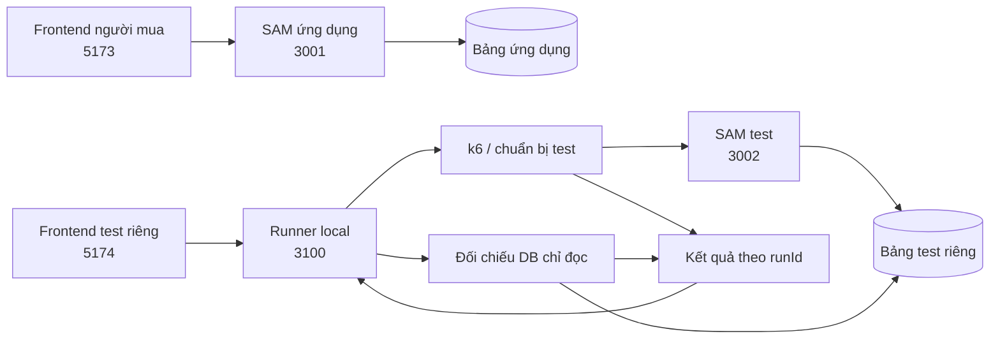

# 23/10 — Rà soát và bàn giao người mua

- Tuần 4, giờ Việt Nam. Nhánh lúc rà soát: `phuc`, commit `c13f4a9`.
- Yêu cầu: đọc biên bản bên đồng hành, chuẩn bị cách làm song song ít xung đột Git; mở `quan-worklog` và giữ nguyên văn hóa làm việc.
- **Đã làm:** đọc biên bản, đối chiếu repository; soạn bộ tài liệu phối hợp và contract nháp để review.
- **Chưa làm:** đổi API/schema/code; tạo nhánh/worktree; commit/push; chạy suite/tải; đọc lại hoặc sửa DB trong lượt này. Chưa triển khai AWS.

## 1. Nguồn yêu cầu và quy tắc

Biên bản được người dùng gửi tại attachment `Pasted text.txt` ngày 23/10; lưu bản sao trong [yeu-cau.md](../yeu-cau.md) để cửa sổ mới đọc được mà không phụ thuộc attachment. Quy tắc chung ở [phong-cach.md](../../phuc-worklog/phong-cach.md): mô tả logic trước khi code, chờ duyệt; giải thích dễ hiểu; khi người dùng tự thao tác phải kiểm tra theo giai đoạn.

Theo biên bản, cửa sổ này nhận **phần ứng dụng/người mua**. Bên đồng hành nhận **kiểm thử/k6/runner/frontend test riêng**. Việc thêm nhật ký Quân không tự chứng minh tác giả/người thực hiện các công việc cũ. Phân công cũ frontend/backend trong bối cảnh tuần 3 không được tự dùng thay biên bản mới.

Mua vé hiện là đặt chỗ và nhận mã, chưa thanh toán. Tuần này local; số đo local không chứng minh AWS autoscaling. Không mở rộng nhiều đơn vị/OTP/SSO trong đợt này nếu chưa có quyết định bổ sung.

## 2. Hiện trạng đã đối chiếu

| Nội dung | Kết quả đọc mã/tài liệu |
| --- | --- |
| Xem/tìm/lọc/chi tiết công khai | Đã có UI và GET API; tìm/lọc ở frontend sau khi tải danh sách |
| Đăng ký hiện tại | Khách gửi fullName/email/phone; chưa yêu cầu User login |
| Admin | CLI tạo tài khoản, login/session/logout, cookie HttpOnly, Origin/CSRF và rate limit đã có |
| Tài khoản người mua | Chưa có register/login/session riêng hoặc userId sở hữu đăng ký |
| Giờ mở bán riêng | Chưa có; hiện chỉ registrationOpen và giờ diễn ra dateTime/startsAtEpoch |
| Transaction/chống trùng | Đã có giảm chỗ + khóa event/email + đăng ký trong một transaction |
| Gửi lại sau mất response | UUID ClientRequestToken giữ trong một lượt xử lý/SDK retry; HTTP mới sinh UUID mới, chưa có key client ổn định và replay kết quả |
| Xem vé | GET registration theo UUID đang công khai; chưa kiểm tra chủ sở hữu, chưa có Vé của tôi |
| Frontend test/runner/k6 | Chưa có thư mục riêng trong repository đã đọc; test hiện có Python/unittest, HTTP smoke và Node browser scripts |
| Git | Working tree sạch đầu lượt; một worktree ở phuc; có main/phuc và remote-tracking main/phuc; không fetch nên chưa xác nhận remote mới nhất |

Các kết quả health/events và xác nhận web chạy ổn đầu ngày nằm trong [nhật ký Phúc](../../phuc-worklog/week-4/23-10.md). Lượt này không chạy lại các bước đó, không coi trạng thái process hoặc số DB cũ là dữ liệu mới.

## 3. Mức độ khớp biên bản và thay đổi đề xuất

Đồng ý luồng công khai xem sự kiện → cần tài khoản khi đặt vé → mỗi User tối đa một vé/sự kiện → Vé của tôi và owner-only. Có thể tái sử dụng lớp handler/service/repository, transaction và các biện pháp auth admin, nhưng không coi role admin hiện tại là tài khoản User đã có.

Điểm điều chỉnh so với phần thảo luận trước: biên bản yêu cầu **Idempotency-Key rõ ràng, phân biệt cùng key khác nội dung**. Bản nháp mới đề xuất có key này ngoài khóa duy nhất User/sự kiện; không chỉ dựa vào trả lại vé khi trùng User/sự kiện như ý tưởng tối giản trước đó. Bổ sung thời điểm `salesOpenAt` là thay đổi schema/API cần duyệt.

Giữ nguyên bản ghi cũ, không gán theo email chưa xác minh, không xóa để làm sạch báo cáo. Đề xuất khóa đọc công khai các vé không có chủ tài khoản; giữ chỗ đã dùng và cung cấp kiểm kê local chỉ đọc khi cần. Chính sách truy cập legacy cần được duyệt vì URL cũ sẽ thay đổi hành vi.

## 4. Kiến trúc và chia việc đề xuất

Sơ đồ là phương án chưa triển khai; 3001/5173 và DynamoDB Local là cấu hình đã có, còn runner/dashboard là đề xuất. Chi tiết file, nhánh, cổng, process và mốc ở [phoi-hop.md](../phoi-hop.md). Contract/schema/fixture và lỗi nằm trong [api-du-kien.md](../api-du-kien.md). Hai tài liệu này là bản có thể đưa cho phía test để góp ý, không tự gửi ra ngoài.

## 5. Điểm cần chốt trước khi code

1. Chấp nhận API v3 dự kiến: realm User riêng với admin, body đặt vé chỉ phone (tên/email từ tài khoản), salesOpenAt và trạng thái not_open, key UUID v4 và replay 200/new 201.
2. Chấp nhận dữ liệu legacy giữ nguyên nhưng không còn đọc công khai qua link UUID; chưa có chức năng nhận lại vé cũ theo email.
3. Chấp nhận phân công file, nhánh buyer/test và thư mục làm việc độc lập; chỉ bên ứng dụng cập nhật canonical contract. Chốt người chịu trách nhiệm merge từng mốc.
4. Chốt cách chuẩn bị 100 tài khoản qua API/script test và chính sách rate limit User đủ cho bước chuẩn bị, vẫn giữ auth/CSRF/quyền. Các con số đề xuất trong contract chưa là cấu hình đã chạy.

Không cần hai người chờ hoàn thành toàn bộ: sau M0 bên test dựng công cụ/kịch bản theo contract, sau M1 nối tài khoản, sau M2 nối đặt vé; frontend người mua hoàn chỉnh ở M3. Mọi API chưa có phải ghi rõ chờ bàn giao, không tính response mẫu/mock là kết quả test thật.

## 6. Nhật ký tiến độ

1. Đã đọc toàn bộ attachment; xác định trách nhiệm ứng dụng so với kiểm thử.
2. Đã đọc lại README, contract v2/data model/security, template/config, auth, admin rules, service/repository, frontend routes/types/service/form và công cụ/env test liên quan.
3. Đã kiểm tra Git: phuc tại c13f4a9, working tree sạch đầu lượt, một worktree. Không checkout/fetch/merge hoặc thay đổi .git.
4. Đã tạo khu `quan-worklog` với bản sao yêu cầu, hướng dẫn đọc, phân công Git và contract dự kiến. Canonical contract v2/schema/code vẫn giữ nguyên.
5. Đã kiểm tra năm file Markdown: liên kết tương đối đều có đích, code fence đóng/mở đủ, không có whitespace cuối dòng hoặc ký tự UTF-8 thay thế. Bản sao biên bản khớp nguyên văn attachment sau phần tiêu đề bổ sung. `git status` chỉ có `quan-worklog/` mới; không có thay đổi tracked file của ứng dụng hay nhật ký bên kia. Không chạy build/test suite vì chưa sửa mã.
6. Đã đối chiếu thêm cookie jar/reset iteration của k6 và lưu ý cookie browser không tách theo cổng; bổ sung kỳ vọng 100 người/200 vé, 10/1 vé và cấu hình giới hạn run. Các số này vẫn là kỳ vọng chưa đo, không phải tính năng đã hoàn thành.
7. **Điểm tiếp tục:** Phúc và bên test review các mục cần chốt ở trên; sau khi duyệt mới cập nhật canonical docs và triển khai M1. Không tự bắt đầu code từ bản nháp này. Hai nhánh/worktree chưa được tạo; bộ tài liệu chưa commit/chia sẻ sang máy khác.

## 7. Nguồn và giới hạn bằng chứng

- [Biên bản gốc](../yeu-cau.md), [quy tắc làm việc](../../phuc-worklog/phong-cach.md), [nhật ký đầu ngày](../../phuc-worklog/week-4/23-10.md).
- [README](../../README.md), [backend README](../../backend/README.md), [frontend README](../../frontend/README.md), [contract v2](../../docs/api-contract.md), [data model](../../docs/data-model.md), [security](../../docs/security.md).
- [Auth](../../backend/lambda/auth.py), [repository](../../backend/lambda/repository.py), [service](../../backend/lambda/service.py), [admin rules](../../backend/lambda/admin_events.py), [template](../../backend/template.yaml), [Vite](../../frontend/vite.config.ts), [routes](../../frontend/src/App.tsx), [form đăng ký](../../frontend/src/pages/RegistrationPage.tsx).
- [Git worktree](https://git-scm.com/docs/git-worktree), [k6 cookies](https://grafana.com/docs/k6/latest/using-k6/cookies/), [DynamoDB transactions](https://docs.aws.amazon.com/amazondynamodb/latest/developerguide/transaction-apis.html), [OWASP CSRF](https://cheatsheetseries.owasp.org/cheatsheets/Cross-Site_Request_Forgery_Prevention_Cheat_Sheet.html): đọc ngày 23/10 cho đề xuất phối hợp/session/transaction. Chi tiết nguồn gắn ở tài liệu bàn giao.

Đọc mã chứng minh cách cài đặt hiện tại; không thay cho test vừa chạy. Chỉ kiểm tra tài liệu/liên kết/whitespace trong lượt này, không tuyên bố tính năng mới đã đạt.
